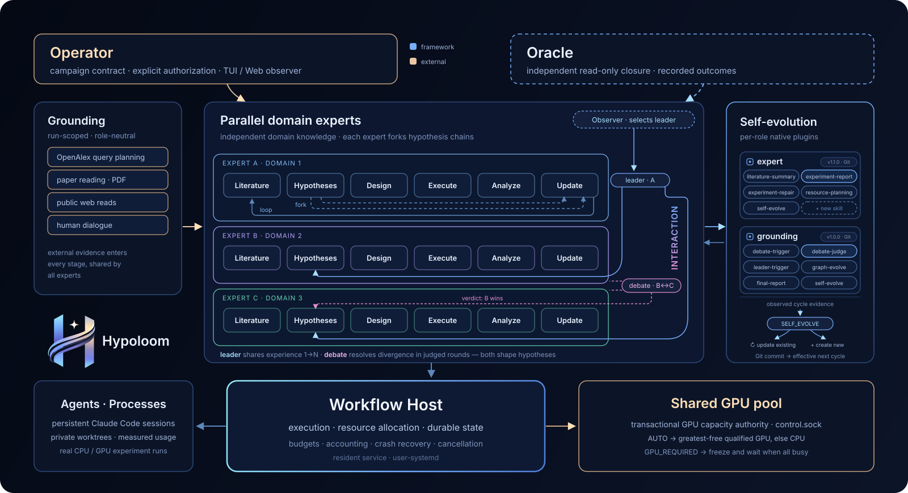
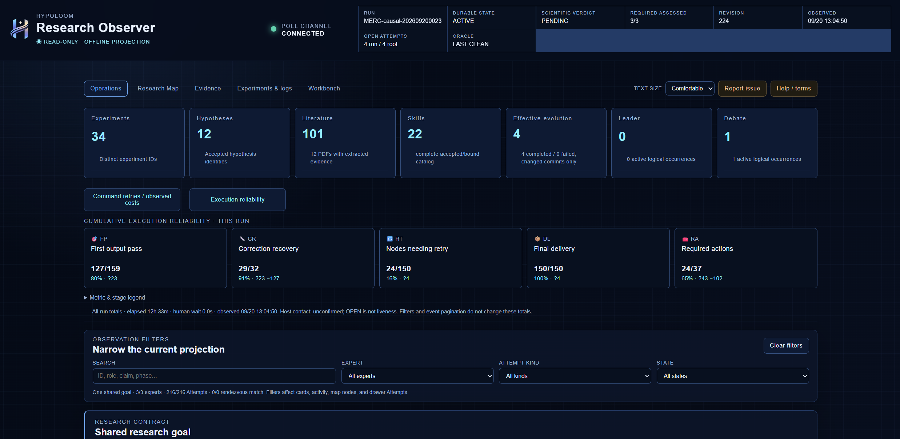
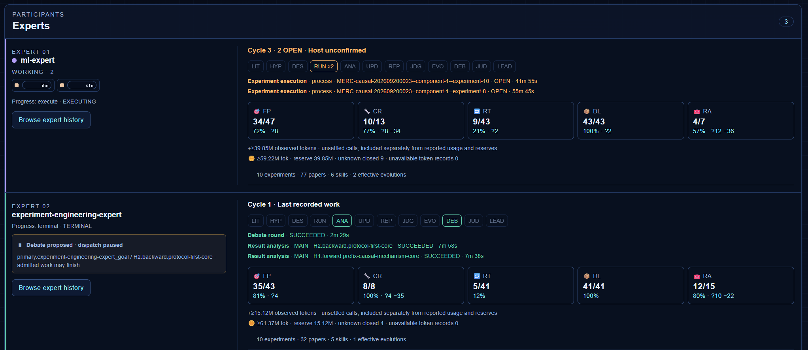
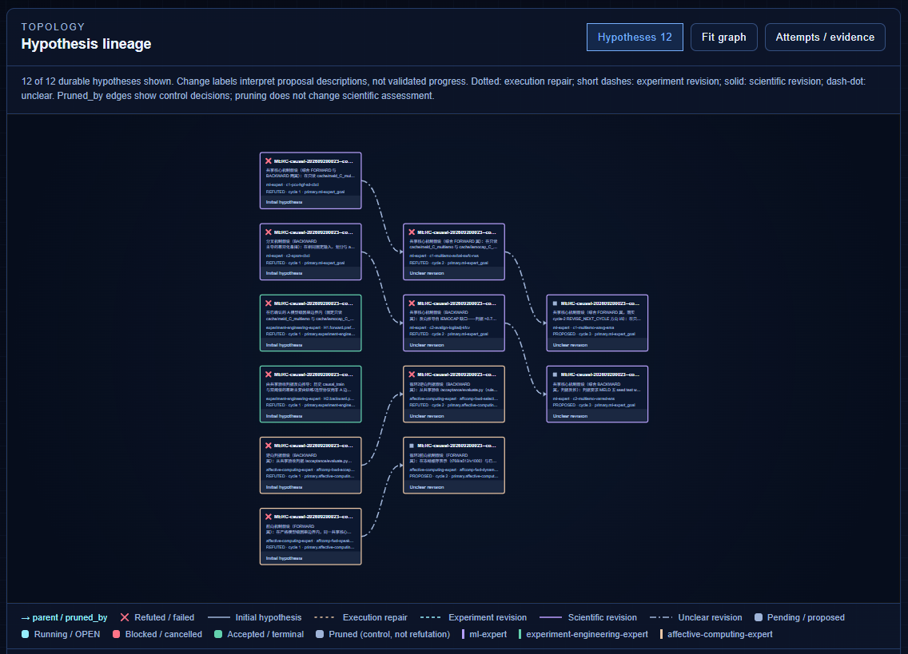
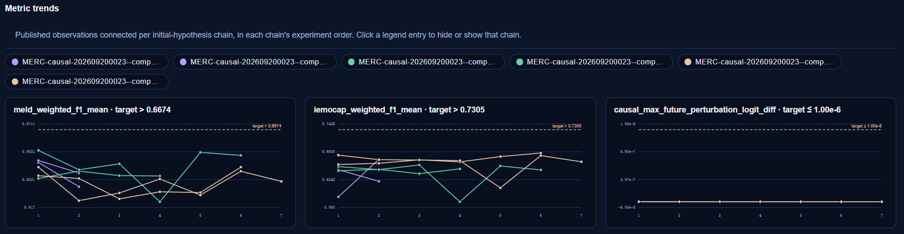
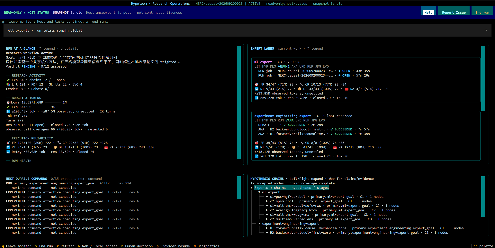

<p align="center">
  
</p>

<p align="center">
  <a href="LICENSE"></a>
  
  
  
</p>

<p align="center">
  <a href="README.md">English</a> · 简体中文
</p>

Hypoloom 是一个开源的自主研究框架,覆盖从假设生成、实验执行到证据驱动迭代的完整闭环。
常驻 Workflow Host 协调持久研究专家:Host 拥有执行、资源分配与持久状态;独立的 Oracle
校验已记录的结果与生命周期一致性。

- **分析(Analyze)**：专家通过 OpenAlex 与 PDF 提取检索并阅读文献,再经显式人工澄清
  与公共验收准则接地研究目标。
- **假设(Hypothesize)**：并行专家链提出假设,预注册实验设计并规划资源。
- **实验(Experiment)**：真实 CPU/GPU 执行——私有 Git 工作树、选定运行时、显式 GPU
  授权,以及容量允许时在同一张卡上容纳多个实验的可选共享 GPU 池。
- **演化(Evolve)**：专家解释测量结果,经辩论与裁决修正研究路线,并演化可复用的
  研究技能。

## 🧩 功能总览

一个常驻 Host 协调整个闭环;操作员保留显式授权,独立的 Oracle 校验记录。

<p align="center">
  
</p>

[Profile 模板](profiles/README.md) 提供中英文版本,维护者使用
[G0–G5 资格工作流](docs/qualification.zh-CN.md)。

## 🔍 运行实况

一次运行有两个观察入口,都是 Host 持久状态的只读投影:浏览器中的 Research
Observer(`hypoloom web`,仅监听 loopback 并携带 bearer 链接)与终端 Research
Operations 界面(`hypoloom monitor`)。两者都不会修改运行。操作员干预——答复
Grounding 人工问题、在供应方故障后恢复、结束运行——都是显式且被记录的命令。

### 📊 运行总览

Operations 总览页跟踪整个运行:持久状态、修订号与最近一次 Oracle 结论;实验、
假设、文献证据、演化技能与 Leader/Debate 活动的计数;累计执行可靠性(首轮输出
通过、纠错恢复、需要重试的节点、最终交付、必要动作);以及对全部已记录 Attempt
的过滤器。

<p align="center">
  
</p>

### 🧑‍🔬 专家卡片

每位专家各自运行六节点研究闭环,并有一张实时卡片:当前所处阶段、正在工作的
Agent 及其上下文相对预算的用量、观测 token 与该专家的可靠性,以及协调状态——
被提议的 debate 会暂停该专家的派发,皇冠标记 Observer 选出的 leader。

<p align="center">
  
</p>

### 🧬 假设谱系

谱系图展示研究路线本身的演化。每个持久假设只出现一次,按所属专家着色;边的
样式区分执行修复、实验修订与科学修订;被剪枝的分支记录的是控制决策——剪枝
不等于科学否定。

<p align="center">
  
</p>

### 📈 指标趋势

指标趋势把每条已发表的测量按实验顺序连接到其初始假设链,并对照研究合同中
预注册的目标线——通向验收准则的进展一目了然。

<p align="center">
  
</p>

### 💻 终端 UI

终端界面在 shell 中呈现同一份持久快照:运行一览(目标、结论、预算与 token、
执行可靠性)、各专家泳道及其当前工作、假设链、下一条持久命令,以及操作员
动作——刷新、Web/本地访问、人工决策、供应方恢复、诊断与 End run。

<p align="center">
  
</p>

[USAGE](USAGE.zh-CN.md) 介绍如何启动 Web observer 与 TUI、分享只读链接,以及各操作员
动作。

## 🚀 快速开始

需要 Linux、bubblewrap、Git 与当前的 Claude Code CLI。固定的
[environment.yml](environment.yml) 提供 Python 3.12 与合适的 SQLite;GPU 实验使用
单独选择的 CUDA 环境。

```bash
conda env create --prefix ./.conda/envs/hypoloom --file environment.yml
conda run --prefix ./.conda/envs/hypoloom python -m pip install -e '.[monitor,dev]'
./.conda/envs/hypoloom/bin/hypoloom --help
```

在本检出中打开 Claude Code 并使用 `/autoresearch init`。选择本地 Profile 或双语
模板,审查目标/数据路径、确切模型、凭据、预算与 CPU/GPU 分配,然后选择
**Prepare only** 或 **Start now**。后者使用受跟踪的 `manage_host.py` 助手与
user-systemd 启动 Host、验证 `control.sock`、创建已审查的运行,并在同一会话中返回
状态,无需 CLI `init` 子命令。

Profile 由六个 YAML 文件组成(goal、experts、methodology、language、notify、
safety);init 会将一套审阅过的模板复制到 `profiles/local/<name>` 且拒绝覆盖,
你再绑定其中的占位符——模型选择器与目标/数据/运行时路径。秘密不写入 Profile:
一个位于已忽略目录的 mode-0600 dotenv 文件(模板
[profiles/templates/hypoloom.env.example](profiles/templates/hypoloom.env.example))
存放 `OPENALEX_API_KEY` 等密钥,Profile 以绝对路径引用它。完整构建规则见
[profiles/README](profiles/README.md) 与 [SETUP](SETUP.zh-CN.md)。

默认 Run ID 为 `<profile>-<YYYYMMDDHHMM>`,
Request ID 为该标识加 `-create-1`;状态根唯一。模型认证需要固定的精确选择器,以及
经批准的环境凭据或符合条件的现有 0600 权限设置文件。使用真实模型或资源前请阅读
[SETUP](SETUP.zh-CN.md)。

## 📚 文档

- [安装与配置](SETUP.zh-CN.md)
- [运行、监控与停止](USAGE.zh-CN.md)
- [操作员指南](docs/operator-guide.zh-CN.md)
- [Profile 模板](profiles/README.md)(中英双语)
- [架构](docs/architecture.zh-CN.md)
- [资格与当前验证状态](docs/qualification.zh-CN.md)(框架与摘要;完整台账为英文)
- [文档索引](docs/README.zh-CN.md)
- [贡献指南](CONTRIBUTING.zh-CN.md)、[Codex 指令](AGENTS.md) 与
  [Claude Code 运行时指令](CLAUDE.md)(维护者/运行时参考,仅英文)

以上各指南顶部都链接了对应的 English 版本;[English homepage](README.md)
直接链接英文版本。

## 🗺️ 后续计划

当前方向,不分先后——是计划而非承诺;先后顺序以资格验证结果为准。

- **更多 Agent 运行时**:框架目前通过 Claude Code 驱动研究专家。后续计划把同一
  Host 拥有的研究闭环扩展到其他编程 Agent 运行时——Codex、Kimi Code、OpenCode
  等——并沿用现有的按绑定资格验证路径。
- **AutoResearch 基准**:我们正考虑围绕业界新兴的 AutoResearch benchmark 开展
  学术性质的后续工作:让 Hypoloom 工作流适配这些任务,进而设计并运行具有学术
  质量的对比评测。

## 🚧 开发状态

Hypoloom 是开发中的框架,尚无冻结发布:接口、Profile schema 与内部合同可能随候选
变化。资格结论仅适用于某个确切的被测候选与环境;模型与 provider 兼容性按已采样
的绑定建立,不作普遍保证。公开模板用于演示配置,并非科学基准;任何资格结果都不
构成对科学主张的证明。当前验证范围记录于
[qualification](docs/qualification.zh-CN.md)。保留的运行使用其自带运行时包;不提供
跨版本运行迁移。

## ⚖️ 许可证

[MIT](LICENSE),版权 © 2026 EIMP Lab and the Hypoloom Authors。
