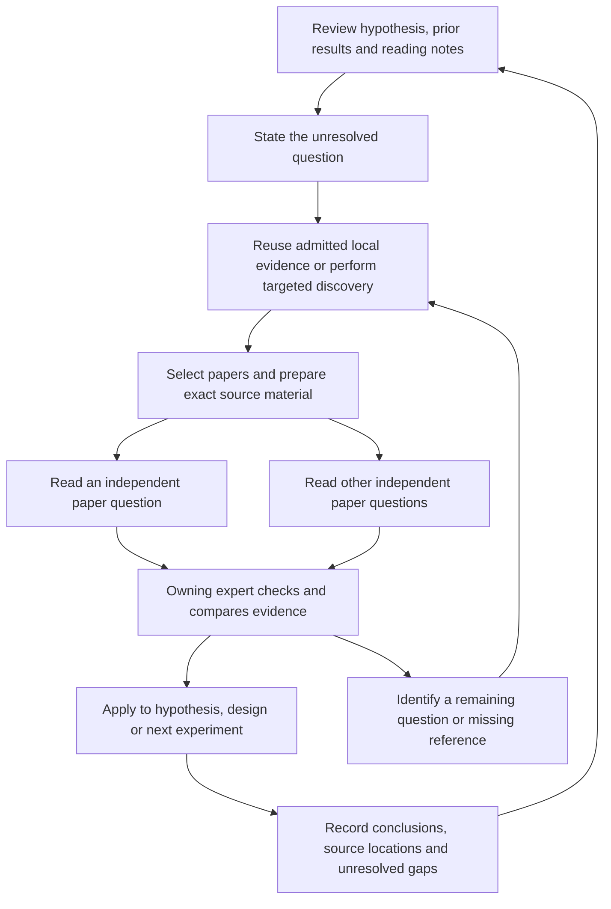

# Architecture

English · [简体中文](architecture.zh-CN.md)

ACI 26 schedules FORWARD/BACKWARD through existing task/Attempt identities with
a narrow same-proposal overlap exception. SYNTHESIS joins accepted responses;
retries retain the successful wing and final failure drains the sibling. First
FORWARD inputs remain the source of Leader advice. Existing sessions, budgets,
publication validators and Oracle checks own the boundaries. Source-reference
lookup is shared by document reuse and reading submission; reader/argument counts
are read projections over existing records, not another task store.
See [reading and proposals](guides/reading-and-proposals.md).

ACI 25 separates persistent research workspaces from bounded model sessions.
New tasks reconstruct from frozen facts, summaries and indexed sources; eligible
same-task corrections retain their archived session. The relay checks a shared
working allowance using measured history where available. Capacity
recovery preserves submitted experiments and costs, while technical analysis
failure alone cannot override a legal revision. See [context and recovery](guides/context-management.md)
for limits, Debate scope, source feedback and monitoring semantics.

Hypoloom is a durable multi-agent research workflow with one resident Workflow
Host per state root. Python code lives in `hypoloom/`; packaged SQL migrations,
native skill/plugin resources and Web assets are required runtime inputs.

## Ownership and execution

The CLI and operator MCP send typed requests over a private control socket.
`workflow_host.py` coordinates policy, durable commands/Attempts, native Agent
sessions and experiment execution. `state_store.py` owns SQLite transactions;
`artifacts.py` owns accepted artifact publication. Agents cannot write durable
workflow state directly. Stable request identities make retries distinguishable
from new commands. Durable status and actual process liveness are separate facts.

Agent sessions use Claude Code with private settings, Host-scoped tools and
bubblewrap containment. The Host grants exact capabilities and read-only
target/data mounts for each request. Provider credentials remain outside the
research sandbox. Experiments run in the selected research environment and
publish validated outcomes through the Host. Native final text is schema checked
at Stop and again at Host postflight; a process exit code alone is not acceptance.

API availability uses existing provider observations, Attempt start/end times
and `PROVIDER_RETRY_CLEAR` controls. It is a derived dispatch state, not a new
run state or separate health service. Consecutive recovery waves use the existing
infrastructure attempt allowance; node retries and accounting retain their own
meanings. Submitted Processes remain independently collectible. The same reducer
feeds Host status and provider notifications; monitor passes it to Web/TUI.

An operator control can select a 0600 connection-only settings file. The existing
control journal owns selection, and that file owns credentials; a Host cache is
discardable. Original private settings and immutable runtime verification remain
in force. Subsequent invocations use the selected connection while preserving
their pinned model. Web reuses the scoped-token and same-origin control boundary
with a separate API-operation grant, so observer/answer links cannot rotate keys.
See [API recovery](guides/provider-recovery.md) for lifecycle and restore semantics.

Observer Stop also reuses the postflight semantic validator against its frozen
request: reference ownership, one contribution parent, trigger eligibility and
available Debate sources. Invalid choices can be corrected in the same invocation
within the existing correction and time budgets. This read-only check does not
accept a control; Host still owns durable admission.

Execution Stop validates parser inputs using the production execution path and
remains interruptible by cancel or deadline. In ACI 22, an EXECUTION response
may name `waiting_for_experiment_id` to hand the latest submitted experiment to
Host waiting. That invocation closes and is charged normally; the research node
remains unfinished. Host invokes the same node again only after terminal
collection, under the remaining Profile budget. Each experiment allows one
accepted handoff, including an exact repaired replacement; no new scheduler or
waiting journal is introduced. Omitting the field still requires the latest
experiment to be terminal. Earlier ACI versions retain terminal-only completion.
Pending work and dispatch pauses cannot be reported as completed execution.

A run-wide dispatch exception quarantines that run. On the next observation
tick, the Host cancels its live Agent calls and records non-retryable
`dispatch_paused` failures using ordinary Attempt closure and session/accounting
capture. Already accepted Agent results stay accepted. Queued readers cannot
start; other runs and explicit STOPPING/final-report cleanup remain serviceable.
Already submitted Processes keep their normal execution/observation path, but
their outcomes await authorized handling; quarantine never invents acceptance
or cancels the run itself. An experiment MCP wait keeps its bounded polling
window until terminal, deadline or endpoint shutdown, avoiding repeated model
turns on the same dispatch fault. Reader capacity blocks still return promptly
so the owner can choose serial reading.

## Research model

Profile v4 is the public authoring format. Six YAML documents define the goal,
experts, methodology/runtime/budgets, language, notifications and safety.
Admission compiles these into the existing typed research contract. Older
Profile parsers and their fixtures remain for covered parser behavior; public
templates use v4. Internal protocol and SQL migration versions retain their
ordering and invariants.

Grounding can request human clarification without keeping a model invocation
open. Common acceptance, when selected, is authored and tested in private
`/acceptance`, then shared read-only with expert chains. Each expert maintains
a persistent research identity, private Git worktree, hypotheses and evidence. Literature,
proposal, design, execution, analysis and update form the core loop.

Literature prefetch and query coverage checks share one background worker per
Host. That worker owns the adapter's mutable traces and cache; the Host thread
continues servicing tools, control requests and Process/pool observations.
Only the Host validates the current task/Attempt and commits returned evidence.
Cancellation discards late results and interrupts retries/between-request work;
an already active transport operation remains subject to its existing timeout.
Shutdown drains the worker; backups are unavailable while a read is in flight.
Pending reads are disposable and use existing task/Attempt identities. Recovery
uses the existing abandoned-Attempt/retry path, without another persistence format.

Optional [institutional access](guides/institutional-access.md) uses one separate
Playwright worker for an operator-authenticated browser. Its bounded queue/cache
are disposable, scoped by existing run/role/component identity. The read-only TUI
groups configured routes and live queue observations by publisher; optional Web
controls never receive credentials or pause research. Only the existing web
document tool admits verified bytes into `/papers` and ordinary publication;
background availability is not reading evidence and cannot revise finished
results. Stopping drops pending/late results. See the
[design and lifecycle limits](design/institutional-literature-access.md).

Observer, Leader, Debate/Judge, adjudication and manager actions use explicit
roles and accepted events. Context projection selects bounded current evidence;
interaction cadence observes elapsed time and new-outcome thresholds. Skill and
memory changes enter later cycles through accepted revisions, not uncontrolled
editing of another expert's state. The UI observer has no research authority.

From ACI 21, runs can appoint a Leader before the final goal is met. Eligibility
requires a closed contribution cycle and accepted scientific evidence: a
supported result or a clean refutation with matching outcome, artifact,
evidence link and assessment. Execution failure is not a contribution. The
Observer must cite exactly one own hypothesis and its evidence; it can still
choose no Leader. Goal completion retains priority over further coordination.

An accepted fact ID and that fact's own entity ID have the same citation meaning.
The original citations remain unchanged in the response and accepted event;
fact references do not implicitly cite foreign-key dependencies. Qualification
and the independent interaction audit use this same ID interpretation.

Screening that may stop before producing complete shared-goal evidence uses the
existing LOCAL scope and a local C5 measurement declared in SYNTHESIS. Later
GOAL experiments can retain that measurement while supplying all common evidence.
An accepted null measurement remains GOAL-only; changing it requires a revised
hypothesis/new cycle. Missing GOAL evidence is an execution failure, not a clean
refutation, and cannot be repaired with fabricated placeholder results.

From ACI 23, Leader selection starts a short, isolated LEADER auxiliary task.
The selected expert receives actual published reports and accepted facts, then
shares bounded advice. Peers keep researching: no automatic pause, drain barrier,
extra cycle, execution priority or parent authorization comes from this role.
The latest accepted advice enters a cycle's first FORWARD request; retries,
BACKWARD and SYNTHESIS reuse that request's advice, including its absence. Late
advice waits for a later cycle. Experts may adopt, adapt or reject it. Advice
cannot reopen terminated research, prune a hypothesis or change scientific facts.
Stable auxiliary command IDs, ordinary retries/accounting and existing accepted
outputs provide recovery; no message ledger or adoption receipt is added.
A failed or unaffordable advice task closes locally. Operator/stop/provider
controls still apply, and unchanged evidence does not trigger repeated advice.

Debate research uses the parent explicitly authorized by its accepted interaction,
even when ordinary adjudication has no selected chain.
Each Debate participant starts after its own admitted cycle closes, with
available budget; the other participant can finish independently. Public Judge
guidance enters the new proposal inputs. ACI 24 carries the winner's authorized
code and accepted sources into a fresh synthesis session; older versions retain
private session promotion. Both keep the existing owner and source restrictions. Ordinary lineage termination and
scientific outcome labels retain their meaning. Older pinned runs keep their
original semantics; cross-version migration is unsupported.

Human research projections and exact-node private views are prepared by one
bounded background worker. The Host publishes human views atomically, discards
an obsolete active view after terminal closure, and rechecks task admission
before dispatching a prepared private view. Derived views may lag the durable
revision; control and research admission still read the original records.
Closed Attempt budget charges are cached in memory through the existing budget
fold, with OPEN attempts reread and uncommitted closes excluded from the cache.

## CPU and GPU resources

Agent, Process and review concurrency are independently bounded. Experiments
receive exact CPU/GPU permission and runtime bindings. Shared GPU capacity is
coordinated by an explicitly configured node-local pool. Requests progress
through reservation, launch and bound-process ownership before release.

Same-card overlap is allowed when authorized UUIDs, workload estimates, live
capacity and reserves permit it. An optional initial memory estimate can exceed
the workload floor; only complete successful comparable measurements permit a
lower subsequent estimate. Incomplete sampling never becomes zero usage.
Nonpooled dispatch serializes a UUID within one root and provides no cross-root
coordination.

## Persistence and recovery

A new run preserves its executable runtime bundle and immutable version binding.
Reentry uses that bundle instead of silently adopting the current checkout.
Process, socket and durable transaction boundaries are exercised by recovery
tests. Cross-version run migration is outside the supported product scope.

Cancellation moves through stopping and terminal cleanup, including child
processes and pending effects. A managed Host can exit when terminal; leaving a
monitor does not cancel it. Backup/restore preserves the same version boundary
and restores only into a fresh destination.

`oracle.py` and the focused outcome oracles independently audit accepted state,
ownership and effects. They do not promote a candidate solely because a status
field says COMPLETED. See [qualification](qualification.md) for the G0–G5 rules.

## Presentation and support

TUI and bearer-protected loopback Web views project durable evidence. Explicit
human-answer links add only the existing reviewed answer operation. Support
exports redact private research fields and local identities by default; sharing
is a separate user action. Model usage reports preserve known charges and
unknown reservations rather than inventing a provider invoice.

Final-report Process details join canonical outcomes to their publishing Attempt
through the existing `execution_artifacts` relation. A shared execution ID alone
does not give lost retries scientific evidence. Device pressure summaries retain
their actual `gpu_minimum_free_memory_mib` field and the existing `owned_memory`
observations; device sampling is labelled `gpu_device_monitored`, without inferring
task GPU computation. Agent cost summaries reuse `fold_agent_attempts` and remain
part of the immutable context captured before the first final-report attempt.
No additional fact, schema or accounting authority is introduced.

## Selective paper reading — 2026-09-16

**Implemented in the local ACI-20 working candidate; qualification status is
recorded in [qualification](qualification.md#current-development--selective-paper-reading-2026-09-16).**
This section combines selective method reading, connected retrieval history and
dynamic parallelism. New reading interfaces apply to fresh ACI-20 runs. Existing runs, bundles, Profiles, credentials,
research data and shared services remain unchanged.

### Evidence and engineering boundary

The pre-change behavior already had useful continuity. In the second MERC run, engineering
Attempt `agent-62e7ae060a064c6d9379e85a5e997d56-1` read its cycle-1 report before
searching for cross-session generalization and speaker modeling in cycle 2.
The report identified those questions after a negative experiment. Subsequent
calls retrieved abstracts/metadata for relevant methods; this demonstrates
connected retrieval, not successful full-text method reading. Both memory reads
and the later search/fetch results are present in that Attempt's native archive.

| Pre-change observation | Implementation consequence |
| --- | --- |
| OpenAlex QUERY_PLAN uses the goal, expert focus and admitted context; retrieval spans foundational, intermediate and recent work. | Preserve broad discovery and its existing coverage validator. |
| Experts can consult their own reports and make admitted web calls. | Carry the reason for a follow-up through existing summaries and memory. |
| `PdfExtraction`/`PdfTrace` expose abstract/conclusion excerpts; increasing `max_chars` does not reveal omitted methods. | Make the original and bounded method-page text accessible. |
| `FixedLiteratureIO.retrieve()` returns `pdf_artifacts`, but the pre-change Host retained only the summary packet in the request. | Retain exact selected source bytes through preparation and ordinary publication. |
| The OpenAlex factory uses two per-paper PDF workers; bulk adapter calls share one Host worker. | Keep I/O limits separate from model concurrency and preserve mutable adapter ownership. |
| MCP stdio calls are handled serially; native tools do not enable Agent/Task, and there is no paper-reader task binding. | True parallel model reading needs explicit Host execution integration. |
| Existing own-role views contain successful summaries and Attempt metadata, not complete old requests/transcripts; their graph is hypothesis lineage. | Expose admitted source references and compact notes without treating that graph as a citation network. |

Sources: [literature](../hypoloom/literature.py),
[Host](../hypoloom/workflow_host.py), [tool bridge](../hypoloom/host_tools_server.py),
[native runtime](../hypoloom/full_cc_runtime.py),
[projection](../hypoloom/research_projection.py) and
[memory](../hypoloom/expert_memory.py).

The concrete failed asset is access to original methods across the
adapter-to-Host, Agent-to-next-node and context-compaction boundaries. Git cannot
recover discarded PDF bytes. Existing stable references, transactions, scoped
mounts, atomic publication, artifact verification and ordinary tests are
sufficient once those bytes are retained. No new hash, reading receipt, paper
registry, frozen scientific contract, knowledge graph or compulsory reading gate
is justified. A typed reading task adds an explicitly requested execution
capability; it is not another source of scientific authority. Maintenance stays
in the existing reader, Agent, publication and projection paths; disposable
indexes can be rebuilt and later merged into native source mounting.

### Research flow and selection

The unit of work is **a selected source and a concrete question**, not every
search hit and not an arbitrary page chunk. The expert owns the research
question, selection and final interpretation throughout this sequence:

This is research behavior, not a new workflow state machine. Stop within the
existing node when its decision-relevant questions are resolved, further reading
is not useful, a necessary source is unavailable, or time/budget is exhausted.
Returning an explicit unresolved limitation is valid. Neither a minimum paper
count nor exhausting all retrieved papers is required.

Select a paper when the abstract cannot settle an implementation choice,
assumption, contradictory finding, ablation, evaluation protocol or result
interpretation. Read relevant definitions, methods, equations, training details,
experiments and necessary appendices. Citation count and recency alone do not
justify close reading. The same paper may merit a different question later;
reuse an existing note only when its source version and question still apply.

Classify dependencies in the expert's ordinary reasoning:

- Already defined questions about independent papers can run concurrently.
- If paper A reveals that reference B supplies an essential definition, return
  that gap to the owner; discover/read B before completing that dependent claim.
- Cross-paper comparison and the next search decision belong to the owner.
  A reader does not recursively create readers or silently widen the topic.

A useful historical pattern is: prior experiment reports poor generalization;
inspect selected speaker/context mechanisms; compare their assumptions with the
current protocol; propose a testable adaptation. A published result never
substitutes for a Hypoloom experiment outcome or changes the accepted evaluator.

### Discovery and targeted follow-up

Keep the current broad `QUERY_PLAN -> LiteraturePacket -> MAIN` route. Its
frozen query, historical strata, source classes and coverage checks remain
intact. Narrow follow-ups during MAIN must be recorded as additional sources;
they do not rewrite that accepted query or pretend to satisfy its coverage.

Use the already selected providers for explicit purposes:

| Need | Route and result |
| --- | --- |
| Broad literature orientation | Existing OpenAlex planning and validated packet. |
| A precise scholarly question or known paper | `web_search(..., scope="academic")`, using the configured OpenAlex metadata transport directly. |
| Ordinary websites, project documentation or source repositories | Existing general `web_search` and `web_fetch`; academic fallback stays clearly labeled. |
| Full text of an admitted work | Reuse retained bytes first; otherwise use its admitted OA location and the selected DOI fallback. Unpaywall provides DOI-to-OA locations, not topic search. |
| A cited prerequisite | The owner supplies the observed citation/title/DOI and why it is needed, then uses the same search/fetch routes. |

`scope="academic"` is an explicit field. It addresses the observed repeated
DDG failures before academic fallback, without replacing general web search.
It uses only the Host-configured OpenAlex client; absent configuration produces
an explicit unavailable result. It does not auto-discover credentials. Responses
retain provider, actual source URL/identity, returned metadata, limits and errors.
A targeted query need not reproduce the broad packet's three time strata.
The CLI injects the selected OpenAlex client for academic scope independently
of `--web-search-fallback`; the latter only opts general-web failures into the
labeled fallback. Both observations reuse the existing Host configuration.

Keep the current explicit OpenAlex and Unpaywall Host bindings. Keys/contact data
remain Host-only and are never included in reader prompts, Profile values,
source notes or provider-mismatched requests. Preserve DOI identity validation,
public HTTPS/peer checks, redirects, byte bounds and the selected fallback's
cooldown. Do not add another provider or automatic fallback chain.

Before another search, the expert checks relevant prior queries, successful
sources and failure reasons. A failed transport is not evidence of no papers.
Prefer exact identifiers for a known work; materially change the question when
existing coverage is insufficient. Repeated equivalent requests after the same
observed failure need a reason to expect a different result. This is guidance
using existing traces and retry rules, not a new mandatory query-history gate.
The first implementation does not crawl an entire reference/citation network.

### Original documents and native reading

Prepare a bounded, Host-owned **`/papers` directory per Agent Attempt**, mounted
read-only. It is disposable input material; the existing `/research` view remains
fixed for the logical request. A new document must not mutate that frozen view.

Use existing `web_fetch` with `mode="document"`:

- Accept an admitted `paper_ref` or a public HTTPS `url`, mutually exclusive.
  A bounded list variant permits two selected sources per preparation call,
  sharing the existing PDF worker allowance across active Host work. Scalar
  and list forms cannot be combined. No field accepts an arbitrary host path.
- Bind a source to its acquisition Attempt and existing packet/tool reference.
  A packet-local ordinal such as `literature-pdf-001` is insufficient on its own;
  DOI identifies a work, not immutable bytes or a particular revision.
- Return source metadata, availability diagnostics and paths to the original,
  page/heading index and bounded page text. Preserve physical one-based PDF page
  numbers. HTML uses actual heading/line positions; supplements are separate
  sources. Headings aid navigation but are not required for document validity.
- Use shared bounded Poppler primitives to expose methods while preserving the
  current summary-path validator. Preparation does not call a summarizing model
  or insert the whole paper into the expert prompt.
- The expert uses native `Read`/`Grep` on selected ranges with surrounding
  definitions. Native PDF/image reading for equations, figures and tables needs
  evidence that the selected CC/model supports it. Otherwise identify the
  unresolved visual detail. Automatic OCR or another vision model is deferred.

Document mode is available on ACI-20 requests. The ordinary URL fetch remains
available. Tool schema/argument changes use normal runtime versioning and the
existing closed validator; batch capability checks happen before work starts.

Fetch/extraction runs outside Host servicing through `WebToolOperation` and the
existing worker/process boundaries. Do not call mutable bulk `retrieve()` from
several socket workers. Keep adapter traces, caches and cooldown updates owned
or protected. I/O capacity wait, transport and extraction share the tool/Attempt
bounds; return individual busy, unavailable or timeout results. The stdio bridge
still returns a bounded synchronous preparation response, not a streamed packet.
The current PDF coordinator collects futures in submission order; existing tests
establish overlap, not streaming or completion-driven refill for the new path.

Host exposure is atomic and checks current Attempt ownership and stop state.
Returned paths never change bytes and partial files are never exposed. Late or
undelivered results retain the existing `response_not_observed` treatment.

### Publication, source reuse and memory

Retain current prefetch PDF bytes in bounded staging instead of discarding them.
Use the existing PDF cache allowance as the aggregate staging ceiling, existing
per-document/page bounds, and the extractor's output-byte bound for text. Report
materials omitted by limits; never evict a path still being read. Raw attachments
are bounded independently of transcript text, and neither allowance is enlarged.

Capture prepared/selected source files as attachments to ordinary **Agent
transcript publications**, reusing `AgentArtifactKey`, `ArtifactPublisher` and
the existing Oracle. Store source-to-file bindings in ordinary request/tool
observations and derive a readable index. Extend exact allowed-file checks;
do not permit arbitrary attachments, add an archive kind or create a manifest.

Prefer references to already published exact sources over making another copy.
If a child reads a parent's still-unpublished staging, the child's durable note
must retain those exact source bytes in its own permitted attachments unless a
verified publication already exists. It cannot cite only a soon-to-disappear
parent path. Bounded duplicate archival is preferable to a dangling source;
global content deduplication is outside scope. Copies do not merge distinct
versions under the same DOI.

Failed/rejected Attempts may retain source and reading evidence without accepting
scientific claims. If staging is lost before any publication, record original
full text as unavailable; a later authorized fetch is a new observation. Same-
bundle retries reuse surviving exact material under existing request boundaries.
No reconstruction of old bytes or cross-version recovery is proposed.

The native backup check exposed an existing omission: copying only the database
and artifacts left the Oracle without the Git plugin/memory commits and frozen
request views referenced by Agent records. Backup/restore now also copies the
existing run-owned `grounding/plugin` and expert `plugin`, `memory` and `views`
directories, preserving their Git history and executable modes. These are the
original evidence sources, not reconstructed substitutes. Existing quiescence,
regular-file/path checks, atomic publication and the full Oracle remain the
validators. Settings, live native work and external research repositories are
outside this copy; runtime/environment preservation keeps its existing separate
bundle boundary. No backup manifest, extra context database or migration was
introduced.

Use the existing summary and round-report bodies for compact notes, with these
contents as writing guidance rather than another compulsory output schema:

| Content | Purpose |
| --- | --- |
| Question and origin | Identify the hypothesis/result, prior report, or paper/page that prompted the reading. |
| Source and consulted locations | Link exact admitted source/version, pages/sections and relevant excerpts. |
| Original method and assumptions | Explain mechanism, training/evaluation details and applicability conditions. |
| Consequence for this research | Separate the paper's claim from the expert's adaptation and intended test. |
| Remaining gaps and next action | State unavailable evidence, conflicts and why further retrieval is needed. |

`CYCLE_REPORT` carries durable conclusions into the existing `rounds/<cycle>.md`
path (including the established component variant) and links from `MEMORY.md`.
During a cycle, ordinary accepted summaries and native transcripts retain the
work. Add admitted source links/notes to the existing own-role projection;
materialize only the selected attachments in `/papers`. Do not recursively copy
all old transcripts into prompts or create `/memory/papers/`, a vector database
or a second paper-history store.

After compaction or in a later cycle, the expert reads the compact question and
source index, then revisits the relevant original passages as needed. Corrections
identify the earlier note/source instead of erasing the history. Another expert
can use explicitly shared evidence, but does not gain access to private reading
notes or an unshared transcript merely because the paper is public.

### Optional Host-managed model readers

Reader execution is optional; it is useful for several independent substantive questions, while
short checks or a capacity-constrained parent can use local native reading.
There is **no fixed two-reader ceiling** and no required number of readers.

Reuse the existing `methodology.literature.tools` capability list with
one additional tool, **`read_papers`**. Existing Profiles keep their current tools;
the tool is opt-in and is absent from both public defaults. ACI-20 grants it only
to an owning Literature MAIN request when selected.
QUERY_PLAN, Grounding, Debate, Judge, experiment nodes and readers themselves
do not inherit this model-spawning capability from the shared settings.

The scoped tool has submit, status/bounded-wait and cancel operations:

1. Submit a finite set of selected source/question items, each with a caller
   reading identifier, relevant bounded context and reason for reading. The
   Host supplies the parent Attempt, expert, cycle, model, permissions and
   budget identity. Sources must already be admitted and readable. The expert
   cannot use this interface to choose an arbitrary model, role or filesystem.
2. Repeated submission of the same identifier under the same parent returns
   its existing task/results; a different payload under that identifier is an
   error. Use ordinary command identities, payload comparison and transactions,
   without hashes or another idempotency registry.
3. Represent work in the existing auxiliary task/command and Agent Attempt
   machinery, with a versioned reading task kind and parent/source binding in
   its ordinary inputs. Reuse `ExpertLoopCandidate`'s summary/references. A reader
   is not a new expert persona, hypothesis node, experiment or scientific fact.
   Explicit integration is required; existing task dispatch and acceptance must
   not accidentally route it as Grounding or a normal literature batch.
4. Each admitted reader gets its own session and narrowed native Read/Grep/Glob
   access to supplied sources/context. It cannot edit parent memory or research
   code, submit experiments, perform unapproved acquisition or delegate again.
   Never concurrently resume one CC session or enable unmanaged native subagents.
5. Status derives from existing commands, Attempts and publications. Bounded
   waiting follows the existing short Host poll pattern; it returns completed
   notes as they become available, remaining work and concrete wait reasons.
   The Host keeps servicing cancel, Process/pool observations and other Agents.
   Collection/publication and native delivery of a result remain separate facts.
6. The original expert checks decision-critical source passages, compares the
   notes and alone produces the final literature summary and later scientific
   decisions. Reader agreement is not a vote or an acceptance condition.

A finite submitted set may be represented by existing requested auxiliary work;
do not create a separate persistent reader queue. Retain logical request/Attempt
ownership for pending items. Work excluded by input/source/byte limits stays
explicit; readers are not silently launched for every search result.

### Dynamic capacity, budgets and closure

On each dispatch opportunity, additional readers are bounded first by the
number of ready independent questions and the free normal-Agent capacity under
`max_active_agents`. Existing budget admission, parent deadline, provider backoff
and other ready work may reduce that number. Count live parents and readers;
waiting does not silently free an Agent slot. Review, Process and GPU capacities
remain separate. Two PDF workers do not cap the number of models reading already
prepared documents.

Integrate simple distribution into the existing Host dispatch loop. Preserve
normal research/interaction opportunities, then give ready experts with fewer
active readers an opportunity before assigning further readers to one expert.
Repeat while capacity and eligible work remain, and refill on completion. An
expert may use spare slots when peers have no ready work. New demand changes
future admissions; do not kill healthy readers merely to rebalance. There is
no extra scheduler, fixed idle share or automatic throughput-tuning controller.

For example, an approved normal-Agent limit of 12 with three live parent experts
and no other normal-Agent work leaves at most nine reader slots. Three experts
could use three each; one expert with six ready papers could use six. These are
illustrative counts, not reviewed settings or measured speedups.

If all capacity is occupied by parents, do not leave every parent waiting for
unstarted children. Submission/wait returns the capacity reason when no owned
reader is running and none can start. The owner can cancel unstarted items and
read them serially; Host ownership prevents a concurrent late dispatch of those
same items. An unfinished reading wave must not look like completed research or
an unexplained `DISPATCH PAUSED` state.

**Budget decision:** every reader is an independent actual Agent invocation under
the owning expert. Apply the existing per-invocation ceiling to each request and
fold all parent, reader, failed and retried calls into the same expert/run caps.
Use the current reservation from each frozen request before starting its model;
unknown outcomes retain their reservation. Do not copy the parent's remaining
allowance, reduce its frozen reservation or bypass accounting with provider
threads. No new literature-budget ledger or parent/child allowance subdivision
is needed. This clarifies the earlier design: a per-invocation cap is not an
already implemented cap on an entire tree of separate invocations. Parallel
reading can add context/synthesis costs even when elapsed time decreases.

Inherit the owning literature stage's selected model and configured limits;
clamp each child deadline to remaining parent/run time. The Host's recorded
provider retry delay applies, but it is run-scoped, not a shared-account RPM/TPM
controller. Review actual account limits and other clients before paid validation;
unknown quota is not unlimited capacity. Do not infer model throughput from GPU
availability or automatically load-test an unknown API limit.

One unavailable/failed paper retains its own outcome and does not discard other
notes. Optional gaps need not block useful synthesis; missing decision-critical
evidence remains an explicit limitation. Before normal parent closure, finish
or cancel every owned reader and settle pending ownership through existing
lifecycle paths. A timed-out parent, End run and Host shutdown cancel its pending
and running readers and drain publication/usage observations. A failed parent
cannot leave a charged child running unowned. Same-bundle recovery uses ordinary
abandoned-Attempt handling and preserves original charges; no blind resubmission
or automatic new-budget restart is allowed. Source archives survive cleanup;
disposable mounts, staging and owned processes do not.

### Later nodes, interactions and observation

| Stage | Allowed use |
| --- | --- |
| Literature MAIN | Connected discovery, selective source preparation, local reading or explicitly enabled model readers, owner synthesis. |
| Proposal, design and analysis | Reread admitted local evidence and connect it to the current hypothesis or outcome. |
| Execution | Consult existing material for implementation details; scientific changes still follow the accepted design/hypothesis path. |
| Debate | Use its existing admitted web subset and explicitly cited local evidence; no implicit model readers. |
| Judge/Leader | Receive bounded evidence through their existing admitted interaction/peer-context mechanisms. |
| Cycle report/next cycle | Carry useful conclusions, original locations and pending questions in existing memory. |

New online acquisition stays within existing permitted nodes in the first
implementation. A new external-source gap during design is recorded for an
existing literature/Debate opportunity; the proposal does not silently grant
network/model-spawning tools to execution or add an automatic literature node.

For an interaction, a URL alone is insufficient evidence. The existing input
builder should attach the bounded cited passage, original source/page identity
and the expert's interpretation, preserving the distinction between them.
Retained pre-23 Leader rounds preserve their admitted peer-memory behavior;
ACI 23 advice uses published report inputs. Do not grant general
cross-role access. Missing or oversized excerpts are explicit under existing
input limits, rather than silently omitted or expanded to full peer transcripts.

Observe three separate things: a source was available, content was delivered
through a native tool, and an expert interpreted it. Extend ordinary
`web_tool_results` metadata for preparation; retain native Read/Grep and reader
results in existing transcripts. A path/index hit or a declaration of reading
cannot establish comprehension. Do not add `fully_read`/`understood` flags,
mandatory reader scores or scientific facts based solely on file access.

Use existing Attempt/status diagnostics to distinguish source unavailability,
I/O capacity, Agent capacity, provider delay, budget and unfinished synthesis.
Show partial outcomes and actual known/unknown usage. Report completion from
owned terminal work and accepted owner output, not the number of downloaded
papers or a generic success flag on a batch response.

### Delivery stages and validation

| Delivery | Concrete changes | Completion evidence |
| --- | --- | --- |
| 1. Original-source access | Preserve prefetch bytes; prepare bounded page text; mount `/papers`; archive sources and project admitted references. | A method detail absent from the abstract is delivered from the exact original page and remains available in the next node. |
| 2. Connected selective reading | Explicit academic scope, document mode, existing Skill guidance, question-origin notes, memory and cited interaction excerpts. | A prior outcome drives targeted follow-up; rereading a retained source makes no new HTTP request; the Judge actually receives the cited passage. |
| 3. Optional dynamic model readers | One scoped Host tool, auxiliary Agent binding, existing capacity/accounting, independent sessions, partial collection and cancellation. | More than two readers can overlap when admitted; competing experts and zero-capacity fallback behave correctly; duplicate submission does not create a second charge. |
| 4. Native/model evaluation and candidate promotion | Existing native CC/CPU and G0–G5 paths, with separately authorized bounded model comparison. | Tool delivery, scientific use, reuse/recovery, all owned terminal effects and actual known/unknown costs are observed; benefits are measured rather than assumed. |

The implementation reuses the existing boundaries:

- `literature.py` and `grounding_web.py`: source extraction, metadata discovery,
  OA retrieval and existing transport/cache limits.
- `host_tools_server.py`, `workflow_host.py`, `domain.py`, `expert_loop.py` and
  `agent_aci.py`: closed tool/task admission, stable ownership, dispatch and
  ordinary observations. No new paper SQL tables or scientific workflow states.
- `paper_sources.py` and `paper_reading.py` hold source preparation/archival and
  auxiliary-reader integration on the existing Host thread. This keeps the
  Host within its existing file-size limit; neither module owns another daemon,
  database, scheduler or budget ledger.
- `full_cc_runtime.py`, `agent_sessions.py` and existing session Oracle: narrowed
  reader tools/mounts, independent sessions and exact permitted attachments.
- `research_projection.py`, `expert_memory.py`, interaction input construction
  and the existing literature/report Skills: source references, compact notes
  and evidence delivery. Scientific acceptance and memory writer boundaries stay.
- `profile_v4.py` and existing admission/native setup docs: optional tool-name
  capability, inherited stage model and existing limits. Public Profiles remain
  the complete English/Chinese six-file pair; no new mandatory file or hard-coded
  reader count, model, key, data path or GPU binding.

Use focused regressions during these deliveries. Reuse current literature,
web/tool, session, memory, projection, budget, interaction and Oracle tests;
extend them for new behavior instead of a parallel qualification mechanism.

- G1: method-page access, missing headings, extraction ambiguity, different
  packet-local ordinals, wrong-role denial, individual batch failures, selected
  provider routing, capability/version admission and packaged native resources.
- G2: exact source attachments in publication/backup, failed Attempt evidence,
  child publication before parent publication, source references on reuse,
  same-bundle restart and lost pre-publication staging. Record historical sample
  gaps honestly; old bundles are not migrated or promoted by fixture success.
- G3: actual native CC and bounded CPU closure through reading, hypothesis,
  experiment, report and next-cycle use; source/reader waits alongside control;
  completion-order collection, changing expert demand, parent-capacity deadlock
  avoidance, duplicate tool requests, budget reservations, late delivery, End
  run, Host shutdown and independently counted remaining processes/mounts.
- G5 when authorized: compare serial reading and more than one approved parallel
  level on the same source bytes, questions, model and constraints. Check useful
  selection, correct method/assumption interpretation, citations delivered to
  synthesis/Judge, design implications, elapsed time and total known/unknown
  cost. Include a dependency that requires a subsequent search/read wave and
  one conflicting or unavailable source. Scripted tests do not prove model
  understanding. PDF/image support needs its own applicable sample.

Reading itself requires no GPU experiment. Candidate qualification still follows
[the existing G0–G5 applicability rules](qualification.md), including affected
resource paths when relevant; prior G4/G5 passes do not promote changed code.
No paid/GPU/model benchmark, research start or configuration change is authorized
by this design document. Record actual future validation in that existing guide,
with detailed logs under ignored `.local/qualification/`.
