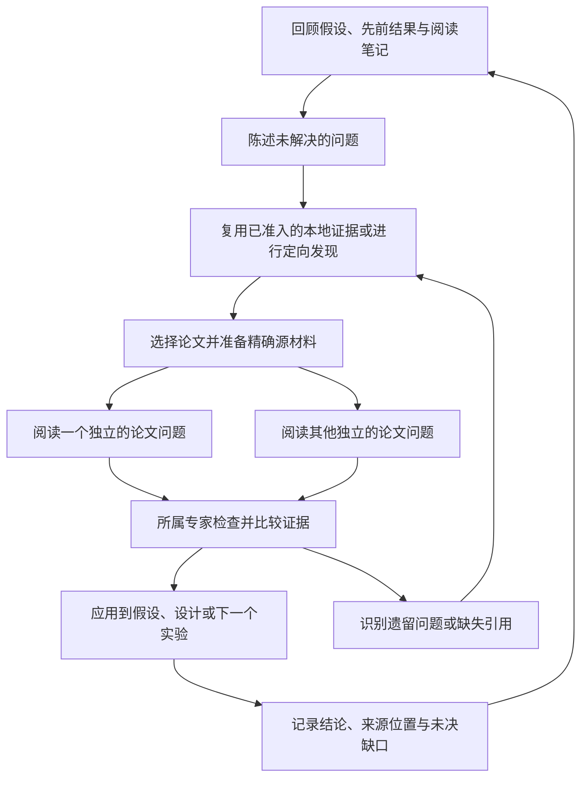

# 架构

[English](architecture.md) · 简体中文

ACI 25 将持久科研工作区与有界模型会话分开。新任务从冻结事实、已有摘要和来源
索引重建上下文，满足条件的同任务纠错保留归档会话；relay 在同一工作容量策略下
优先使用可核对的实测历史。容量恢复保留已提交实验和费用，
分析技术失败本身不覆盖合法修订。配置、Debate 范围、来源反馈和监控口径见
[上下文与恢复](guides/context-management.zh-CN.md)。

Hypoloom 是一个持久的多 Agent 研究工作流,每个状态根对应一个常驻 Workflow
Host。Python 代码位于 `hypoloom/`;打包的 SQL 迁移、原生技能/插件资源与 Web
资产是必需的运行时输入。

## 所有权与执行

CLI 与操作员 MCP 通过私有控制套接字发送带类型的请求。`workflow_host.py`
协调策略、持久命令/Attempt、原生 Agent 会话与实验执行。`state_store.py`
拥有 SQLite 事务;`artifacts.py` 拥有已接受工件的发布。Agent 不能直接写
持久工作流状态。稳定的请求标识让重试与新命令可区分。持久状态与实际进程
存活是两个独立事实。

Agent 会话使用带私有设置、Host 范围工具与 bubblewrap 隔离的 Claude Code。
Host 为每个请求授予精确能力和只读的目标/数据挂载。provider 凭据留在研究
沙箱之外。实验在选定的研究环境中运行,并通过 Host 发布经校验的结果。
原生最终文本在 Stop 时做 schema 检查,并在 Host 事后检查中再次校验;仅有
进程退出码不等于接受。

API 可用性复用已有 provider 观察、Attempt 起止时间和 `PROVIDER_RETRY_CLEAR`
控制记录，是派生的调度状态，不另设运行状态或健康服务。连续恢复轮次使用
既有基础设施尝试上限，节点重试与费用记录各自保留。已提交实验独立执行和
收集。同一计算逻辑供 Host 状态与通知使用，monitor 将状态传递给 Web/TUI。

操作者控制可选择权限 0600、仅包含连接字段的设置文件。既有控制日志决定
选择，私有文件保存凭据，Host 缓存可丢弃。原始私有设置和固定运行版本检查
保持有效，后续调用更换连接时仍使用固定模型。Web 复用按范围授权和同源检查，
另授 API 操作权限，观察链接和人工回答链接不能切换凭据。生命周期和备份恢复
语义见 [API 状态与恢复](guides/provider-recovery.zh-CN.md)。

Observer 的 Stop 还复用事后语义校验器，依据冻结请求检查引用归属、唯一贡献父假设、
触发资格与可用 Debate 来源。无效选择可在既有纠错次数和时间预算内于同一次调用
修正。该只读检查不接受控制操作，持久准入仍由 Host 负责。

执行节点的 Stop 检查用生产执行路径校验解析器输入并检查已提交实验的状态,
并始终保持可被取消或截止时间中断。重试复用已接受的实验标识。待处理工作与
派发暂停不能被报告为已完成执行。

运行级派发异常会隔离该运行。在下一次观察 tick,Host 取消其存活的 Agent
调用,以普通 Attempt 关闭和会话/账目捕获记录不可重试的 `dispatch_paused`
失败。已接受的 Agent 结果保持已接受。排队的 reader 不能启动;其他运行以及
显式 STOPPING/最终报告清理仍可服务。已提交的 Process 保持其正常的
执行/观察路径,但其结果等待授权处理;隔离从不虚构接受,也不取消运行本身。
实验 MCP 等待在有界轮询窗口内保持,直到终态、截止或端点关闭,避免在同一
派发故障上重复消耗模型轮次。reader 容量阻塞仍会及时返回,使所有者可以选择
串行阅读。

ACI 22 的 EXECUTION 输出可通过 `waiting_for_experiment_id` 将最新已提交实验交还
Host 等待。本次调用正常关闭并计费，研究节点仍未完成；Host 在实验进入终态并完成
收集后，按 Profile 剩余预算重新调用同一节点。每个实验（包括明确的修复替代
实验）只允许成功交还一次。省略该字段仍要求最新实验已进入终态，较早 ACI 版本
保留原有终态完成规则。此机制复用原实验记录，不增加等待队列或延长 Agent 时限。

## 研究模型

Profile v4 是公开的创作格式。六个 YAML 文档定义目标、专家、方法/运行时/
预算、语言、通知与安全。准入选它们编译为现有的带类型研究合同。旧版 Profile
解析器及其夹具保留,用于覆盖既有解析器行为;公开模板使用 v4。内部协议与
SQL 迁移版本保持其顺序与不变量。

Grounding 可以请求人工澄清,而不必保持一个模型调用打开。公共验收(若选择)
在私有 `/acceptance` 中创作并测试,然后以只读方式共享给专家链。每位专家
维护持久科研身份、私有 Git 工作树、假设与证据。文献、提议、设计、执行、分析与
演进构成核心闭环。

文献预取和查询覆盖检查共享每个 Host 一个后台 worker。该 worker 拥有适配器的
可变痕迹与缓存;Host 线程继续服务工具、控制请求与 Process/池观察。只有 Host
校验当前任务/Attempt 并提交返回的证据。取消会丢弃迟到结果并中断重试与
请求间工作;已激活的传输操作仍受其既有超时约束。关闭时排空 worker;读取
进行中备份不可用。待处理读取是一次性的,使用现有任务/Attempt 标识。恢复
复用现有的被放弃 Attempt/重试路径,不引入另一种持久化格式。

Observer、Leader、Debate/Judge、裁决与管理动作使用显式角色和已接受事件。
上下文投影选择有界的当前证据;交互节奏遵循已耗时间与新结果门槛。技能与
记忆变更通过已接受的修订进入后续轮次,而不是不受控地修改另一位专家的
状态。界面观察器没有研究权限。

从 ACI 21 起，运行可以在最终目标达成前任命 Leader。资格要求贡献所在周期
已经收尾，并有已接受的科学证据：受支持结果，或 outcome、artifact、证据链接
与评估相互匹配的有效反证。执行失败不构成贡献。Observer 必须明确引用一个
本方假设及其证据，仍可选择不任命。目标达成后的收尾优先于继续协调研究。

已接受事实的 fact_id 与该事实自身的实体 ID 具有相同引用含义。响应和已接受事件
保留原始引用；引用事实不会隐含引用其外键关联的其他实体。资格校验与独立交互
审计采用同一套 ID 解释。

可能在完整共同目标证据产生前停止的筛选，使用既有 LOCAL 范围，并在 SYNTHESIS
声明本地 C5 测量。后续 GOAL 实验可保留该测量，同时提供全部共同证据。已接受的
null 测量仍只能使用 GOAL；改变它需要修订假设或进入新周期。GOAL 证据缺失属于
执行失败，不是有效反证，也不能用虚构占位结果修复。

从 ACI 23 起，Leader 任命启动简短、会话隔离的 LEADER 辅助任务。被选专家读取
实际已发布报告及接受事实，生成有界建议。同行继续研究，不因 Leader 自动暂停、
等待清空、增加研究轮次、获取执行优先或改变父假设授权。最新建议在首个 FORWARD
请求中确定，重试、BACKWARD 与 SYNTHESIS 复用同一请求中的建议（包括无建议）；
中途到达的建议留到后续周期。专家可采纳、改造或拒绝，不自动重开终止链、剪枝或
改写科学事实。稳定辅助任务 ID、普通重试／计费与已接受输出承担恢复，无独立消息
账本或采纳回执。建议失败或预算不足只结束本次协调；手动控制、停止、API 等待
继续生效，无新增证据不重复生成建议。

Debate 的后续研究使用已接受交互明确授权的父假设，即使普通裁决没有选出链。
每位 Debate 参与者在自己已经进入的周期收尾且预算允许后启动，
另一位可以独立完成当前工作。公开 Judge 建议进入新假设的规划输入；ACI 24 将
胜方获准的代码与已接受来源交给新的综合会话，旧版本保留私有会话承接，两者都受
原有归属和来源约束。普通谱系终止和科学结果标签保持原义。旧运行
继续使用固定版本的原有语义，不支持跨版本迁移。

人类研究视图与绑定确切节点的私有视图由一个有界后台 worker 准备。Host 原子
发布人类视图，在终态后丢弃过时的活动态视图，并在派发私有视图对应的任务前
重新检查准入。派生视图允许落后于持久修订；控制与研究准入仍读取原始记录。
已关闭 Attempt 的预算计费通过原有折叠计算缓存在内存中；OPEN Attempt 每次
重读，未提交的关闭记录不进入缓存。

## CPU 与 GPU 资源

Agent、Process 与审查并发各自独立限界。实验获得精确的 CPU/GPU 许可与
运行时绑定。共享 GPU 容量由显式配置的节点本地池协调。请求依次经过预留、
启动与绑定进程所有权,然后释放。

当授权的 UUID、工作负载估算、实时容量与 reserve 允许时,同卡重叠是允许的。
可选的初始显存估算可以高于工作负载下限;只有完整、成功且可比较的测量才
允许后续降低估算。不完整采样永远不会变成零用量。非池化派发在一个根内按
UUID 串行化,不提供跨根协调。

## 持久化与恢复

新运行保存其可执行运行时包和不可变版本绑定。重入使用该包,而不是静默
采用当前检出。进程、套接字和持久事务边界由恢复测试检验。跨版本运行迁移
不在受支持的产品范围内。

取消经过 stopping 与终态清理,包括子进程和待处理效果。托管 Host 可以在
终态退出;离开 monitor 不会取消它。备份/恢复保持同一版本边界,且只恢复
到全新的目标。

`oracle.py` 与聚焦的结果 oracle 独立审计已接受状态、所有权与效果。它们
不会仅因为状态字段写着 COMPLETED 就晋升一个候选。G0–G5 规则见
[资格](qualification.zh-CN.md)。

## 呈现与支持

TUI 和 bearer 保护的 loopback Web 视图投影持久证据。显式的人工答复链接
只增加现有的已审阅答复操作。支持包导出默认隐去私有研究字段和本地标识;
分享是独立的用户动作。模型用量报告保留已知费用和未知预留额,而不是虚构
provider 账单。

最终报告通过已有 `execution_artifacts` 关系，将 canonical outcome 归属到实际发布
它的 Attempt；相同 execution ID 不会让 LOST 重试继承科研证据。设备压力摘要保留
真实字段 `gpu_minimum_free_memory_mib` 及已有 `owned_memory` 观察，设备采样标为
`gpu_device_monitored`，不据此推断本任务执行过 GPU 计算。Agent 费用汇总复用
`fold_agent_attempts`，仍属于首次最终报告尝试前固定的不可变上下文。
不新增事实、schema 或独立记账来源。

## 选择性精读 — 2026-09-16

**已在本地 ACI-20 工作候选中实现;资格状态记录于
[qualification](qualification.md#current-development--selective-paper-reading-2026-09-16)(英文台账)。**
本节组合了选择性方法精读、关联检索历史与动态并行。新的阅读接口适用于全新
ACI-20 运行。既有运行、bundle、Profile、凭据、研究数据与共享服务保持不变。

### 证据与工程边界

变更前的行为已经有有用的连续性。在第二个 MERC 运行中,工程 Attempt
`agent-62e7ae060a064c6d9379e85a5e997d56-1` 在第 2 轮检索跨会话泛化与说话人
建模之前,阅读了它的第 1 轮报告。该报告在一个否定性实验之后提出了这些问题。
后续调用检索了相关方法的摘要/元数据;这展示了关联检索,而不是成功的全文
方法精读。记忆读取和后来的检索/抓取结果都保存在该 Attempt 的原生归档中。

| 变更前观察 | 实现后果 |
| --- | --- |
| OpenAlex QUERY_PLAN 使用目标、专家焦点和已准入上下文;检索覆盖基础性、中期和近期工作。 | 保留广泛发现及其既有覆盖校验器。 |
| 专家可以查阅自己的报告并发起已准入的 Web 调用。 | 通过现有摘要和记忆携带后续追问的理由。 |
| `PdfExtraction`/`PdfTrace` 暴露摘要/结论摘录;增大 `max_chars` 无法看到被省略的方法。 | 让原文和有界的方法页文本可访问。 |
| `FixedLiteratureIO.retrieve()` 返回 `pdf_artifacts`,但变更前的 Host 在请求中只保留摘要包。 | 通过准备和普通发布保留精确选定的源字节。 |
| OpenAlex 工厂使用两个每论文 PDF worker;批量适配器调用共享一个 Host worker。 | 让 I/O 限额与模型并发分离,并保留可变适配器所有权。 |
| MCP stdio 调用串行处理;原生工具不启用 Agent/Task,也没有论文 reader 任务绑定。 | 真正的并行模型阅读需要显式的 Host 执行集成。 |
| 现有同角色视图包含成功的摘要和 Attempt 元数据,而不是完整的旧请求/转录;其图是假设谱系。 | 暴露已准入的源引用和紧凑笔记,不将该图当作引用网络。 |

来源:[literature](../hypoloom/literature.py)、
[Host](../hypoloom/workflow_host.py)、[工具桥](../hypoloom/host_tools_server.py)、
[原生运行时](../hypoloom/full_cc_runtime.py)、
[投影](../hypoloom/research_projection.py) 与
[记忆](../hypoloom/expert_memory.py)。

具体的失败资产是跨适配器到 Host、Agent 到下一节点和上下文压缩边界的原文
方法访问。Git 无法恢复被丢弃的 PDF 字节。一旦这些字节被保留,现有的稳定
引用、事务、范围化挂载、原子发布、工件校验和普通测试就足够了。不需要新的
哈希、阅读回执、论文注册表、冻结科学合同、知识图谱或强制阅读门控。带类型
的阅读任务增加的是一个显式请求的执行能力;它不是另一个科学权威来源。
维护停留在现有 reader、Agent、发布和投影路径;一次性索引可以重建,之后
并入原生源挂载。

### 研究流程与选择

工作单元是**一个选定的来源和一个具体问题**,而不是每条搜索命中,也不是
任意页面片段。专家在这一序列中始终拥有研究问题、选择和最终解释:

这是研究行为,不是新的工作流状态机。当决策相关问题已解决、继续阅读无益、
必要来源不可用、或时间/预算耗尽时,在现有节点内停止。返回一个显式的未决
限制是有效的。既不要求最低论文数量,也不要求读完所有检索到的论文。

当摘要无法决定一个实现选择、假设、矛盾发现、消融、评估协议或结果解释时,
选择该论文。阅读相关定义、方法、公式、训练细节、实验和必要附录。引用数
和新近程度本身不构成精读理由。同一篇论文之后可能值得换一个不同的问题;
只有当来源版本和问题仍然适用时,才复用现有笔记。

在专家的普通推理中分类依赖关系:

- 关于相互独立论文的已定义问题可以并发运行。
- 如果论文 A 显示引用 B 提供了必要定义,将该缺口返回给所有者;在完成该
  依赖论断之前先发现/阅读 B。
- 跨论文比较和下一步检索决策属于所有者。reader 不会递归创建 reader,也
  不会静默扩大课题。

一个有用的历史模式是:先前实验报告泛化不佳;检查选定的说话人/上下文机制;
比较它们的假设与当前协议;提出可检验的适配。已发表结果从不替代 Hypoloom
实验结果,也不改变已接受的评估器。

### 发现与定向跟进

保留当前广泛的 `QUERY_PLAN -> LiteraturePacket -> MAIN` 路线。其冻结查询、
历史分层、来源类别和覆盖检查保持不变。MAIN 期间的收窄跟进必须记录为附加
来源;它们不会改写已接受的查询,也不假装满足其覆盖。

将已选定的 provider 用于明确目的:

| 需求 | 路线与结果 |
| --- | --- |
| 广泛文献定向 | 现有 OpenAlex 规划与经校验的包。 |
| 精确的学术问题或已知论文 | `web_search(..., scope="academic")`,直接使用已配置的 OpenAlex 元数据通道。 |
| 普通网站、项目文档或源码仓库 | 现有通用 `web_search` 与 `web_fetch`;学术后备保持明确标注。 |
| 已准入作品的全文 | 优先复用保留字节;否则使用其已准入的 OA 位置和选定的 DOI 后备。Unpaywall 提供 DOI 到 OA 位置,不提供主题搜索。 |
| 被引用的先决工作 | 所有者提供观察到的引用/标题/DOI 及需要它的原因,然后使用相同的检索/抓取路线。 |

`scope="academic"` 是显式字段。它解决观察到的学术后备之前 DDG 反复失败的
问题,而不取代通用网页搜索。它只使用 Host 配置的 OpenAlex 客户端;缺少配置
会产生显式的不可用结果。它不会自动发现凭据。响应保留 provider、实际来源
URL/标识、返回的元数据、限制和错误。定向查询不必复现广泛包的三个时间分层。
CLI 为学术范围注入选定的 OpenAlex 客户端,独立于 `--web-search-fallback`;
后者只把通用网页失败纳入带标注的后备。两种观察都复用现有 Host 配置。

保留当前显式的 OpenAlex 与 Unpaywall Host 绑定。密钥/联系数据仅属于 Host,
从不进入 reader 提示、Profile 值、来源笔记或与 provider 不匹配的请求。
保留 DOI 身份校验、公共 HTTPS/对端检查、重定向、字节上限和选定后备的冷却。
不要再加 provider 或自动后备链。

在再次搜索之前,专家检查相关的先前查询、成功来源和失败原因。传输失败不是
无论文的证据。已知作品优先使用精确标识符;当现有覆盖不足时,实质性地改变
问题。在观察到同一失败后重复等价请求,需要一个期待不同结果的理由。这是
利用现有痕迹和重试规则的指导,不是新的强制查询历史门控。首个实现不会爬取
整个引用/被引网络。

### 原文档与原生阅读

准备一个有界、Host 拥有的**每 Agent Attempt `/papers` 目录**,只读挂载。
它是一次性输入材料;现有的 `/research` 视图对逻辑请求保持固定。新文档不得
改变该冻结视图。

使用现有 `web_fetch` 的 `mode="document"`:

- 接受已准入的 `paper_ref` 或公共 HTTPS `url`,二者互斥。有界的列表变体
  允许每次准备调用选两个来源,在活跃 Host 工作间共享现有 PDF worker 额度。
  标量与列表形式不能组合。任何字段都不接受任意主机路径。
- 将来源绑定到其获取 Attempt 和现有的包/工具引用。仅
  `literature-pdf-001` 这样的包内序号本身不够;DOI 标识一部作品,而不是
  不可变字节或特定修订。
- 返回来源元数据、可用性诊断,以及原文、页/标题索引和有界页文本的路径。
  保留物理的从 1 开始 PDF 页码。HTML 使用实际标题/行位置;补充材料是独立
  来源。标题有助于导航,但不是文档有效性的必要条件。
- 使用共享的有界 Poppler 原语暴露方法,同时保留当前摘要路径校验器。准备
  不调用摘要模型,也不把整篇论文塞进专家提示。
- 专家对选定范围使用原生 `Read`/`Grep`,并带上下文定义。公式、图和表的
  原生 PDF/图像阅读需要所选 CC/模型支持它的证据。否则识别出未解决的视觉
  细节。自动 OCR 或另一个视觉模型暂缓。

文档模式在 ACI-20 请求上可用。普通 URL 抓取仍然可用。工具 schema/参数变更
使用正常的运行时版本化和现有封闭校验器;批量能力检查在工作开始前完成。

抓取/抽取通过 `WebToolOperation` 和现有 worker/进程边界在 Host 服务之外
运行。不要从多个套接字 worker 调用可变的批量 `retrieve()`。让适配器痕迹、
缓存和冷却更新保持被拥有或被保护。I/O 容量等待、传输和抽取共享工具/
Attempt 限界;分别返回忙碌、不可用或超时结果。stdio 桥仍返回有界的同步
准备响应,而不是流式包。当前 PDF 协调器按提交顺序收集 future;现有测试
确立的是重叠,而不是新路径的流式或完成驱动补充。

Host 暴露是原子的,并检查当前 Attempt 所有权和停止状态。返回的路径从不
改变字节,部分文件从不暴露。迟到或未交付的结果保留现有的
`response_not_observed` 处理。

### 发布、源复用与记忆

将有界的预取 PDF 字节保留在有界暂存中,而不是丢弃。使用现有 PDF 缓存额度
作为聚合暂存上限、现有每文档/每页上限,以及抽取器的文本输出字节上限。报告
被限制省略的材料;从不驱逐仍在被读取的路径。原始附件独立于转录文本计限,
两种额度都不扩大。

把准备好/选定的源文件作为普通 **Agent 转录发布**的附件捕获,复用
`AgentArtifactKey`、`ArtifactPublisher` 和现有 Oracle。把来源到文件的绑定
存入普通请求/工具观察,并导出可读索引。扩展精确的允许文件检查;不允许
任意附件,不增加归档种类,也不创建清单。

优先引用已发布的精确来源,而不是再复制一份。如果子任务读取父任务尚未发布
的暂存,子任务的持久笔记必须在自己被允许的附件中保留那些精确源字节,除非
已存在经过验证的发布。它不能仅引用一个即将消失的父路径。有界的重复归档
优于悬空的来源;全局内容去重不在范围内。复制不会把同一 DOI 下的不同版本
合并。

失败/被拒绝的 Attempt 可以保留来源和阅读证据,而不接受科学论断。如果暂存
在任何发布之前丢失,记录原文为不可用;之后的授权抓取是新的观察。同包重试
在现有请求边界内复用幸存的精确材料。不提议重建旧字节或跨版本恢复。

原生备份检查暴露了一个既有遗漏:只复制数据库和工件会让 Oracle 失去 Agent
记录引用的 Git 插件/记忆提交和冻结请求视图。备份/恢复现在也复制运行拥有的
`grounding/plugin` 和专家 `plugin`、`memory`、`views` 目录,保留其 Git 历史
和可执行模式。这些是原始证据来源,不是重建的替代品。既有静默性、普通文件/
路径检查、原子发布和完整 Oracle 仍是校验器。设置、存活原生工作和外部研究
仓库不在此复制范围内;运行时/环境保存保持其既有独立包边界。没有引入备份
清单、额外上下文数据库或迁移。

使用现有摘要和轮次报告正文存放紧凑笔记,以下内容是写作指导,而不是另一种
强制输出 schema:

| 内容 | 目的 |
| --- | --- |
| 问题与来源 | 标识促使本次阅读的假设/结果、先前报告或论文/页码。 |
| 来源与查阅位置 | 链接精确已准入来源/版本、页/节和相关摘录。 |
| 原方法与假设 | 解释机制、训练/评估细节和适用条件。 |
| 对本研究的后果 | 区分论文论断与专家的适配和预期检验。 |
| 遗留缺口与下一步 | 说明不可用证据、冲突,以及为何需要进一步检索。 |

`CYCLE_REPORT` 把持久结论带入现有 `rounds/<cycle>.md` 路径(包括既定的组件
变体),并从 `MEMORY.md` 链接。轮次进行中,普通已接受摘要和原生转录保留
工作。向现有同角色投影添加已准入源链接/笔记;只在 `/papers` 中物化选定的
附件。不要递归地把所有旧转录复制进提示,也不要创建 `/memory/papers/`、
向量数据库或第二个论文历史存储。

压缩之后或在后续轮次,专家阅读紧凑问题和来源索引,然后按需重访相关原文
段落。更正会指出较早的笔记/来源,而不是抹掉历史。另一位专家可以使用显式
共享的证据,但不会仅因为论文公开就获得私有阅读笔记或未共享转录的访问权。

### 可选的 Host 托管模型 reader

reader 执行是可选的;它对多个独立的实质问题有用,而短检查或容量受限的父
任务可以使用本地原生阅读。**没有固定的两路 reader 上限**,也没有必需的
reader 数量。

复用现有 `methodology.literature.tools` 能力列表,增加一个工具
**`read_papers`**。既有 Profile 保持当前工具;该工具是选择加入的,两个公开
默认模板都不含它。ACI-20 只在选择它时授予拥有方的 Literature MAIN 请求。
QUERY_PLAN、Grounding、Debate、Judge、实验节点和 reader 自身不会从共享
设置继承这个派生模型的能力。

该限定范围工具有提交、状态/有界等待和取消操作:

1. 提交有限的选定来源/问题项集合,每项带调用方阅读标识、相关有界上下文
   和阅读理由。Host 提供父 Attempt、专家、轮次、模型、权限和预算标识。
   来源必须已准入且可读。专家不能用此接口选择任意模型、角色或文件系统。
2. 同一父任务下重复提交同一标识返回其既有任务/结果;该标识下不同的载荷
   是错误。使用普通命令标识、载荷比较和事务,不用哈希或另一个幂等注册表。
3. 用现有辅助任务/命令和 Agent Attempt 机制表示工作,带版本化阅读任务
   种类,并在其普通输入中绑定父任务/来源。复用 `ExpertLoopCandidate` 的
   摘要/引用。reader 不是新的专家人格、假设节点、实验或科学事实。需要
   显式集成;现有任务派发和接受不得意外地把它路由成 Grounding 或普通
   文献批次。
4. 每个准入的 reader 获得自己的会话,以及对所供来源/上下文的收窄原生
   Read/Grep/Glob 访问。它不能编辑父记忆或研究代码、提交实验、执行未批准
   的获取或再次委派。从不并发恢复同一个 CC 会话,也不启用非托管的原生
   子 Agent。
5. 状态来自现有命令、Attempt 和发布。有界等待遵循现有的短 Host 轮询模式;
   它在笔记完成时即返回,并返回剩余工作和具体等待原因。Host 继续服务
   取消、Process/池观察和其他 Agent。收集/发布与结果的原生交付是两个
   独立事实。
6. 原专家检查决策关键的源段落、比较笔记,并独自产出最终文献摘要和后续
   科学决策。reader 一致不是投票,也不是接受条件。

有限的已提交集合可以由现有请求的辅助工作表示;不要创建独立的持久 reader
队列。待处理项保留逻辑请求/Attempt 所有权。被输入/来源/字节上限排除的
工作保持显式;不会为每条搜索结果静默启动 reader。

### 动态容量、预算与收尾

在每个派发机会,额外 reader 首先受就绪独立问题数和 `max_active_agents`
下空闲普通 Agent 容量限制。既有预算准入、父任务期限、provider 退避和其他
就绪工作可能进一步减少该数。存活父任务和 reader 都要计数;等待不会静默
释放 Agent 槽位。审查、Process 与 GPU 容量是独立的。两个 PDF worker 不限制
阅读已准备好文档的模型数量。

把简单的分配集成进现有 Host 派发循环。先保留正常研究/交互机会,然后让
活跃 reader 较少的就绪专家先获得机会,再把更多 reader 分给某一专家。容量
和合格工作存在时重复,完成时补充。当同伴没有就绪工作时,专家可以使用
空闲槽位。新需求改变未来准入;不要仅为再平衡而杀掉健康 reader。没有额外
调度器、固定空闲份额或自动吞吐调优控制器。

例如,批准的普通 Agent 上限 12,有三个存活父专家且没有其他普通 Agent
工作,最多剩九个 reader 槽位。三位专家可以各用三个;有六篇就绪论文的一位
专家可以用六个。这些是示意数字,不是经过审阅的设置或实测加速。

如果所有容量都被父任务占用,不要让每个父任务等待无法启动的子任务。当没有
自有 reader 在运行且无法启动时,提交/等待返回容量原因。所有者可以取消未
启动的项并串行阅读;Host 所有权阻止这些相同项被并发迟到派发。未完成的
阅读波次不得看起来像已完成研究或原因不明的 `DISPATCH PAUSED` 状态。

**预算决策:** 每个 reader 是所属专家下一次独立的实际 Agent 调用。对每个
请求应用现有的单次调用上限,并把父任务、reader、失败和重试调用全部计入
相同的专家/运行上限。在启动其模型前使用每个冻结请求的当前预留额;未知
结果保留其预留额。不要复制父任务的剩余额度、减少其冻结预留额,或用
provider 线程绕过记账。不需要新的文献预算台账或父子额度细分。这澄清了
较早的设计:单次调用上限不是对整棵独立调用树的已实现上限。并行阅读即使
缩短耗时,也可能增加上下文/综合成本。

继承所属文献阶段的选定模型和配置上限;把每个子任务期限钳到父任务/运行
剩余时间。Host 记录的 provider 重试延迟适用,但它是运行范围的,不是共享
账户的 RPM/TPM 控制器。付费验证前审查实际账户限制和其他客户端;未知额度
不是无限容量。不要从 GPU 可用性推断模型吞吐,或自动压测未知 API 限额。

一篇不可用/失败的论文保留自己的结果,不会丢弃其他笔记。可选缺口不必阻塞
有用的综合;缺失的决策关键证据保持为显式限制。在正常父任务关闭前,完成
或取消每个自有 reader,并通过现有生命周期路径结清待处理所有权。超时的
父任务、End run 和 Host 关闭会取消其待处理和运行中的 reader,并排空发布/
用量观察。失败的父任务不能让一个已计费的子任务无主运行。同包恢复使用普通
的被放弃 Attempt 处理并保留原费用;不允许盲目重新提交或自动新预算重启。
来源归档在清理后存活;一次性挂载、暂存和自有进程不存活。

### 后续节点、交互与观察

| 阶段 | 允许的用法 |
| --- | --- |
| Literature MAIN | 关联发现、选择性来源准备、本地阅读或显式启用的模型 reader、所有者综合。 |
| 提议、设计与分析 | 重读已准入的本地证据,并把它连接到当前假设或结果。 |
| 执行 | 查阅现有材料获取实现细节;科学变更仍走已接受的设计/假设路径。 |
| Debate | 使用其既有已准入 Web 子集和显式引用的本地证据;不隐式使用模型 reader。 |
| Judge/Leader | 通过其既有已准入交互/同伴上下文机制接收有界证据。 |
| 轮次报告/下一轮 | 在现有记忆中携带有用结论、原文位置和待决问题。 |

首个实现中,新的在线获取停留在既有允许的节点内。设计期间出现的新外部
来源缺口会记录给现有文献/Debate 机会;该提案不会静默授予执行节点网络/
派生模型工具,也不会增加自动文献节点。

对交互而言,仅有 URL 不是充分证据。现有输入构建器应附上有界的引用段落、
原始来源/页标识和专家的解释,并保持它们之间的区分。保留现有已准入的
旧版 Leader 同伴记忆行为；ACI 23 建议使用已发布报告输入，不授予通用跨角色访问。缺失或超大摘录在现有输入
上限下是显式的,而不是被静默省略或扩展成完整同伴转录。

观察三件独立的事:来源可用、内容经原生工具交付、专家做出了解释。扩展
普通 `web_tool_results` 元数据用于准备;把原生 Read/Grep 和 reader 结果
保留在现有转录中。路径/索引命中或阅读声明不能证明理解。不要增加
`fully_read`/`understood` 标志、强制 reader 评分,或仅基于文件访问的
科学事实。

使用现有 Attempt/状态诊断区分来源不可用、I/O 容量、Agent 容量、provider
延迟、预算和未完成综合。展示部分结果和实际已知/未知用量。完成度从自有
终态工作和已接受的所有者产出报告,而不是从下载论文数或批量响应上的通用
成功标志报告。

### 交付阶段与验证

| 交付 | 具体变更 | 完成证据 |
| --- | --- | --- |
| 1. 原文来源访问 | 保留预取字节;准备有界页文本;挂载 `/papers`;归档来源并投影已准入引用。 | 摘要中没有的方法细节从精确原文页交付,并在下一节点仍可用。 |
| 2. 关联选择性阅读 | 显式学术范围、文档模式、现有技能指导、问题来源笔记、记忆和被引交互摘录。 | 先前结果驱动定向跟进;重读保留的来源不发新的 HTTP 请求;Judge 实际收到被引段落。 |
| 3. 可选动态模型 reader | 一个限定范围的 Host 工具、辅助 Agent 绑定、现有容量/记账、独立会话、部分收集与取消。 | 准入时两个以上 reader 可以重叠;竞争专家和零容量回退行为正确;重复提交不产生第二笔费用。 |
| 4. 原生/模型评估与候选晋升 | 现有原生 CC/CPU 和 G0–G5 路径,以及单独授权的有界模型比较。 | 观察到工具交付、科学使用、复用/恢复、全部自有终态效果和实际已知/未知成本;收益是测量出来的,不是假设的。 |

该实现复用现有边界:

- `literature.py` 与 `grounding_web.py`:来源抽取、元数据发现、OA 检索和
  现有传输/缓存限制。
- `host_tools_server.py`、`workflow_host.py`、`domain.py`、`expert_loop.py`
  与 `agent_aci.py`:封闭工具/任务准入、稳定所有权、派发和普通观察。
  没有新的论文 SQL 表或科学工作流状态。
- `paper_sources.py` 与 `paper_reading.py` 在现有 Host 线程上承载来源准备/
  归档和辅助 reader 集成。这使 Host 保持在既有文件大小限制内;两个模块
  都不拥有另一个守护进程、数据库、调度器或预算台账。
- `full_cc_runtime.py`、`agent_sessions.py` 和现有会话 Oracle:收窄的
  reader 工具/挂载、独立会话和精确允许的附件。
- `research_projection.py`、`expert_memory.py`、交互输入构建和现有文献/
  报告技能:来源引用、紧凑笔记和证据交付。科学接受和记忆写入边界保持。
- `profile_v4.py` 和现有准入/原生设置文档:可选工具名能力、继承阶段模型
  和现有限制。公开 Profile 保持完整的中英文六文件成对;没有新的强制文件,
  也没有硬编码的 reader 数量、模型、密钥、数据路径或 GPU 绑定。

在这些交付期间使用聚焦回归。复用当前文献、Web/工具、会话、记忆、投影、
预算、交互和 Oracle 测试;为新行为扩展它们,而不是建立并行资格机制。

- G1:方法页访问、缺失标题、抽取歧义、不同包内序号、错误角色拒绝、单个
  批次失败、选定 provider 路由、能力/版本准入和打包原生资源。
- G2:发布/备份中的精确源附件、失败 Attempt 证据、先于父发布的子发布、
  复用时的来源引用、同包重启和发布前暂存丢失。诚实记录历史样本缺口;
  旧包不因夹具成功而迁移或晋升。
- G3:实际原生 CC 和有界 CPU 闭环,贯穿阅读、假设、实验、报告和下一轮
  使用;来源/reader 等待与控制并存;完成顺序收集、变化的专家需求、父
  容量死锁避免、重复工具请求、预算预留、迟到交付、End run、Host 关闭和
  独立计数的残留进程/挂载。
- G5(经授权时):在相同源字节、问题、模型和约束下比较串行阅读和多个
  批准的并行级别。检查有用的选择、正确的方法/假设解释、交付给综合/
  Judge 的引用、设计影响、耗时和总已知/未知成本。包括一个需要后续检索/
  阅读波次的依赖,以及一个冲突或不可用来源。脚本化测试不能证明模型理解。
  PDF/图像支持需要自己的适用样本。

阅读本身不需要 GPU 实验。候选资格仍遵循
[现有 G0–G5 适用规则](qualification.zh-CN.md),包括相关时受影响的资源路径;
先前的 G4/G5 通过不晋升已变更代码。本设计文档不授权任何付费/GPU/模型基准、
研究启动或配置变更。把未来的实际验证记录在该既有指南中,详细日志放在被
忽略的 `.local/qualification/` 下。
