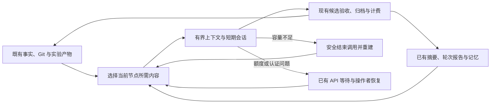

# 上下文管理、科研记忆与运行恢复开发方案

## CC 窗口获取与隔离运行传递（2026-10-10）

可复现问题：CC-switch 的 settings 已声明 1,000,000，但原有
`context_policy` 默认加入 262,144 工作上限，取最小值后仍限于 262,144。
完整研究 CC 使用独立环境及 `--setting-sources ''`，原有容量参数未传入。
因此个人 CC、研究 CC 和界面分母可能分别采用不同窗口。用户确定的默认行为是：
未显式配置工作上限时自动跟随窗口；本地不足时允许有界只读元数据查询。

实现使用 adapter 80 和现有版本边界，不增加 ACI schema、数据库表或容量注册表。
Host 在原有请求事务前，按节点精确模型和所选连接解析容量，将非敏感结果放入
既有 `node_runtime.context_window`。基础设施重试复用原请求；提示构建、relay、
会话恢复和监视器都消费该输入。旧请求缺少该字段时保留原策略，禁止跨版本迁移。
环境鉴权的非敏感上下文开关纳入既有 Host configuration；文件鉴权继续使用已有
Host 私有 settings 生命周期。CC-switch 仅负责维护这个输入文件，不直接接入数据库。

白名单覆盖数值窗口、禁用 1M、主动压缩控制及自动压缩窗口。数值和布尔值先校验，
再传入隔离 CC；完整 settings、provider 凭据和其他个人配置不进入 Agent。
`autoCompactWindow` 支持按模型设置，环境覆盖优先；压缩阈值与容量分开记录。
模型 `[1m]` 后缀大小写一致处理，wire model 仅移除此后缀；显式禁用 1M 时
不再错误要求 CC 发送 1M beta，其他模型和协议校验保留。

解析结果区分 CC 显式声明、模型后缀、内置/默认推定及 provider 元数据。
同义上限取最小值，显式工作上限继续生效；无显式工作上限时不再添加 262,144。
无可用窗口才使用该框架兜底；没有声明的自定义模型通常仍有 CC 的 200,000
默认推定，不能标为 provider 实际容量。总窗口扣除输出、工具和估算预留后才是
输入额度；provider 的独立输入上限另行约束，不与输出上限相加推导窗口。

本地不足时由 Host 查询固定端点的 `/v1/models`。每个 Host/预览至多 3 次，
每次至多 2 秒、总计 5 秒；子进程边界同时约束 DNS 和慢速读取。至多读取 1 MiB，
不跟随重定向，凭据经 stdin 输入，不写命令行或诊断。只接受精确模型 ID 和明确
正整数字段 `context_length`、`max_input_tokens`；不将 `max_tokens` 当总窗口。
失败、字段缺失或预算耗尽回退本地信息；`memory.context_metadata: false` 可关闭。
短期缓存按端点、凭据和模型隔离，仅避免同一 Host 重复查询，不是持久容量目录。
连接切换不改变 Profile 或已提交请求；新任务使用所选连接，历史请求不追改。
论文阅读子任务继承父任务的显式容量限制及元数据开关，再按自身模型解析窗口；
不继承父任务的科研记忆或工具权限。

Web/TUI 使用同一有效上限，并展示窗口来源、自动/显式工作限制、元数据结果、
独立输入上限和压缩阈值。CC 最终 `modelUsage.contextWindow` 只作运行观察；
仅匹配本次模型，出现差异时提示，不能冒充 provider 实测容量或重写原策略。
胶囊继续显示最近实测输入、保留固定宽度的压缩箭头，估计不替代实测。
初始化 review 显示按模型解析结果和元数据查询次数，不发送生成探测。

失败资产是配置在 Host/Agent 生命周期边界的遗漏，以及已有容量计算中的隐式限制。
现有私有配置副本、请求记录、版本验证、普通类型检查和回归测试足以修复；无需
新增 hash、冻结契约、快照、标记或第二份容量权威。维护成本集中在小范围 CC
规则适配和协议回归；若 CC 提供可靠的启动前结构化窗口接口，可替换规则推定。
当前本机 CC 2.1.296 对照还确认：`DISABLE_COMPACT=1` 时数值覆盖可影响带
`[1m]` 的自定义 ID；`claude-private@YYYYMMDD` 仍报告 200K。这些边界用实际
CLI 对照保留，不将文档的一般表述代替观测。默认不关闭压缩。

参考：[CC 窗口与压缩](https://code.claude.com/docs/en/model-config#correct-the-window-for-a-gateway-or-custom-model-id)、
[模型元数据接口](https://platform.claude.com/docs/en/api/models/retrieve)。验证覆盖
基线策略回放、精确模型/参数矩阵、有界本地 HTTP、实际隔离 CC、Host/relay/CPU
闭合及容量恢复、双语浏览器/TUI和历史兼容；不是付费模型科学质量或全套 G0–G5
资格提升。

## 流式输入用量的临时零值（2026-10-10）

本次 GLM Grounding 在 message_start 中返回零输入、零输出，在 message_delta
中才提供完整输入及缓存用量。历史两次 MiMo Grounding 的 142 条带开始事件的
响应均在开始时提供非零输入，本次 GLM 的 45 条响应则均从零开始。三次运行的
`latest_context` 和实时观测函数相同：未完成的临时零值被当作当前测量，盖过了
已保存的上次实测值，使持续工作的 Agent 看起来没有上下文。

修复复用 ACI-25 以来的共享 `latest_context`：输入与适用缓存用量合计为零，且
message/HTTP body 尚未同时完成时，当前测量保持未知。保留现有上次完整实测、
交互编号、当前请求估计和容量判断；不把历史用量或估计写进当前实测占用条。
完整且有效的真实零值、非零流式输入、缓存输入及未知缓存口径保留原语义。
不改变原始 capture、计费、容量锚点、预算或请求内容，不依赖模型名或服务商。
Web/TUI 对缺少当前读数明确显示“待返回或不可用”，有历史测量时继续展示它。

失败资产是已有 provider 记录到只读界面的投影，现有字段、原子诊断写入和普通
回归已足够区分上述状态；无需新 schema、hash、标记或另一份用量权威。维护成本
仅为既有投影中的零值判断和反例测试；若统一协议以后明确提供用量就绪语义，
可合并该判断。现有研究 bundle 和运行状态保持只读，不热替换或迁移。

验证使用原记录的只读回放、零值/缓存/结束状态反例、真实本地 relay 的分段 SSE，
并将同一投影送入 TUI 和实际浏览器。资格范围记录在
[qualification](../qualification.md#streaming-zero-input-observation-2026-10-10)。

同日胶囊可见性跟进：虽然共享投影已返回“上次 81.13K”，固定 3.3rem 宽度使
`last`／“上次”留在第一行，数字换到第二行并被固定高度的 overflow:hidden
裁掉。原测试只确认 DOM 文本存在，遗漏了实际字形可见性。胶囊中栏改为按内容
宽度布局，保留原最小宽度、字体和高度，读数禁止换行；不改变用量字段或占用条
的实测语义。中英文浏览器回归以实际文本矩形检查桌面及窄屏数字完整可见。
这是现有 CSS 与普通测试的修复，无需新增观测状态或权威。还需区分新观察器与
运行固定 bundle 中的旧 Web 服务；页面刷新不能升级后者的 Python 代码。

同日交互调整：胶囊统一表示“最近实测上下文”，去掉数字前的 `last`／“上次”。
当前请求有实测时使用它，否则使用已有的 `last_observed_input_tokens`；没有实测
才显示 `—`，估计不混入。数字和填充使用同一读数。此处替代上文旧版“历史数字
但当前占用条留空”的胶囊语义；当前请求、历史交互和估计仍在提示中分别展示，
不更改后端当前读数，也不把被拒请求标成有实测。`↻` 继续只由明确的 compacting
状态驱动，移到固定宽度状态位，固定数值框宽度，出现/消失不移动数字。

分母沿用已有 `effective_context_tokens`：工作上限、已配置提供商窗口及运行时
上限的最小值。提示明确给出分母的精确 token 数及扣预留前口径；输入准入额度
另行展示，不能把占用条当作剩余可输入额度。当前只读样本配置为 262144，提供商
窗口和运行时上限未配置，输出 32000、工具 8192、余量 16384 后输入额度为 205568。
这只能确认与本地工作上限一致，不能证明上游实际窗口。未确认窗口继续明确标注；
不依据模型名推断，不更改运行配置、容量计算、provider 数据或持久化字段。
复用已有测量与容量策略、CSS 布局和浏览器几何/比例回归即可，无需新状态权威。

## 混合用量账本、空流和服务恢复（2026-10-08）

本次 Grounding 的原始输出可在冻结运行代码中只读重现
`invalid_provider_metadata`：CLI 汇总遗漏压缩调用并重复计入上一轮输入，
而 `modelUsage` 的四类 token 与逐请求完整用量一致，费用也与最终结果一致。
未缓存输入下降、缓存输入和输出上升的组合不符合原有两个归一化分支。
一条缺少模型标识的零用量终止流又使交叉校验失败，并被错误用作零 token
上下文锚点。随后旧会话首请求被本地容量检查拒绝，fresh 重建遇到上游
HTTP 500（正文声明 ServiceUnavailableError/503），耗尽基础设施重试。

修复沿用现有事实和验证入口：

- 扩展 `_normalized_provider_usage` 的已有交叉核对分支：完整模型账本与
  实际 wire 分类用量、模型和费用一致时，允许输入类别混合增减及遗漏的
  输出增加。显式总量、预算、模型身份、未知计量和未对账调用仍受原有约束。
- 仅对完整 HTTP 200 SSE、显式零输入/输出/缓存、无模型/内容到达、正常
  end_turn 且无传输错误的空终止流作窄分类。它不贡献成功生成次数，不提供
  容量锚点，也不解除 API 等待；账本核对仍验证请求模型并保存原始记录。
  不放宽正常上下文额度，不跨 relay 保存测量。
- 明确的上游 HTTP 500/502/503/504 复用现有共享可用性退避、Retry-After、
  单次恢复和 Attempt 记录，避免暂时服务故障消耗科学节点重试。
  本地超时、清理/凭据保护拒绝不冒充上游故障；认证、额度、总预算和终止
  报告的有界失败行为不变。

机制取舍：失败资产是 CLI 用量投影和现有恢复分类，边界是 provider 响应到
Host Attempt 验收。Git、事务、归档和类型校验已经保存了全部必要证据，
普通回归及原始记录回放足以修复；无需新 hash、schema、账本、门控或持久化
标记。只维护现有判定函数及其针对性反例，若 CLI 消除汇总差异则可删除
相应兼容分支。保留账本完整性、写入边界和原运行版本隔离。

验证覆盖原版失败回放、合成混合账本及损坏反例、实际 relay 空流后的容量
拒绝、服务退避/取消/重启投影、原生 CLI/Host/CPU 的结果发布与无残留闭环。
资格结果记录在 [qualification](../qualification.md)；现有研究运行只读。

状态：2026-09-26，**ACI-25 修复 ACI-24 在长探索中的容量误判与续作缺口**。
本页先记录当前设计，后文保留首版方案及其边界。用户教程见
[上下文管理](../guides/context-management.zh-CN.md)；验证结论以
[资格记录](../qualification.md)为准。既有运行和个人 Goal/Profile 不变，不迁移运行。

## ACI-25：实测历史与任务内续作

两份 Grounding 报告显示，本地将完整 UTF-8 JSON 字节数当作 token 硬拒绝，
发生在供应商窗口耗尽之前。旧 GLM/MiMo 成功请求也可复现：实际输入约51k/59k，
字节估算却超过205568输入额度。旧方案的25–31小时运行有实际Process和结果分析，
但也有原生压缩失败及数十万token的大请求，因此不整体回滚短上下文设计。

- 同一 relay 先复用已观察的同输入计数，其次核对完整实测请求的未变前缀，
  对新增文本保守估算。单一text块与相同字符串、text/tool_result块上已知
  ephemeral缓存标记的移动，仅在计数比较时归一；内容、顺序、工具身份与thinking
  签名仍精确比较，不改wire。上下文改变使锚点失效，未知明确回退；
  不主动发计数或摘要API请求，不用固定bytes/4或跨供应商比例。
- 分开当前请求估算与最后成功实测及exchange编号，拒绝不抹去历史实测，历史实测
  也不冒充当前占用。字节/请求/时间/总token/费用和原有容量预留独立生效。
- 同一冻结任务的普通纠错、具备测量证据的传输重试，在归档、模型/来源/权限和
  容量均允许时resume；跨任务、容量/摘要失败、缺证据时fresh。API连接重载或切换
  后后续普通重试保守fresh；已有OPEN绑定仍决定中断调用的恢复归档。
- 续作材料复用既有归档与工作区，保留有限工具参数、路径、范围、检查、错误；
  Grounding发现已有验收草稿并重挂同任务的已授权论文。可选过程笔记不是验收
  文件或新事实权威，未写下的思路不能承诺恢复。
- 原生PreToolUse从已有Attempt/session输出验证socket获取80%容量建议，只返回
  附加上下文，不返回工具许可、不消耗输出纠正次数；遥测失败不取消Stop验收。
  提示鼓励保留当前进度，没有额外摘要Agent，也不把模型是否听从作为正确性条件。
- ACI-25不随Attempt编号自动削减内联量。仅有完整“fresh首请求被拒、生成零转发”
  证据时结束不变重试；resume首拒绝仍允许fresh重建。既有重试/预算/停止条件负责
  有界结束，不因重复读文件或没有Git差异就断言无进展。

机制取舍依据：已复现失败的资产是模型输入容量计量及任务过程连续性，边界在
relay请求与Attempt重建。Git、事务、原子写入和原有归档能保存事实，却不能把
字节变成准确token，也不能提供未观察的进展。现有usage、工具归档、OPEN绑定和
验证socket已经足够修复，故不增加hash、schema、检查点、摘要账本或第二套权威。
额外成本仅为有界计数投影、同任务判断和已有socket上的可选提示；以后若runtime
提供可靠同义计量/续作反馈，应合并到同一入口，而非叠加更多门控。

新行为属于ACI-25/adapter63；ACI-24及更早运行使用原固定bundle。计量锚点只在
单次relay有效，恢复很大的旧会话首请求仍可能回退拒绝，此时按既有基础设施
重试额度走fresh恢复；该额度为0时会明确停止，普通模型纠错额度不能替代它。
真实质量验证必须区分长阅读/草稿接续、普通同任务纠错、实际CPU结果与下一动作；
一次闭环或一组离线通过不能证明所有模型的长期科研质量。

## 首版 ACI-24 方案与历史验证

首版最终 G1 为6092项通过、26项按需跳过；有限真实模型样本包含成功恢复、禁重试
对照和超时，长期科研收益未证明。详见
[原结果与限制](../qualification.md#current-development--context-observations-and-measured-recovery-costs-2026-09-26)。
以下首版设计由上面的ACI-25修订覆盖，不应把旧的每Attempt重建/字节计量规则用作新运行教程。

实施细化：首版普通节点每次 Attempt 都重建会话，Git 工作区和原始冻结输入保持连续；恢复诊断只进入派生提示，不修改 input_artifacts。三轮 Debate 保留原协议，容量不足时明确关闭辅助任务而不重复过大请求。未知供应商窗口不从模型名推断；262144 是保守字节估算的框架工作额度，49152 是总内联输入额度，两者均不宣称物理容量。现有四条 MiMo 请求只读回放的提示从 202805–279595 字节降到 77131–82857 字节，原文来源全部保留。GLM 首次超限提示的只读回放也由 793660 字节降至 68786 字节，原始输入及文件保持不变。现有原生压缩保持可选，不增加版本敏感环境变量。

## 1. 本轮目标与范围

交付一条完整路径：**选择有界输入 → 进行阶段性研究 → 保存事实和过程摘要 → 安全更换会话 → 从原始来源续跑 → 准确展示状态**。

研究状态、代码和正式证据的连续性由 Hypoloom 负责。Claude Code/供应商原生压缩与缓存作为可选优化；即使不触发或失败，框架也能有界恢复或明确停止等待。物理窗口、token 计数及工具协议仍需适配，不能承诺任意供应商版本零兼容性工作。

适用通用科研流程，不包含具体模型、数据集、用户阈值或任务专项补丁。本轮不增加向量数据库、独立记忆平台、摘要账本或跨版本运行迁移；不调整实际科研策略，不重写已接受的历史结果。

### 已复现问题与交付对应

| 编号 | 证据与影响 | 本轮措施 |
|---|---|---|
| F1 | MiMo 三个长会话中，Host 节点提示占 API 正文 58%–67%；普通重试继续追加相同输入 | 总内联预算、按节点选择材料、短会话、不同于原样重试的容量恢复 |
| F2 | MiMo 当前组合不进入原生压缩；GLM 曾成功压缩，也出现摘要为空、连接失败和压缩请求 429 | 框架重建能力与原生摘要解耦；正确区分容量、输出、供应商不可用 |
| F3 | RESULT_ANALYSIS 最终调用失败进入 batch science failure，覆盖已接受的下一轮修订意图 | 区分运行阻塞与科学终止；恢复与合法继续条件一起修复 |
| F4 | 专家停滞原因不在顶层清晰呈现；上下文条混用调用 token 预算，部分 CLOSED 数据混用累计 token | 统一原因投影；分开窗口、最新请求输入、累计消耗 |
| F5 | parser 已输出差值，声明却再次要求 DELTA_FROM_BASELINE | 独立 P1：明确接口语义、原始值/基线/最终值诊断，保持现有算术与事实不变 |
| F6 | 来源或引用错误部分到 Host 终检才暴露，增加跨调用纠正成本 | 独立 P1：把同一验证器及当前有效来源域提前反馈，保留最终验收 |

本地证据保持原位置：`.local/analysis/research-progress-20260925-2043/` 下的根因、请求构成、重试增长和真实 CLI 离线对照；`.local/analysis/context-management-cross-model-20260925/` 下的七运行对照与设计推导。七个运行共检查 1,109 份归档，按已有 UUID 去重观察到 448 个原生压缩边界。不同运行不是受控模型排名，成功压缩也不等于科研语义保真。

## 2. 已确定的设计原则

1. **事实和权限沿用现有来源。** 状态库、Git、已发布产物和既有验证器继续授权科研效果。模型摘要和检索排名没有这种权限。
2. **科研身份长存，会话有界。** 专家、假设链、代码分支与具体模型 session 的生命周期分开。
3. **压缩由三部分组成。** 准确的当前事实、有限过程摘要、可读取的原文索引。不是单纯缩短聊天文本。
4. **记忆按需检索。** 先按 ID/版本/任务关系选择，再用路径、关键词和元数据查找；有实际语义召回缺口后再讨论 embedding。
5. **恢复不能要求摘要必定成功。** 额度耗尽时保存工作和进度，等待供应商恢复；没有摘要仍可由现有事实和代码重建。
6. **不通过忽略错误推进研究。** 技术故障不伪装成假设否定，未完成分析不伪装成成功，缺少必要验收不能跳过。



## 3. 开发包 D1：准确的容量观察与故障分类（P0）

### 修改

- 从现有 provider exchange 或 transcript 读取**最新一次模型请求的输入量**；累计 usage 单独保留，不能填入 context_tokens。
- 分开供应商/部署窗口声明、框架工作窗口、本次输出上限、累计调用预算。能力未知或只有估计时明确标注。
- 在适配层归一化 usage，处理缓存是输入子集或单列的差异；计数端点不可用时保留估计/未知，不伪造精确值。
- 对失败形成可追溯的分类：明确输入过长、本地容量限制、正常输出截断、零输出异常、原生压缩失败、认证/429/额度、其他传输错误。
- `HTTP 200 + 空内容 + max_tokens` 本身只能证明异常。结合输入量接近边界、历史增长和响应形态决定是否尝试容量恢复；证据不足时保留原因未知，不直接认定输入过长。
- 压缩请求遭遇 429/认证问题优先进入现有 provider recovery。单个会话容量问题不能暂停所有专家。

主要位置：`provider_observation.py`、`claude_agent_host.py`、`monitor.py`、现有 accounting 读取路径。新增信息复用已有 diagnostics/observation；不新建计量账本。

### 验收

- 同一 Attempt 累计 3,722,840 tokens、末次输入 472,337 的真实样本必须呈现为两个不同量。
- 正常 max_tokens、空 max_tokens、明确输入过长、摘要为空、摘要 429 分别进入正确处理路径。
- 明确保留原始供应商状态与本地判断依据；分类不能篡改失败来源。

## 4. 开发包 D2：任务上下文构建、记忆检索与项目级压缩（P0）

### 4.1 当前上下文的组成

| 类别 | 必须保留什么 | 如何进入上下文 |
|---|---|---|
| 当前事实 | 任务身份、假设/候选版本、必要约束、比较口径、实验状态、已接受结果与证据 | 从现有结构化事实直接投影；关键值不交给摘要改写 |
| 当前过程 | 实现理由、已尝试修复、失败条件、未解决问题、下一步意图 | 复用正常节点 summary、已接受轮次报告；近期必要记录保留原文片段 |
| 原始材料 | 完整 Goal/Grounding、代码、日志、论文、旧报告 | 现有 /inputs、/research、/papers 和归档索引，按需读取 |

自由文本中的必需约束无法可靠提取时，保留其原文并减少其他内容；最小必需上下文仍超限则明确阻塞，不静默删约束。

### 4.2 输入选择

- 在现有单项文件化基础上增加**总内联预算**。选择顺序为必要约束/当前任务、当前规范结果、相关过程摘要、可选背景。
- 相同原文使用现有 ref 和版本定位，减少当前提示内重复及跨节点的完整背景复制。原始 input_artifacts 与其已确定的事实含义保持不变，展示层投影不改写请求权威。
- 每个新会话都获得完整的短核心和当前来源索引，不依赖“模型以前读过”。不新增已读/已送达凭据。
- 将 `R1/R2`、`/inputs/0000.txt` 等明确为当前请求作用域；历史同名映射不能被当成当前版本。
- 检索先限制角色权限、研究范围、版本和有效状态，再进行相关性选择。新会话只访问该请求原本获准的来源，不能挂载整个 live run。
- 自有工具输出采用有界片段与来源位置；原生工具指导使用范围读取。截断必须可见，重要错误不能被尾部裁剪掩盖。容量控制还要覆盖原生工具产生的大结果。

### 4.3 阶段化压缩

| 工作阶段 | 摘要重点 | 应退出活动上下文的材料 |
|---|---|---|
| 设计/调试 | 当前代码状态、有效改动、最近错误、尝试与未验证点 | 旧版本全文、重复日志、无后续价值的已完成工具过程 |
| 结果分析 | 精确 spec、候选代码版本、规范结果、对照与适用范围 | 大量先前调试对话和无关实验实现 |
| 新实验/新轮次 | 当前假设、相关正负结果、失败条件、待验证问题 | 前面所有实验的完整原生会话 |
| Observer/Judge/Leader | 当前授权事实、分歧及来源、必要经验 | 非授权私有记忆和无关全文历史 |

首版通过**事实投影 + 已有节点 summary + 短会话重建**实现框架级压缩，不新增每个工具轮次都调用一次的摘要 Agent。完善现有 summary/轮次报告的写作指导，但不另建强制摘要 schema。普通节点仍不能直接写专家 MEMORY.md；其写入继续归 CYCLE_REPORT 管理，普通响应和归档承载过程信息。

中途失败、没有已接受摘要时，从工作区及已保留工具/调用记录选取有限片段，明确它们尚未经科研验收，再由下一次调用继续判断。不得声称这无损保留了未写下的思路；通过恢复质量验证决定是否需要后续增加受限的 COMPACT_CONTEXT 辅助调用。首版不把该辅助调用变成必须成功的前置条件。

主要位置：`agent_context.py`、`workflow_host._expert_inputs`、`claude_agent_host._prompt`、现有专家/论文视图、`expert_memory.py`、runtime 指令。

### 验收

- 对本地 GLM 首次大提示和 MiMo 重复节点提示做只读回放：必要事实相同、原文可按当前权限回读，总内联量受声明预算约束。
- 在同一短会话/新会话/原生压缩后三种场景下，任务核心与引用均可解析；不依赖隐藏的“已发送”状态。
- 多轮负结果仍保留实验条件与不确定性，不自动泛化成整个方法族被否定。
- 记录实际字节、准确/估计 token、重复材料量和重读次数。不能仅以压缩率作为成功标准。

## 5. 开发包 D3：短会话与安全续跑（P0）

### 正常会话边界

- 同一调用内部的修复保留近期会话；同一节点的新 Attempt、设计 → 执行也重建短会话，通过保留工作区、冻结输入和有限前次工具观察接续。实现选择让正常轮换与故障重试共用一种会话边界，避免依赖供应商私有历史格式。
- 结果分析默认从该实验的准确材料重新构建会话；下一实验和下一轮使用新会话。
- Observer、Judge、Leader 继续按当前授权输入构建有界会话；长期 Graph manager 改为按当前图事实与必要历史决策重建。
- Git 分支、候选工作区和研究链身份不因更换 session 而变化；归档保留旧会话，不直接编辑 Claude 私有 transcript 来实现压缩。

### 容量不足或压缩失败的续跑

1. 从本次调用/既有请求判断需要减载，停止新增模型请求；正常边界轮换不额外制造失败或付费摘要。
2. 优先在已发出的工具调用完成后结束 Agent；按现有工作区捕获、归档和费用路径关闭本次 Attempt。不能与下一调用并发写同一工作区。
3. 根据数据库核实实验是否已经提交、Process 是否仍运行、结果是否已收集。正式 Process 沿用自己的生命周期，不因换会话重复提交或被顺带杀掉。
4. 在原节点身份和冻结输入约束上构造新的有界工作上下文；只通过既有所有权查询引入该节点已正式发生的进度/副作用，不重新读取任意已变化的用户 Goal/Profile。
5. 使用新 Attempt/会话绑定继续同一任务，按现有发布/验收路径完成。保留所有前次消耗与失败历史。

无法排空工具或无法可靠捕获工作区时，沿用既有取消/LOST/归档失败处理，不把续跑标成安全完成。当前 execution handoff 只支持等待实验，需增量设计一般容量恢复；不能直接把它当作现成接口。

恢复次数计入现有节点重试限制，正常阶段间换会话不算故障重试。重建后必要输入仍过大、同类故障重复且未降低负载，或者预算/权限不允许时，结束自动恢复并暴露明确原因；不通过新 session 获得无限预算或实验名额。

主要位置：`agent_sessions.py`、`workflow_host.py`、`agent_context.infrastructure_retry_request`、现有 Attempt/session_binding 与工作区终结逻辑。

### 验收

- 原生压缩完全禁用时，真实 Host + CLI + 本地 provider 仍能跨会话完成一次假设演进、代码修改、实际 CPU 实验和结果分析。
- 注入 Host 重启、旧 worker 晚到、提交成功但答复丢失，以及归档前后中断；独立核对实际提交、Process、接受结果和发布次数，没有重复科研效果。
- 当前候选版本、最近有效代码改动、未完成事项和证据引用能够恢复；摘要缺失不阻断事实保存。
- 全部已结束 Agent 的进程组/socket 按现有规则清理；正式 Process 的继续或取消由既有控制决定。

## 6. 开发包 D4：实际请求容量与原生能力适配（P0）

复用一个预算计算逻辑：提示构建时用于选择材料，ProviderRelay 已有请求解析入口用于检查即将转发的完整请求。一个 Agent 内部的工具迭代也必须覆盖。

```text
有效窗口 = 已确认的部署窗口、runtime 能力上限、框架工作窗口中的最小值
可用输入 = 有效窗口 − 输出预留 − 工具增长预留 − 估算误差余量
```

框架工作窗口可小于供应商上限。不从 `[1m]` 等名称猜测可靠能力，也不直接把 invocation.max_tokens 当作物理窗口。准确计数不可用时，估计须有保守余量与未知标识；没有足够能力信息时使用明确的保守配置或阻塞，不宣传零越界保证。

实际转发前的本地容量拒绝走 D3 的专门恢复路径，诊断为本地容量原因，不能伪装成供应商额度错误。relay 不重写思考块或随机删除消息。只有在当前受支持 runtime 上验证过的参数/事件才可启用原生压缩优化；普通请求与摘要请求都受实际窗口及预算限制。

API 429/认证失败继续使用已实现的全局 provider waiting/operator connection recovery；容量不足仅阻塞相关节点。当前 connection 切换不扩展为任意热切模型或 CLI 升级。

### 增量限额检查的必要性论证

1. **故障与影响：** GLM 首次大提示失败、MiMo 36 次空响应及重试增长已经复现，现有路径会耗尽节点并停止研究。
2. **资产与边界：** 失败的是提交给模型的活动消息集合及其容量，发生于 Host 输入、原生 Agent 工具扩展与 API 转发之间。
3. **为何原手段不足：** Git/事务/主键/原子写保证工作与副作用身份，不限制活动消息大小；类型合法仍可超窗；测试不能替每次真实请求处理输入规模。已有 relay 字节上限按 invocation 预算计算，是传输限制，不是上下文窗口。
4. **最小机制及维护：** 扩展现有请求限额验证并共享一次预算计算，不新增代理、表、哈希、快照或检查账本。维护成本是 token/usage 与 runtime 能力适配。若受支持 runtime 后续提供等价、可验证的请求前限制，则合并到该单一执行点，避免双重判定器。

### 验收

在原生不触发、计数接口 404、usage 缺失、不同缓存口径、巨大工具结果、摘要空响应/429、HTTP 200 空 max_tokens 下，都能停止无效增长并有界恢复或等待。正常输出截断不能被误判为输入耗尽。

## 7. 开发包 D5：技术失败与科研终止分离、状态展示（P0）

不能只删除 `_batch_science_failed` 的某个判断，让所有失败节点直接向后运行。按如下语义调整现有失败分类与 batch closure：

| 情况 | 行为 |
|---|---|
| 容量恢复仍可进行 | 保持当前逻辑节点未完成，执行有界恢复，不伪造科学结论 |
| API 不可用 | 等待既有 provider recovery；界面明确显示供应商原因 |
| 分析调用最终失败，但已有合法更新、闭合条件、下一轮修订意图和剩余预算 | 不因该技术失败自动永久关闭专家；按已有控制/验收规则验证是否可继续 |
| 缺少必须的分析/裁决，尚不能合法选取或推进 | 显示具体运行阻塞，不把它当 REFUTED，不绕过验收 |
| 明确 TERMINATE_LINEAGE、预算耗尽、操作者停止 | 保留原有终止与权限边界，不因会话重建复活 |
| 有界恢复耗尽 | 明确显示节点、原因、已尝试的恢复与已有可用操作；不能表现为无说明的空闲 |

判断复用现有 Attempt、retry、update disposition、batch 和 provider 状态，不新增独立专家状态机或 RunState。若现有操作者控制尚不能针对某类耗尽节点重试，界面应明确该限制；不得用“清除 API 等待”冒充重新打开任意科研节点。

Web/TUI/STATUS/issue report 复用同一状态投影，分别展示：末次输入量及其来源、有效/声明窗口、累计用量和费用、缓存量、当前会话范围，以及压缩中/重建中/等待 API/节点阻塞/科研结束的真实原因。未知窗口不画成正常低占用；上下文下降需实际压缩事件或新会话绑定才能标为压缩/重建。

主要位置：`workflow_host._read_batch_science_failed`、`_batch_control_closed`、既有 retry/closure 分类、`monitor.py`、`observer_summary.py`、Web/TUI 与支持导出投影。

验收包括：结果分析技术故障与真实科学终止的反例、无 selected tip 的合法修订、缺少必要裁决不得推进、已有停止/预算边界不得被恢复绕过，以及浏览器中的未知/等待/恢复耗尽展示。

## 8. 独立开发包 D6：已观察到的接口反馈问题（P1）

### 测量口径

- 明确 VALUE 输入最终测量值；DELTA_FROM_BASELINE 输入未作差的候选值与 baseline，由既有测量器计算差值。
- 展示 parser value、baseline、comparison 和最终 metric，便于专家识别二次作差。
- 在当前 schema 描述、runtime 指令和教程中加入非零 baseline 的通用例子；引导专家使用已有本地测试路径检查自己的 parser。
- 不新增猜测性语义验证器；不根据字段名含 delta、负号或某个任务数值自动修正输出。任意 Python parser 的科学语义不能仅靠通用框架可靠推断。
- 历史接受结果保持原样；修订仍走现有候选/实验路径。

### 来源和引用反馈

- 将 `validate_web_sources` 等已有验证器及其当前可用来源域尽量接入原生 Stop 反馈，Host 最终验收继续使用同一逻辑。
- 区分本次实际检索、已提供文献包、历史引用等来源；存在一个 URL 不等于它是本次工具取回的证据。
- 优先覆盖本次实际重复错误，不顺带重写所有文献和引用机制。

位置：`measurement_contract.py`、`full_cc_runtime.py`、`agent_aci.py`、`native_output.py`、`grounding_background.py` 与现有测量/来源反馈。D6 独立评审和提交，不阻塞 P0 完整恢复交付；可由模型后续纠正的科学策略继续搁置。

## 9. 实施顺序与可审查交付

| 顺序 | 交付内容 | 依赖与退出条件 |
|---|---|---|
| 1 | D1 的分类/计量与已复现故障回归 | 先固定事实口径，避免错误用量驱动新策略 |
| 2 | D2 输入投影、阶段摘要指导、现有记忆检索 | 原始事实不变；总内联有界且来源仍可读取 |
| 3 | D3 会话生命周期与安全续跑 | 真实 CPU 路径完成；副作用和归档唯一，重启可恢复 |
| 4 | D4 请求前容量控制、可选原生适配；D5 调度闭合修复 | 所有容量拒绝都有恢复/阻塞出口，不错误终止专家 |
| 5 | D5 统一 UI/诊断和用户文档，冻结完整 P0 候选 | 无静默停滞、指标口径正确、满足下面资格范围 |
| 6 | D6 测量与来源反馈 | 独立的聚焦回归与原生同调用纠正验证 |

各开发包可形成小提交供审查，但 **D1–D5 才构成完整 P0 修复**。只增加 CLI 参数、单独加容量拒绝或只缩短提示，不能发布为已解决跨供应商上下文问题。

默认窗口、输入预算和摘要长度先通过已有记录回放确定保守配置，再通过正常与恢复路径验证；不直接把 70%、200K 或测试中的 500K 写成所有模型的通用安全值。新配置放入已有 runtime/methodology 管理和验证路径，减少面向用户的调参项。

本变更涉及 session binding 和节点续跑语义，应按现有 ACI/runtime 版本机制隔离新行为，仅用于新运行；旧 bundle 只读，保留旧版审计兼容，不增设第二套版本或迁移机制。设计阶段不预占具体 ACI 编号。

## 10. 验证范围

实现经过聚焦回归与最终完整 G1：6078 项通过，26 项按需跳过。9 个原生／CPU 流程由既有 Oracle 与独立计数共同通过，闭合 311 次 Agent 调用和 26 次 CPU 执行。原始失败、修复、只读回放及实际验证边界见[资格证据](../qualification.md#current-development--bounded-context-and-recovery-2026-09-26)；未进行本轮付费模型或 GPU 科研质量验证。

- **输入与语义：** 用原捕获材料做只读回放；独立核对当前必要约束、候选版本、已接受结果和引用。摘要正文不要求逐字一致，也不建立 golden snapshot。
- **运行闭环：** 真实 Host、broker、原生 CLI、本地 provider、实际 CPU 假设演进、Process、collection、publication 和下一动作。复用既有 execution handoff、session、provider、batch/recovery 用例。
- **故障矩阵：** 首次超大输入、长工具循环、压缩禁用/不触发、摘要失败、count_tokens 404、缺失 usage、200 空 max_tokens、正常输出上限、429、操作者停止及 Host 恢复。
- **边界与并发：** 同一工作区只有有效写入者；旧 worker 晚到不产生第二次接受；提交丢回复不产生第二个实验；权限、原文来源域和预算不被重建扩大。
- **成本与质量：** 检查恢复次数、重复输入、重读量、摘要耗时和累计消耗；不能为了降低提示体积而导致每个工具轮次都重新读全部文件。真实模型验证需评估压缩后能否延续有效科研判断，不能仅看 boundary 数量。
- **独立审计：** 用现有 Oracle 与原始所有权/终态/进程组记录分别计数，不在测试里重建第二套调度 reducer，不削弱原失败用例。

冻结候选时遵循现有 [G0–G5](../qualification.md)。G1 全离线、G2 保留运行只读审计、G3 真实原生/CPU 闭环按现有规则执行；涉及 Process ownership/续跑时安排对应 G4 资源资格；G5 使用明确模型/预算的 GLM 与 MiMo 小规模科研样本验证质量。既有历史费用授权不能转用到新测试。本次不进行 GPU 或付费测试，长时间 soak 不作为默认调试循环。

## 11. 文档与完成标准

更新 Architecture、Usage、provider recovery、Profile 配置和监控术语的中英文说明；runtime 写作与读取要求只进入 CLAUDE/.claude/或相应 runtime 指令，不把本开发记录注入研究记忆。资格证据留在 qualification，本文件在实施后再更新状态。

完整 P0 必须同时满足：

1. 原生压缩不可用时，仍能完成有界、可观察的续跑或明确等待。
2. 不再原样追加已知过大请求；必要输入无法容纳时有清晰终点。
3. 当前事实、原文及有效代码工作可恢复，摘要不获得科学授权。
4. 已提交实验与正式结果不重复，不因换会话改变科研终止或预算边界。
5. 技术失败不会无说明地永久关闭专家，合法修订和必要验收分别得到保障。
6. UI 显示真实窗口/输入/累计量和停止原因，用户能够理解系统在等待什么。

后续可选项仅包括：出现实证召回缺口后的语义检索、恢复质量不足时的受限专用摘要任务、以及缓存/压缩性能调优。这些不作为掩盖本轮缺口的预留承诺。

## 2026-09-30：辩论纳入短会话边界

复现：一次 DEBATE 首请求从专家完整会话继承约 285709 字节的输入，在
205568 token 工作输入额度下被本地保守估算拒绝；DEBATE 又被排除在有界
恢复分类之外。失败资产是可丢弃的模型工作上下文，不是已接纳科学事实。

复用现有 ACI 版本边界（新运行 29，保留 14–28 读取）、Attempt、会话 UUID、
归档与原始输入校验；不增加 schema 字段、证据数据库或恢复标记。Git 与
原子写入不能缩短供应商会话；既有版本区分足以保留旧 fork 语义，无须新
保护机制。每轮及重试用独立短会话，原专家源码/归属仍从原始成功 Attempt
验证，上一轮己方及对方的完整已接纳观点作为投影输入。原始大记录按需读取。
实际新会话 ID 由既有辩论 UUID 和 Attempt ID 导出；不冒充旧会话的原生 fork。
裁判读取六条实际观点，胜者接续绑定实际第三轮会话及原专家来源。旧版本
继续原生 fork；维护成本仅是现有版本分支，待旧版本读取退役后可合并。

沿用原有容量检查、有限恢复和最小输入仍超限时的结束规则，不放宽估算或
权限。当前修复不改变辩论触发、参赛者暂停/释放、判断权和科研验收规则。

## 2026-10-09：窗口额度恢复与本地重试时间

只读复现确认：上游在 17:04:42 返回 403/permission_error，正文明确表示当前
五小时额度窗口耗尽、窗口结束后恢复，没有有效 Retry-After。原分类把它当作
认证失败，使用失败 Attempt 结束时间加 18000 秒；同批最后失败在 17:05:20
结束，直到 22:05:20 才重试，22:05:39 收到成功响应。供应商实际何时恢复未知。
其他调用的约五小时 Retry-After 来自本地流量协调器，不是供应商重置时间。
TUI 的 API 提示固定 UTC，而文献服务提示使用本地时间，导致同一时刻显示不同。

修复使用现有错误分类、退避序列、Host reducer、流量协调器和时间戳：

1. 仅为已观察到的 permission_error 文案增加窄范围识别：必须同时说明某个
   正整数小时窗口的 usage limit 已到达，以及同一窗口结束后 quota 将重置。
   分类为 usage_window_exhausted，纳入既有临时不可用集合。模糊额度提示、
   普通 permission_error、明确认证错误及 HTTP 401 保留认证保护；余额或
   无恢复依据的 quota_exhausted 保留原有人工处理规则。
2. 标准 Retry-After 继续通过既有解析器处理，较长等待优先。缺失时使用
   60/120/240/480/900 秒的既有退避，后续每 900 秒用一个正常待执行任务重试。
   不从“五小时”推算剩余等待，不臆测未记录或语义未知的供应商 reset 响应头。
3. 同批失败、重启、当前连接完整响应释放等待、节点尝试额度和已提交 Process
   收集均沿用原实现。新分类必须经过实际 relay、Host 和 CPU 闭合验证；不得
   仅修正文案或依靠人工清除证明自动恢复。
4. TUI 的 API 与服务重试提示复用一个本地时间格式化函数，显示日期、秒和明确
   UTC 偏移。按 TUI 所在进程的系统时区转换，历史日期使用对应的夏令时规则；
   时间戳与调度不变。Web 保留浏览器本地时间，补充新错误类别的中英文解释。

失败资产是错误类别与人类可读时间，现有来源记录、版本、字段类型和普通测试
足够，不新增事实 schema、恢复标记、持久队列、完整性 gate 或第二套状态权威。
适配器递增为 77；已保留研究运行不改写、不恢复、不迁移。新运行采用新分类，
当前源码启动的观察界面采用新显示。验证不需要调用付费 API 或共享 GPU。

## 2026-10-10：本地错误规则与一次性定时重试

目标是降低操作负担：init 不增加供应商问题、不询问模型身份、不发额外探测请求。
本地错误规则是既有 provider_observation 分类器的代码，随 Git/运行版本发布。
依据连接的精确主机名和路径识别 Kimi Code、MiMo API/Token Plan、Anthropic；
未知代理使用通用规则，不根据模型名猜测实际服务。响应的结构化 type/code 优先，
仅在文档或实际样本支持时匹配文案。保留原始诊断，公开投影只暴露安全类别。

首批依据（2026-10-10 查阅）：
- https://www.kimi.com/code/docs/en/kimi-code/error-reference.html ：小时、周、月额度；
  周/月额度不推算恢复时刻，走 quota_exhausted；并发 403 的文档含风控说明，
  不擅自放宽为自动重试；明确的上下文错误复用 input_too_long。
- https://mimo.mi.com/docs/en-US/api/guidance/error-codes ：402 为余额不足；429
  同时可能是速率或套餐额度，仅凭状态保留通用退避，不臆测余额/恢复时刻。
- https://platform.claude.com/docs/en/api/errors ：overloaded_error/529 为临时故障。

API 面板允许绝对本地日期时间、今天的 HH:MM 或“30 分钟后”/30m/2h。
输入转换为 epoch；不存在或有歧义的夏令时时刻需输入明确 UTC 偏移；过去时刻拒绝。
面板显示本地时间/偏移、预约时刻和剩余秒数。预约暂停新的请求和 Agent 自动恢复，
不取消在途响应或已经提交的 CPU/GPU 实验，不暂停既有研究时限。

预约/替换/取消复用 PROVIDER_RETRY_CLEAR 控制命令和事务性控制记录，增加可选
retry_at（null 表示取消预约），与切换连接互斥。不建数据库、任务清单、后台脚本
或独立调度权威。Host tick 到点调用同一恢复入口；已有命令主键负责幂等。
执行后的 clear 取代预约，因此只触发一次；其后失败照常重新分类/退避。
立即重试或切换 API 也取代预约。关闭 TUI 不影响预约，Host 正常重启后检查到期项；
终止、停止或研究时限耗尽时不触发。Host 退出不会因此被重新启动。

失败边界是错误解释以及操作意图跨 TUI/Host 生命周期的保存。现有 Git、类型检查、
事务、稳定命令主键和测试足够，因此不增加独立码本 schema、恢复标记或新 gate。
普通认证/授权、密钥、不可变运行版本和研究预算保护保留。适配器递增为 78；
已有研究运行只读、不迁移。验证覆盖分类反例、真实 relay、控制重放/重启、定时
更改/取消、在途请求、时区/DST、TUI 交互和真实 Host/CPU 闭合。

## 2026-10-10：DeepSeek 与 GLM 错误覆盖

本地构造响应复现了两个缺口：DeepSeek 402 未进入额度恢复；GLM 的 1113 欠费、
1309 套餐到期被普通 429 规则归为短期限流，导致无效自动重试。失败发生在既有
响应分类到恢复策略的边界；扩展原分类器、既有 Attempt 诊断和普通回归即可，
无需新增码本 schema、调度器、恢复 gate 或持久化权威。

适配器 79 依据官方 Anthropic 兼容入口自动选择规则：
`api.deepseek.com/anthropic`、`open.bigmodel.cn/api/anthropic`、
`api.z.ai/api/anthropic`。国内与国际 GLM 保留各自服务标识，共用已核对的业务码。
未知中转站仍按通用协议处理，不根据 GLM/DeepSeek 模型名推断服务商。
init 无新增问题或付费探测；已有研究版本不迁移。

官方来源（2026-10-10 查阅）：
- [DeepSeek 错误码](https://api-docs.deepseek.com/quick_start/error_codes/)与
  [Anthropic 兼容入口](https://api-docs.deepseek.com/guides/anthropic_api)。
- [智谱业务错误码](https://docs.bigmodel.cn/cn/api/api-code)与
  [Claude Code 入口](https://docs.bigmodel.cn/cn/coding-plan/tool/claude)。
- [Z.ai 业务错误码](https://docs.z.ai/api-reference/api-code)与
  [Claude Code 入口](https://docs.z.ai/devpack/tool/claude)。

DeepSeek 402 为余额不足。GLM 1113 为余额/资源包不足；1309、1314 为套餐到期；
1220、1311、1313、1315 为权限、产品密钥或需供应商介入的访问限制。
后两类分别显示 subscription_expired、access_denied，复用既有 waiting_operator，
不因 Retry-After 自动解除。用户仍可明确预约重试或更换 API。
1302 为限流，1200/1230/1234/1305 为临时服务错误，1261 进入既有上下文恢复；
参数、模型和内容拒绝不伪装为全局 API 冷却。HTTP 401 或显式认证失败优先。

GLM 1308、1316/1318/1320 的可再生窗口复用临时退避；1310、1317/1319/1321
的周/月额度在恢复时间未知时等待用户。上述窗口/周期码可从官方文案中的
next_flush_time 提取明确带 UTC 偏移或 Z 的 ISO 日期时间。文档未规定具体格式
或默认时区，因此无偏移日期、单独时刻、时长、占位符、非法或过期日期均不推算。
有效标准 Retry-After 优先；否则采用明确的未来重置时刻，并保留现有退避下限。
缺失时继续原有短窗口退避或长周期人工恢复，TUI 定时重试仍可显式覆盖。

解析结果只将数值 provider_retry_at 放进已有 exchange 诊断，再归入已有
provider_failure.retry_at；Host 重启仍从 Attempt 记录恢复。原始文案不进入
公开状态。Web 显示实际“下一次尝试”，去掉一律声称重置时间未知的固定句子。
验证使用分块 JSON/SSE、真实本地 HTTP relay、Host/CPU 与原生 Claude Code；
本地脚本响应不是供应商线上错误格式或实际额度重置的实测证据。
