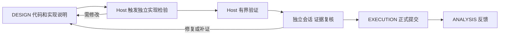

# 代码实现检验机制设计草案

状态：等待用户确认，尚未实施。2026 年 11 月 14 日。

专家 Agent 交付实现代码及工程说明，由独立的代码实现检验者检查正确性、工程合理性和计算效率。Host 自动发起检验，管理实际测试及证据，再按检验结果允许正式执行或退回修复。检验者不承担假设生成、假设成立性、创新性或研究价值判断。

检验模型在 init 阶段通过准确模型名称选择。TUI 和 Web 增加与 Grounding 并列的 Verifier 专用卡片，展示检验者当前工作，并按原专家展开触发、发现的问题、修复及交付情况。配置、调度、记账和展示使用现有机制的扩展，不建立另一套运行状态来源。

原 `goal.execution_checks` 更新已通过 dev `d91fdd3`、main `90f4c19` 回滚。两个回滚提交的文件树分别与原更新的父提交完全一致。本草案只讨论后续方案；确认前不修改运行时、工具协议、研究 Profile 或现有运行。

## 问题与责任边界

已检查的长期研究中，性能指引送达了设计、执行和分析节点，但实现优化没有可靠落实；部分运行参数又被误当成固定研究条件。既有工作流已经要求实际入口检查、小规模试验和性能归因，缺少的是从这些要求到实际执行、证据审查及后续行动的约束。

静态任务检查器只能执行预先给定的检查，要求用户提前定义尚未出现的方法的检验方式，不适合作为本问题的主机制。检查内容应跟随实现产生和修改，其依据是代码声明的计算规则、接口与运行约束、实现变化及当前工作负载。

| 责任 | 承担者 | 产出 |
| --- | --- | --- |
| 交付代码及实现约定 | DESIGN Agent | 实际实现、入口、输入输出约定、自测和未解决问题 |
| 选择检查方法并核查覆盖 | 独立代码实现检验者 | 针对实际代码的检查、反例、边界情况或性能探针 |
| 运行验证并保存原始观察 | Host 和现有 Process 运行设施 | 绑定候选、命令、环境、输入和资源的执行记录 |
| 判断证据是否支持扩大计算 | 独立代码实现检验者 | 工程检查通过、需修改或证据不足的结论及具体依据 |
| 组织修复与正式提交 | EXECUTION Agent | 对审查意见的响应、实际执行安排及未解决限制 |
| 检查遗漏并改进后续方法 | ANALYSIS Agent | 真实运行与验证预测的差异，下一轮待解决问题 |

当前 ACI 25 及后续版本已经在新任务中重建会话，并保留专家身份、工作区和必要记忆。因此，仅把 DESIGN 与 EXECUTION 分成两次调用，不能消除同一研究链的假设和上下文偏差。新增审查需要独立职责及受控输入，而不只是新 session ID。

独立会话可以提供另一轮判断机会，但使用相同基模仍可能出现相同盲点，不能当作独立证明。Host 可以核查执行记录、归属和流程，不能仅凭日志或结构化字段证明任意实现正确，也不能保证检验者总能设计充分的测试。检验通过不构成科研成功或假设成立的证据。

## 与现有机制的对应

| 已有机制 | 当前行为 | 本方案的扩展 |
| --- | --- | --- |
| `bootstrap_inspect.py`、`bootstrap_questions.py` | init 识别缺失项，保留明确回答，支持准确基模名称 | 增加 verifier 模型选择和回答续接，沿用最终启动审阅 |
| `bootstrap.py`、`profile_v4.py` | `model_review` 与实际请求共用 `resolve_node_runtime`，Grounding 有独立模型设置 | 增加检验模型的显式运行覆盖和统一解析，预览与实际请求使用同一结果 |
| `agent_sessions.py`、辅助任务 | 新任务重建会话，部分评审任务无状态；已有受限独立阅读任务 | 显式增加实现检验任务、只读输入和独立会话，不沿用 Grounding 的命令分派 |
| `workflow_host.py`、Process、publication | Host 是调度和状态写入者，保存命令、Attempt 及产物 | 在正式提交前增加有界检验、交付意见和复核阶段 |
| `observer_scope.py`、`observer_summary.py`、`MonitorSnapshot.overview` | Grounding 作为运行级分组，专家活动单独归属 | 增加 `verifier` 分组和被检验专家维度，保持唯一计费归属 |
| `tui.py`、Web `renderGrounding` | 两端读取同一 observer 快照，详情按引用查询 | 并列 Verifier 卡片、逐专家列表及问题详情，复用当前刷新和详情框架 |

当前 `max_active_reviews` 对应 `ANSWER_RENDEZVOUS` 的容量，不是通用检验者并发配置。实现检验会话计入现有普通 Agent、供应商并发与 RPM 限制，实际测试计入 Process 和资源池限制，不能挪用该字段绕开容量。

## init 指定检验模型

运行级角色使用固定的 `verifier` 标识，界面名为“代码实现检验者 / Verifier”。它不加入 `experts.yaml.experts` 的科研专家名册，不增加假设名额，也不参与 Leader 选举。用户在 init 输入的是供应商支持的准确模型 ID，不是角色名称或研究方向。

建议提供以下配置入口，均属于待实现接口：

| 入口 | 用途 |
| --- | --- |
| `experts.yaml.verifier.model`、`effort` | 与 `grounding` 并列的持久配置，可使用不同于研究专家的模型 |
| `bootstrap --verifier-model`、`--verifier-effort`，以及对应的新运行启动参数 | init 本次选择的显式覆盖，已有 Profile 文件保持只读 |
| `effective_configuration.models` 的 verifier 路由 | 展示最终模型、推理预算及每个值的来源，供启动前确认 |

推荐流程如下：

1. init 读取已有 verifier 设置及用户已经给出的本次选择；缺少准确模型时询问“代码实现检验者使用哪个模型？”。可明确选择沿用当前基模，也可输入另一个准确 ID。候选项不自动成为回答，后续 inspect 保留已答选择。
2. 显式启动选择高于 Profile 中的 verifier 设置；仍未选择时，Host 基模只作为待确认建议。新运行不能靠遗漏字段静默关闭检验。推理等级优先使用显式选择，其次 verifier 设置，再使用已展示的通用默认值。
3. 模型由同一解析器用于预览和实际请求。检验路由不读取被检验专家自己的 `model` 或 `stage_overrides`。绑定进检验请求后，模型不能由专家 Agent 或检验者自行更换。
4. 新模板可用现有 `--set` 准备 verifier 配置。已有 Profile 的 `--set` 目前被禁止，需新增显式运行覆盖入口，在内存中形成有效 Profile 文档并经过原接纳器重新编译；覆盖及来源纳入原 CREATE_RUN 记录，不写第二份配置账本。
5. prepare、最终审阅、`--start` 和直接 CLI 创建运行共用该合并与接纳逻辑，重新检查实际配置。最终审阅显示“研究基模 / Grounding / Verifier”及各自来源，防止预览与运行不一致。
6. 沿用现有模型名称、别名、占位符和推理等级校验，并将新路由纳入上下文窗口检查。没有经过真实请求的模型只说明配置有效，不宣称供应商可用或已经验证能力。

此处不会自动选择所谓最强模型，也不会自动升级费用。可以选择更强的检验模型；其检错收益、误报及成本需要在受控案例中确认。首版不新增 TUI/Web 运行中切换检验模型的操作。旧运行保留冻结配置和原有模型路线。

## 独立审查会话

推荐引入按需调用的代码实现检验者，英文名为 Implementation Verifier。它是 Host 管理的辅助任务，不成为常驻监控进程。会话与任务类型需要在方案确认后显式接入；现有独立阅读任务和无状态评审会话可提供实现参考，不能直接假定新角色已经受支持。

Host 为检验者构建输入，包括适用的工程约束、实现说明、实际代码与改动、真实入口及配置、接口和数据结构、自测代码、相关证据和资源预算。不传入完整研究假设、科研贡献论证或专家私有推理历史。若代码声明实现特定公式，交付该公式及必要定义，检查代码是否符合它；不评价选择该公式的科学价值。约定不足时返回明确的缺口，不替专家生成假设。

实际测试后的复核另提供原始日志、测量、失败记录及完整产物索引。检验者可以按引用读取授权范围内的材料，不能只收到专家挑选的摘要或成功结果。假设、组件和链 ID 可作为归属引用保留，不因此授予科研裁定职责。

检验会话不恢复专家 Agent 的会话、不挂载其私有 MEMORY 或未交付的讨论历史。实现定义、接口文档和影响行为的历史事实仍需明确交付，避免为了隔离而丢失必要上下文。专家 Agent 的“已经正确”或“已经优化”作为待核实声明，不成为通过依据。检验者先从实现说明和实际代码形成风险判断，再对照原有自测，减少只按自测清单打勾的倾向；这项方法本身仍需通过缺陷案例评估。

检验范围包括实现是否符合声明的计算规则、检查是否覆盖实际调用和关键边界、检查能否发现所针对的错误，以及性能观察能否支持当前资源安排。检验者可以在独立工作目录编写小测试、反例或性能探针；实际 CPU/GPU 验证通过 Host 提交受限 Process。候选及正式产物对其只读，检验者不改写研究代码、修改 Goal 或递归委托。意见及探针作为独立输出保存，专家负责实现修复。

## 触发、归属与交付闭环

Host 在已交付实现准备进入正式计算时自动建立检验任务，第一次运行和相关实现、入口、配置、数据条件变化均需要新的检验或明确的兼容证据。专家可以请求补充检验，不能自行跳过；Host 检测来源及条件变化，检验者判断其工程影响。尚未检验的代码可以运行被明确限制预算的探针，不能先启动完整训练再补报告。

主触发点放在 EXECUTION 的正式提交边界，复用 `submit_experiment` 对工作区字节和来源的捕获。Host 接收提交意图后先组织检验，未满足条件时不启动完整工作。DESIGN 的交付可以提前检查，但正式提交时仍核对实际源码、命令和相关输入；EXECUTION 修改了实现后，不能沿用旧版本的通过结论。等待检验和意见交付需要扩展现有 handoff 协议，不假定当前工具已经提供这种行为。

检验任务复用现有来源身份，关联 `run_id`、原专家稳定标识、组件、研究链、交付命令、候选源码/补丁、实际入口、配置与数据引用。正式计算尚未创建时不伪造实验 ID；创建后补充实际关系。独立检验角色是执行者，原专家是被检验对象，两者分别记录。

同一逻辑请求的传输重试或 Host 恢复不形成新的触发。一次交付中的修复保留交付链与问题引用，新版本关联下一次检验；真正的新交付另建来源。没有语义变化的兼容重复执行可以复用，界面单独显示复用次数，不把它算作新的完整检验。

| 环节 | 可观察证据 | 不能据此宣称 |
| --- | --- | --- |
| 报告已生成 | 检验 Attempt 完成且报告已经发布 | 专家已经看到或理解 |
| 已交付专家 | 报告引用进入该专家的实际任务输入 | 专家已经修复 |
| 专家已响应 | 已接纳响应引用问题并说明修改、异议或所缺证据 | 修改已经有效 |
| 修复待复核 | 新候选版本或补充证据已提交 | 原问题已经解决 |
| 已验证解决 | 独立检验结果将具体问题关闭并引用修复证据 | 整个研究假设成立 |

这与 Grounding 的 sharing 证据边界一致：加入输入是交付事实，不是理解或采纳事实。报告未能交付、专家等待恢复、已响应但未复核应分别展示。

问题使用“首次产生的已发布报告引用 + 条目身份”作为稳定来源，后续响应和复核显式引用它。状态可为待响应、修复中、待复核、已解决、撤销或重新打开；撤销必须保留原意见及撤销依据。不同报告中重复出现的问题通过明确的延续关系关联，不用相似文本自动合并，也不增加全局问题哈希库。

每个问题包含类型、阻断或建议等级、工程现象、位置、证据、影响条件及可检验的解除条件。问题“在某专家交付中发现”不等于“由该专家引入”；共享代码、Grounding 产物或其他授权依赖导致的问题保留实际来源及未知归因。

每条需要阻止扩大执行的意见必须给出候选版本、源位置或证据引用、具体失败条件或关键覆盖缺口，以及可检验的解除条件。一般性能建议与阻断项分开。审查者不能因偏好另一种架构或认为新思路“不熟悉”而否决研究，也不决定科学成功或否证。

作者有异议时提交推导、修正或新证据，保留原问题并进行有限复核，不允许自己清除阻断项。额度用尽仍有关键问题时，保留未解决状态，停止扩大本次执行；不无限争辩，也不把审查分歧自动解释成科研否证。

## 推荐的执行流程

1. **DESIGN 交付代码和实现说明。** 说明入口、计算规则、接口、变化、自测和未知项，作为检验输入而非检验通过结论。
2. **Host 触发独立实现检验。** 检验者自行检查实际入口和实现，选择检查与有界探针；作者自测可作参考，不能限定检验范围。
3. **Host 完成技术验证阶段并交还证据。** 使用实际提交的代码和环境，记录命令、退出状态、日志、原始测量及产物。此时不运行完整科研预算，也不产生科研成功或否证。需要 GPU 的验证仍由 Host 分配资源。
4. **独立会话复核返回证据。** 不能仅转述检查脚本的布尔结果；需要解释正确性依据、失败敏感性、效率观察、预计成本与覆盖缺口。复核读取已交付的计划审查问题和本次原始记录，不继承作者的执行对话。计划通过不自动意味着证据通过。
5. **EXECUTION 响应审查，Host 控制扩大。** 正式运行必须使用审查对应的候选与适用条件。已观察到的正确性失败需要修复并验证；缺少关键证据时只能补充有限工作或停止。可接受的性能取舍允许继续，但必须说明依据。
6. **ANALYSIS 核对实际表现。** 将正式运行暴露的入口差异、尺度问题、效率偏差及审查漏检送回下一轮。科研负结果、实现错误与效率不足分别处理。



验证和正式运行之间释放 Process 及 GPU 配额，Agent 使用现有 handoff 恢复，不占着 GPU 等待模型判断。重新分配设备后的轻量环境检查仍然必要；性能记录必须说明实测设备及共享条件，不能假定两次分配的吞吐相同。

## 随候选生成的验证内容

检验者形成或修订的计划至少回答以下问题，专家已有自测作为输入。字段表示通用责任，不固定测试类型、函数名或期望研究结论。

| 内容 | 需要说明的问题 |
| --- | --- |
| 实际工作 | 哪个入口、哪些分支和输入规模会执行？改动涉及哪些路径？ |
| 正确性依据 | 应满足哪些本次方法的性质？依据来自推导、手算样例、参考实现、数据约束还是已有证据？ |
| 检查的检错能力 | 什么具体错误应被发现？用何种反例、边界情况或其他独立依据确认检查有意义？ |
| 效率问题 | 哪一阶段的时间或资源成本不确定？怎样获得有单位、有工作量口径的观察？ |
| 决策与预算 | 哪些结果要求修复？哪些允许带着明确限制继续？验证最多花多少计算和 Agent 预算？ |
| 复用与未知项 | 引用了哪些已发布记录？为什么适用？哪些关键路径仍未覆盖？ |

不同研究使用不同检查。例如，等价工程改写可以比较输出和梯度；新的损失定义可以使用手算样例、数值梯度及边界性质；求解器可以检查残差和已知解；数据流程可以检查行数、单位、划分及保存重载一致性。新方法不需要与旧方法的目标函数或数值结果相同。

检查要接入正式工作选择的实现，包括必要的子类、实例覆盖、注册分支、配置解析和产物消费路径。验证代码与正式代码可以有不同的规模参数，但必须明确差别；Host 复用现有源文件和产物引用核对关联，独立审查者核查语义上的覆盖。只看某个函数存在或一个配置标志不能确立覆盖。

有意义的反例或独立依据由方法决定，不要求所有问题机械进行同一种故障注入。无法提供时应说明原因及替代证据；“没有可用参考实现”不能自动成为不做正确性检查的理由。

## 正确性与效率的不同决定

| 观察 | 后续行动 |
| --- | --- |
| 已执行检查发现实现违反本次声明的性质 | 修复后验证受影响路径，阻止该实现扩大运行 |
| 检查没有覆盖关键路径或执行证据缺失 | 保持未验证状态，补充有界工作或在预算内停止 |
| 已测瓶颈有可行的工程修复 | 保持研究语义，验证修复的正确性及成本收益 |
| 方法较慢，但成本可承受且有研究价值 | 记录原因、剩余成本和取舍，允许继续 |
| 短程吞吐不足以预测大规模或收敛成本 | 报告范围与不确定性，可先进行更有代表性的有限验证 |
| 科研指标未达到预期 | 交由原科研测量与分析流程判断，不当作验证设施失败 |

初版不设统一加速倍数、GPU 利用率、worker 数或“必须向量化”规则。效率验证首先要求测量与判断，允许“不改动”成为合理结论。改变损失定义、精度、batch 或停止规则是否属于科学变化，依据当前研究协议判断，不能为了加速默默改写已经接受的比较条件。

检查失败后修改检查本身，需要保留原检查及失败证据，解释原预期为何错误，并补充支持修改的依据。不能仅放宽阈值把失败改成通过；本次实验已接受的科研测量与最终目标仍由原流程管理。

## 长期运行中的成本与复用

每次提交都说明验证状态，但不要求每个 seed、每轮调用都重复整套探测。已有证据可以复用，前提是相关实现、配置、数据条件、环境和规模范围仍适用。依据使用现有源码版本、提交捕获、产物引用及授权读取范围，不建立全局“验证通过”缓存。

普通 seed 重复可以复用接口及基本数值检查，但随机性是已知风险时需要相应覆盖。更改模型结构、损失定义、分派路径、输入规模或精度时，重新检查受影响部分。旧的小规模性能证据不能无条件覆盖更大的内存需求或不同计算复杂度。

Agent 为每次验证给出时间、样本或迭代上限，并解释相对完整实验成本是否合理。Host 用已有资源、Process 和运行总预算约束实际消耗；默认上限应在实现验证时按这些预算确定，方案不先写死为所有任务统一的分钟数。补充验证及修复必须有有限次数，不能通过创建新的验证请求绕过原有额度。

首次候选或实质变化默认需要实现检查与探针规划、执行结果复核两个独立任务，实际 token、时间及调用费用均计入运行预算和 Agent 容量。它们按现有节点机制使用新会话，显式交付必要的前次检验记录，不跨候选积累私有检验记忆。复核等待期间交还容量，正常 handoff 不误计为故障重试，故障修复仍服从已有有限额度。

调度按被检验专家轮转，单个专家的连续修复不能无限占用检验服务。检验者不占科研专家名额，但实际会话仍占普通 Agent 和供应商容量；等待 Process 时释放会话，等待模型时不占 GPU。检验费用单独归入运行级 verifier 分项，原专家的修复调用归原专家。按专家展示“关联检验成本”只是分解同一账单，不能再次加入运行总额，也不把 provider 故障直接计为专家交付缺陷。

兼容的 seed 重复和未改变覆盖条件的执行复用已发布审查结论，避免每次重开两轮审查。变更影响不明确或证据不足时再发起有界复核。初版不常驻监控、不叠加多位审查者投票；成本收益需要实际测量，不能把独立调用当作免费改进。

短小、低成本的工作也要说明适用的检查，但可以用实际执行本身完成验证，条件是 Host 限制该阶段预算，不允许以“轻量任务”的声明直接运行完整昂贵实验。正式阶段有未覆盖的非关键限制时可记录后继续；关键实现错误不能以效率理由豁免。

验证子进程与正式工作隔离随机数、采样器和模型状态；检查不提前消费正式数据迭代器。按研究协议使用允许的数据，不使用保留测试集来选择实现或性能配置。

## TUI 和 Web 的 Verifier 卡片

两端在 Grounding 卡片之后、科研专家列表之前展示独立 Verifier 卡片。Grounding 是一次运行的准备阶段，Verifier 在整次运行中持续待命；一次检验结束后显示待命，不能直接复制 Grounding 的永久 DONE 语义。模型已配置但尚无任务显示待命，旧运行没有该机制显示“旧运行未启用”，缺失的历史数据不得画成零次问题或百分之百通过。

卡片至少包含以下信息：

| 区域 | 内容 |
| --- | --- |
| 身份与配置 | 代码实现检验者、init 选择的模型和推理等级、实际执行模型的可用观察 |
| 当前工作 | 正在检验哪个专家的哪次交付、源码版本、计划检查/探针执行/证据复核阶段、已用时间 |
| 队列与限制 | 排队、活动任务、等待专家、等待资源、供应商冷却或预算不足，明确原因 |
| 资源与费用 | verifier 自身的 RPM、token、已知费用、检验 Process 用时；未知值和下界沿用现有表示 |
| 逐专家汇总 | 交付数、检验触发数、复用数、首次通过分子/分母、未解决阻断、待复核及最新结果 |
| 详情入口 | 按专家查看交付链、问题、响应与复核；打开实际 Attempt、日志和代码证据 |

以下为布局示意，数字不代表真实运行：

```text
代码实现检验者 Verifier                       审查中
模型：<init 选择的准确模型 ID>    推理：high
当前：专家 A · 交付 7 · 证据复核             1m 12s
排队 2 · 待专家响应 1 · 未解决阻断 3

专家       交付/检验   首次通过    需修复   待复核
专家 A       4 / 6      2 / 3        1        0
专家 B       3 / 4      2 / 2        0        1

专家 / 阶段 / 状态筛选       交付详情 · 问题 · 历史
```

TUI 的 `ExpertsPanel` 插入同类 Rich Panel，保留现有滚动与内容相等检查；逐专家明细通过现有详情选择入口进入，不在主卡片展开全部历史。全局总数与角色筛选后的数字明确标注，专家很多时分页并显示总数。普通专家卡片增加一行“检验状态 / 当前阻断 / 最近交付”，跳转到同一份详情。

Web 在 Grounding panel 邻近增加 Verifier panel，复用 `workingTile`、状态与费用组件。逐专家列表可展开交付、问题和修复时间线，链接到现有 Attempt/log 详情。保留已展开项、焦点和滚动；新增文案进入共享中英文字典，状态同时有文字与颜色。

现有 `renderGrounding` 会清理 `role === null` 的工作 tile；新增运行级分组后应按实际分组和 Attempt 身份维护，防止 Grounding 刷新删除 Verifier tile。Host 未响应、状态过期时沿用 `OPEN?` 与快照时间，不能把持久 OPEN 记录直接画成确认运行。

卡片首版为只读观察，不提供手工伪造通过、清除问题或更换模型的按钮。需要取消运行时继续使用现有受授权控制流程。

## 逐专家的交付分析

“交付分析”评价工程交付和响应情况，不评价科学假设、创新性或科研胜负。报告应能逐项回到源码、检验记录和专家响应，采用以下明确口径：

| 指标 | 口径 |
| --- | --- |
| 交付数 | 不同交付链，修复版本和同一任务的 API 重试不增加交付数 |
| 检验触发数 | Host 实际接纳的逻辑检验次数，区分初检、条件变化和修复复核；与模型调用次数分开 |
| 首次通过 | 首个版本完成完整初检且无阻断的交付数 / 已获得首轮完整工程结论的交付数；仅计划通过不计入。等待、供应商失败和证据不足另列，不计作通过或代码失败 |
| 当前问题 | 按稳定问题引用计算未解决阻断与建议，连续复核不重复新增同一个问题 |
| 响应和闭环 | 报告生成、实际交付、专家响应、修复提交、独立关闭分别计时；排队和外部故障单列 |
| 修复轮次 | 专家实际提交的修复版本次数，不以 Agent Attempt 或工具调用次数代替 |
| 重复问题 | 有明确延续或重新打开关系的问题；仅文字相似不算同一缺陷 |
| 成本 | 原专家修复消耗与其关联的 verifier/探针消耗分别展示；汇总不重复计费 |

每个专家可查看一段来自当前统计与已发布检验报告的交付摘要，例如“最近 6 次交付中 3 次首次通过，2 次经修复通过，1 次仍有输入掩码问题待复核”。只在样本确实支持时生成这类描述，显示观察窗口和来源。不设不透明综合分、不按问题数量自动淘汰专家或修改其 Leader 资格。

界面刷新不调用模型来重新评价专家。确定性的计数、状态和时间线来自 observer 投影，语义性问题说明来自已发布的检验报告；二者都只呈现已有证据。

## 记录与共享观察投影

候选、检验计划、探针运行、检验结论、专家响应和复核继续使用现有命令、Agent/Process Attempt、产物发布及来源引用。必要的任务类型和结构化结果随协议版本显式加入，单一接纳器负责字段和归属校验，Oracle 独立核对顺序与来源。问题状态从这些已接纳记录派生，不维护独立的可写问题数据库或前端状态真相。

建议 `MonitorSnapshot.overview` 增加 `verifier`，包含 `state`、有效模型配置、当前工作、队列原因、费用、总计及 `by_expert` 汇总。运行级 `run_group=verifier` 表示真正执行者，`subject_expert` 等来源字段表示关联专家。`observer_scope` 通过明确的检验任务身份和来源归属解析，不能靠角色名包含 verifier 来猜测，也不能同时把一次调用算作全局和专家费用。

逐专家交付、检验和问题详情扩展 `observer_details` 的白名单种类及选择器，复用 Web `/api/details` 和 TUI 详情入口。请求只能引用本次运行内授权的交付、问题、Attempt 与产物，不能传任意路径。扩展两端相同的分页、缺失、旧版本和错误语义，不让两套 UI 分别推断检验结果。

运行数周后，卡片仍只读取有界摘要，历史明细分页。统计从已接受的结构化记录生成，复用现有修订缓存、observer worker 和共同刷新服务，不在每次轮询中扫描完整会话或重新执行 Oracle。缓存带来源修订和观察时间，可以丢弃重建，不获得裁定权。需要新增索引时依据实际查询与性能测量决定，不先增加持久化计数账本。

## 框架需要增加的最小约束

当前主要故障发生在“准备完成”到“消耗完整实验预算”的边界：指引送达不等于检查执行，脚本成功也不等于结果经过审查。Git 能确定版本，主键和事务能避免重复提交，类型及普通测试能验证接口，但不能使一个未发生的研究检查自动发生。

因此建议增加的约束是：**正式扩大执行必须具有与当前候选匹配的验证证据及独立审查结论，或有仍适用的已发布证据、审查结论和本次复用判断。** 内容由研究 Agent 和独立审查者动态形成，Host 执行流程约束。作者不能把自己的声明写成审查通过记录。固定这一责任不会固定未来的研究方向。

验证应成为现有 EXECUTION 节点中的技术阶段，独立审查复用现有辅助任务和 Agent Attempt 机制；各自复用资源 broker、日志发布、artifact 引用与 handoff。技术验证不能伪装成带虚构科研指标的 LOCAL 实验，也不能通过故意失败来获取后续修复机会。验证、审查与正式计算的预算都计入实际运行开销；不增加独立数据库、外部验证服务或第二个科研裁定器。

这需要显式扩展现有执行请求、阶段转换及恢复审计。当前流程主要围绕一次提交的工作及其科学解析器展开，不能把多阶段恢复视为已经具备。具体工具字段与生命周期转换在方案确认后的实现设计中确定，并通过对应版本与 Oracle 同步验证；不在本草案中提供看似可用的 Profile 字段。

需要防止的流程错误包括：未提交验证计划、未实际运行验证、作者伪造审查来源、审查引用错误的候选、使用已过期的覆盖结论、阶段完成后重复执行，以及超时取消后残留子进程。结构化记录不代替语义审查；一个总是返回成功的候选脚本仍需要审查者通过代码和证据识别，Host 不应声称能通用地识别所有这种情况。

维护成本主要在多阶段调度、审查会话的输入和工具隔离、handoff、预算归属、恢复与审计，而不在算法专用检查库。如果既有执行计划将来原生支持相同的阶段、审查和源绑定，应合并到该机制中，移除重复约束。

## 首版范围与实现位置

首版覆盖新运行的 init 模型选择、代码交付、独立实现检验、Host 有界测试、修复复核，以及 TUI/Web 专用卡片与逐专家交付分析，支持 CPU 及 Host 授权的 GPU。Profile 的科研目标保持原职责，新增角色配置只描述检验模型及其运行参数。已有运行保持冻结；本次不启动、恢复或迁移研究任务。

| 现有位置 | 预计变化 |
| --- | --- |
| `agent_aci.py`、`host_tools_server.py`、`full_cc_runtime.py` | 随候选提交验证安排，交付技术证据，表达审查与复用决定 |
| `bootstrap*`、`profile_v4.py`、Profile 接纳与 CLI、autoresearch init 指引 | 选择 verifier 准确模型、显式运行覆盖、同源生效预览及启动接纳 |
| `workflow_host.py`、生命周期定义及恢复逻辑 | 顺序执行技术阶段与正式阶段，有限 handoff，正确记录阶段完成与下一步 |
| `execution_workspace.py`、现有 Process 运行和发布设施 | 捕获候选、隔离工作目录、执行预算、保留原始观察及实际资源条件 |
| `agent_context.py`、`workflow_guidance.py`、研究工作流参考文档 | 让各阶段读取所需源文件、计划、证据和未解决问题 |
| `agent_sessions.py`、辅助任务分派及能力定义 | 独立审查会话，不继承作者私有上下文，明确只读源与受限探针权限 |
| `agent_budget.py`、调度与资源分配 | 普通 Agent/Process 容量，有限检验次数，独立费用与专家关联，公平排队 |
| `observer_scope.py`、`observer_summary.py`、`observer_details.py`、`monitor.py` | 运行级 verifier 分组、交付/问题归属、共用统计及分页详情 |
| `tui.py`、`web_observer.py`、Web assets 及共享语言资源 | Grounding 旁的专用卡片、逐专家状态与详情、过期和未知状态、中英文一致展示 |
| `oracle.py` 与相关执行审计 | 独立核对阶段归属、源关联、决策顺序及终止残留 |

不恢复静态 `goal.execution_checks`，不引入 MERC 专用判断，不设置统一的性能成功标准。高级自动 profiler、持续在线调优、跨运行知识库及多审查者投票留待真实需求再决定。init 指定模型也不等于已经证明检验能力，需要相应验证。

## 实施后的验收

1. 使用此前不存在的新损失实现与一个非训练类计算任务，验证检验者能提出不同的工程检查，框架不要求旧方法接口或数值等价；检验者不输出假设成立性或科研价值结论。
2. 覆盖已知错误、错误参考、只测基类而正式运行使用覆盖方法、只有声明没有执行、空证据和过期证据；检验相应审查和执行约束。脚本化 Agent 能验证流程，真实 Agent 的检错能力需要另行有界评估，不能混报。
3. 验证“正确但较慢、理由充分”可以继续，“已发现实现错误”不能扩大；效率不足不会自动成为科研否证。
4. 覆盖兼容证据复用以及代码、配置、精度和规模变化后的必要重验，确认没有重复完整基线训练。
5. 在真实 Host、broker、Process 和发布链路中测试阶段交接、崩溃恢复、取消、超时和有限修复；独立核对执行次数、所有权与残留。
6. 验证审查者没有恢复作者会话或读取其私有记忆，能读取决定所需的真实源与原始记录；作者不能代写通过结论，审查者不能改写研究实现或直接运行完整实验。
7. 使用有已知缺陷和正确实现的有界案例，比较作者自审与独立会话审查的检错、误报和成本。保留未检出的错误；不得以脚本化审查测试声称基模审查能力已经提高。真实模型评估在实施阶段明确预算后执行。
8. 测量新增 Agent 调用、验证时间及资源开销，检查方法能否以可接受成本减少无效长任务。单次短测不宣称周级稳定性。
9. init 的模型选择在多轮 inspect、prepare、最终审阅和实际 Agent 请求中保持一致，覆盖显式选择、已有 Profile、新模板、缺失选择、非法模型名、直接 CLI 和只读预览；已有 Profile 文件及旧运行保持不变。
10. TUI 和 Web 从同一夹具得到一致的逐专家触发、问题与交付统计；覆盖两位以上专家、共享依赖问题、重复请求、修复再检、复用、旧版缺失、零样本、Host 断联和过期快照。Verifier 调用不得归入其他全局任务或重复计费。
11. 验证“报告生成但尚未交付”“已交付但未响应”“修复已提交但未复核”在 UI 中可区分；来源不能跨专家串线，报告可追溯到实际源码和日志。检查 Web 的工作 tile 不被 Grounding 刷新清理，以及 TUI 筛选、分页、滚动和两端语言展示。
12. 用接近周级运行规模的结构化历史检查 observer 刷新、详情分页和 Host 控制响应，确认不会逐次重扫长会话。按既有 G0–G5 要求完成适用验证，再考虑发布。实现与发布服从用户确认后的范围。

## 待确认的推荐方案

Host 自动触发按需的代码实现检验，检验者使用 init 指定的准确模型，独立制定工程检查并复核 Host 执行的实际证据，专家负责修复。检验者不承担假设相关任务。TUI/Web 提供 Grounding 同级的 Verifier 卡片，以同一数据投影展示逐专家触发、问题、响应及修复交付情况。初版以复用和局部重验控制成本，不要求用户维护算法专用检查器。

用户确认本方案后才开始运行时实现。本次交付是精确回滚和可审阅设计。

## 相关依据

- [现有实现指引](../../hypoloom/skills/research-workflow/references/implementation.md)
- [现有性能审查指引](../../hypoloom/skills/research-workflow/references/performance.md)
- [现有增量执行与复用](../../hypoloom/skills/research-workflow/references/incremental-execution.md)
- [框架架构](../architecture.md)
- [会话与上下文边界](../guides/context-management.zh-CN.md)
- [初始化与生效配置](../guides/initialization.zh-CN.md)
- [init 模型预览与启动](../../hypoloom/bootstrap.py)
- [模型与节点配置解析](../../hypoloom/profile_v4.py)
- [观察归属](../../hypoloom/observer_scope.py) / [共享运行摘要](../../hypoloom/observer_summary.py)
- [TUI 专家卡片](../../hypoloom/tui.py) / [Web 卡片](../../hypoloom/web_observer_assets/app.js)
- [回滚验证记录](../qualification.md#execution-checks-rollback-2026-11-14)
