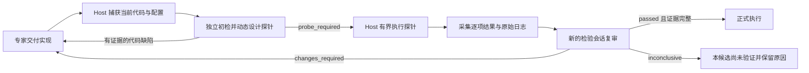

# 代码实现检验者的可靠性与效率优化方案

状态：用户于 2026 年 11 月 14 日批准实施 P0 和 P1，现已完成实现与工程验证；真实模型付费资格测试仍为后续单独步骤。以下保留设计依据，并记录实际实现选择与验证边界。

优化目标是提高每次检验产生可用工程结论的概率，并降低模型调用、无效检索和无效修复的开销。检查内容继续由独立检验者根据当前实现动态决定；框架负责明确输入、执行探针、验证证据和控制资源。用户不需要为未来算法编写 `execution_checks`。

## 依据与问题归因

[Flash 作者与 Pro 检验者实测](../qualification.md#flash-author-and-pro-verifier-samples-2026-11-14)中，一个 Flash 交付通过独立 CPU 检查；Pro 能识别人为注入的梯度断开。简化输入实验完成了初检、真实探针和独立复审，但没有通过完整的生产原生调用路径。较早的[直接 CC 测试](../qualification.md#direct-cc-verifier-capability-samples-2026-11-14)也出现了发现缺陷却无法交付合法报告的情况。

这些结果支持优先优化框架与模型之间的接口。它们还不能给出两个模型的总体检错率，也不能把复杂任务超时解释为作者缺少向量化能力。

| 已有证据 | 可以确定的问题 | 优化决定 |
| --- | --- | --- |
| 原生 Pro 调用两次约 301 秒截止；简化初检约 130 秒、复审约 26 秒 | 当前调用开销较大；实验同时改变多个因素，不能单独归因于提示长度或 effort | 保留原生链路，拆分变量做对照 |
| 检验者搜索 `/workspace`、不存在的 `/input` 和 `/runtime`，源码实际上已内联 | 审查会话与探针环境说明混淆，增加无效检索 | 显式说明两个环境，提供准确文件位置 |
| 原生报告使用错误 `resolved_refs`、同时返回 `changes_required` 和 probe | JSON 形状约束未充分传达跨字段语义 | 从既有合同生成阶段规则和纠错信息 |
| 测试请求遗漏 `output_correction`，实际失败校验上限为 1 | 测试未覆盖模板配置的纠错机会 | 用真实 Profile 编译器和节点解析器构造测试 |
| 静态核对发现提示仅允许 `supporting_refs` 使用别名，schema 与解析器同时处理 `evidence_refs` | 提示与实际协议存在冲突 | 统一别名规则及其提示来源 |
| 探针打印多个 FAIL 却退出 0；缺失梯度引起 TypeError | 返回码不能表达逐项检查结果，探针错误和代码错误易混淆 | 增加通用断言记录与完整性校验 |
| 复审声称全面覆盖、引用不准确行号，实际只测试部分 CPU 条件 | 结论范围与证据范围没有明确对应 | 报告列明已测、未测、阻断性缺口及源码位置 |

180 或 300 秒是相关测试的调用预算；当前模板的 `agent_invocation.wall_seconds` 为 600。不能将测试超时率直接当作生产超时率。模板 `max_failed_validations: 3` 表示第三次失败结束校验机会，并不表示初次失败后再额外重试三次。

## 责任与执行流程

沿用[独立实现检验机制](dynamic-experiment-verification.md)的边界：Host 自动触发，作者专家修复候选，检验者使用 init 指定的准确模型名称。初检和证据复审使用两个新的临时会话。输入包括捕获代码、接口及计算规则说明、入口、配置、资源条件和本轮相关证据，不包含作者的私有推理、会话记忆或假设价值评价。



语法、引用和报告字段错误继续在同一次 Agent Attempt 内通过 Stop hook 纠正。代码缺陷、验证工具故障和供应商故障分别记录；没有工程通过结论时，本候选不进入正式计算，但其他可调度任务继续按已有策略推进。

## 第一阶段 原生调用与报告协议

### 精简检验会话输入

在 `full_cc_runtime.py` 中为 `VERIFY_IMPLEMENTATION` 使用专用的简短系统指令，替换通用编程助手的任务说明。继续经过 `ClaudeAgentHost`、`AgentSessions`、只读工具授权、原生 AgentResponse 包装、Stop hook、provider relay 和统一记账。简化实验中绕过原生包装的直接报告方式仅作为对照，不成为另一条生产客户端。

提示按 inspect 和 review 分开。初检关注实际入口、实现约定及动态探针；复审关注当前源码、原探针、执行观察和需要解决的问题。既有 schema 与语义校验器仍是报告的唯一接纳依据。

文件说明使用已有的输入呈现结果生成：

- 审查会话的小源码直接内联；大输入保留准确的只读 `/inputs/NNNN.txt` 地址、内容类型和文件索引。不得把 JSON 容器地址描述成可导入的 Python 源文件。
- `/input` 是之后的 Process 探针环境。审查者无须在当前会话搜索它，也不需要搜索运行时来发现代码。
- 所需依赖必须有明确的已授权输入或挂载；缺失时记录证据缺口。保留现有只读工具和输入体积上限，不通过静默裁剪改变检验范围。
- 提供由捕获源码生成的带行号视图。持久引用仍使用已有输入引用和文件路径，不新增源码身份或摘要。行号只帮助定位，复审需要检查被引代码是否支持结论。

### 统一报告规则和纠错

在 `verification_contract.py` 中集中产生阶段提示、引用说明和可表达的 schema 约束；语义规则仍由 `validate_review` 执行。修正 `_prompt` 与 `reference_aliases.py` 的说明冲突，并回归其他任务的引用行为。

| 字段或决定 | 必须传达的规则 |
| --- | --- |
| `supporting_refs`、`findings[].evidence_refs` | 使用当前请求提供的 R 别名，接受时由既有解析器恢复完整输入引用 |
| `resolved_refs`、`followup_of` | 只引用提供的历史 `report_ref#finding_id`；没有历史问题时分别为 `[]` 和 `null` |
| `changes_required` | 至少一个有证据的 blocker，`probe` 必须为 null |
| `probe_required` | 提供合法探针；初期只允许在 inspect 阶段返回 |
| `passed` | 只允许 review；需要当前有效执行证据，并明确解决相关历史 blocker |
| 探针文件和入口 | 使用 `verification/` 下的新文件，argv 直接以 `python` 调用其入口；不得覆盖候选文件 |

能用当前 CC 支持的 schema 表达的约束直接收窄，例如按阶段给定 verdict 集合、按请求给定历史问题引用。跨字段规则和 CC 不支持的 schema 表达由同一个语义校验器处理；不增加旁路验证器，也不通过补字段或改 verdict 自动修复模型结论。

校验错误返回具体字段、当前值违反的规则及合法引用来源。例如：`resolved_refs 只能引用此前的问题；本请求没有历史问题，应为 []`。同一组独立错误可有界汇总，避免每轮只修一个字段。schema 不合法时先报结构错误，避免级联噪声；提示不得替模型选择通过或阻断结论。

测试统一使用实际 Profile 编译结果和 `resolve_node_runtime`，确认模型、effort、上下文、预算以及 `output_correction` 均与原生请求一致。测试显式覆盖第一次拒绝后修正成功、第三次仍错误终止、剩余时间或 token 不足提前结束。所有修正共享原 Attempt 的 deadline、turn、token 和费用限制。

### 配置与真实请求保持一致

第一阶段继续使用已有配置，不增加算法检查项。下列仅是下一轮资格测试的候选基线，不能从一次成功样本推导为所有科研任务的默认值：

```yaml
# experts.yaml；实际专家及阶段覆盖仍由现有解析器决定
defaults:
  model: mimo-v2.6-flash
  effort: medium
verifier:
  model: mimo-v2.6-pro
  effort: low
```

`methodology.yaml.output_correction.max_failed_validations: 3` 沿用模板。init 已有的 verifier 模型和 effort 选择继续使用同一解析器；本设计不修改私有 Profile 或已冻结运行。

在已有 provider diagnostics 中归纳“配置要求、实际发送、可观测响应”三层信息：模型、effort、wire `max_tokens`、thinking 参数是否发送、生成是否因上限停止、耗时和可观测 usage。复用 relay 已有的模型及 effort 核验，不新建能力目录或另一份费用账本。

`AgentBudget.max_tokens` 是调用累计预算，不等于单次生成的 wire `max_tokens`。第一阶段不把实验用环境变量开放成任意透传配置，也不承诺第三方模型遵守 Claude 专用 thinking 开关。省略 thinking 参数只能记为“未发送”，不能显示“已关闭推理”。降低输出上限可能引发截断与续写，必须结合完整报告率评估。

单次生成上限如需产品化，作为后续独立变更接入同一个节点运行参数解析和 relay 核验；先确认目标 CC 版本及供应商的实际行为。本轮不新增 `thinking_budget` 或自动升档模型，不自动提高调用预算。

## 第二阶段 动态探针与证据复审

### 通用检查记录

扩展现有 `probe` 报告，而不是 Profile：检验者为当前代码返回动态 `checks`，每项包含局部 `id`、目的、判据依据、类型（断言或测量）和是否为本次通过所必需。判据可以来自接口约定、独立手算、数学性质或实现不变量；存在歧义的推断需要标明，不能直接把旧算法当作新算法的正确答案。

建议初始上限为 32 项，沿用现有最多 8 个文件、256 KiB 源码及 120 秒探针上限。每次计划至少包含一项必需的实现断言。检查内容、输入分布、尺度和容差仍由检验者决定，没有预置的损失函数、模型结构或向量化合格线。

框架通过已有 `trusted_workspace_files` 和 `ExecutionWorkspace` 注入只读的小型 runner 与检查辅助库。辅助库提供通用的相等、近似、条件断言和计时记录，不引入算法测试包依赖。执行仍是 Host 管理的普通 Process，使用捕获实现、现有环境与资源授权。

- 检验者用断言接口提交实际值、期望值和容差，helper 计算结果；只打印 PASS 或 FAIL 不构成检查证据。
- runner 根据预先声明的 ID 记录开始与结束。断言检查没有执行任何断言时不能记为通过；缺失、重复或未声明的检查 ID 不能组成完整证据。
- 断言不满足记录 FAIL；意外异常记录 ERROR 及原始堆栈；未执行记录 NOT_RUN。一次检查已记录的断言失败不能被后续成功覆盖，捕获异常也不能清除该记录。缺失梯度等情形由动态探针先做明确条件断言，避免继续算差值时只留下 TypeError。
- 测量成功只表示测量完成，记录实测值和单位；不等于实现正确或速度达标。热身、重复次数、负载、计时范围及 GPU 同步方式由探针显式提供并接受复审。
- helper 在 `/output` 写入有界结果；Host 在已有 probe observation 中采集、校验并引用原始结果及 stdout/stderr。建议单次结构化结果上限 64 KiB；数据超限或末尾不完整不能通过截断补成完整证据。

结果由已有 Attempt、probe 报告引用和捕获提交绑定；不增加另一套通过文件、签名或数据库。正常路径中 FAIL/ERROR 对应非零退出；Host 同时核对逐项结果和进程状态，因此“返回 0 但必需检查失败”仍不能通过。进程被杀、提前退出、结果丢失或状态冲突都保留原始观察并标为不完整。

相应修改 `verification.inputs()` 的 `probe_evidence.usable`：当前的“成功 Process 加非空 stdout”判据需要纳入上述绑定、实际启动、终态和逐项证据完整性检查。stdout 保留为辅助原始证据；一段看似成功的文本不能代替有效的检查结果。

该机制防止意外漏报、空检查和错误汇总，不能证明任意测试逻辑有意义。即使每个断言都执行过，也可能比较了错误对象。因此新的复审会话必须同时看到探针代码、候选代码和实际结果，判断检查是否真正针对声明的风险。

### 将结论绑定到覆盖范围

在检验报告中增加 `coverage`，列明已覆盖条件及其检查 ID、未覆盖条件、阻断性证据缺口。Host 能校验检查 ID 存在、已执行、必需项完成且无失败，以及报告没有忽略已知 blocker；覆盖是否足够仍由检验者依据实现及当前正式运行条件判断。

复审读取实际原始证据，初检意见仅作为待复核内容。以下区别必须在报告及界面保留：

| 结果 | 正式执行决定与归属 |
| --- | --- |
| 验证了实现违反声明的计算或接口规则 | `changes_required`，关联作者及准确代码证据 |
| 探针使用错误输入、参考值或调用方法 | `inconclusive`，记录验证问题；不作为作者已证实缺陷 |
| 超时、provider 错误、报告协议失败 | 记录已有基础设施或输出失败原因；不作为科研否证或专家代码缺陷 |
| 必需检查失败、未执行，或关键环境未覆盖 | 不接纳 `passed`；FAIL 是发现问题的证据，ERROR 本身不能确定责任 |
| 证据充分且无未解决 blocker | `passed`，保留具体覆盖范围；CPU 小规模通过不能表述为任意 CUDA、大规模训练均已验证 |
| 仅有可改进的性能或风格问题 | advisory；只有实测证明当前资源安排不可行时才作为阻断依据 |

必需检查失败后，复审可以说明探针本身有误并返回 `inconclusive`，不能把该失败忽略后直接通过。未执行的可选检查须解释影响；会影响当前正式运行正确性的缺口必须提升为阻断性缺口。

性能结论需要对应实际入口和工作负载。声明前向加反向耗时时，探针代码必须真的执行这两个阶段；声明改善比例时需要可比的实测参照。新的研究方法不必与旧方法数值等价，也不要求每个 Python 循环都被删除。框架记录实际时序与资源，检验者判断热点和取舍。

### 新增机制的边界与成本

| 项目 | 最小增量及理由 |
| --- | --- |
| 可复现故障 | 错误归约探针输出多个 FAIL 但退出 0；无梯度探针异常退出；复审扩大通过范围。可能让有问题的代码进入昂贵正式运行 |
| 受影响边界 | 动态生成的探针经 Process 执行后，其输出被检验者和 Host 用于正式执行准入 |
| 现有手段不足 | Git、主键、事务和原子写能绑定和保存结果，不能说明哪些检查执行或失败；开发期测试无法覆盖未来每个生成探针 |
| 最小新增机制 | 扩展既有 probe/report 合同，增加小型通用 runner 和现有 observation 中的检查结果；继续使用原校验器、发布和 Attempt 身份 |
| 维护及移除条件 | 维护 runner、合同版本和真实 Process 回归；以后若统一的 Process 检查结果协议覆盖同等语义，则合并移除专用实现，不长期维护两套判定 |

保留当前“一次初检、一次探针计划、一次独立复审”的逻辑上限。首期不放开 review 再次返回 `probe_required`；基础设施重试仍按既有策略和费用预留执行，不自动开始新的付费资格测试。

探针自修复可作为后续单独设计：至多增加一次修订，沿用同一捕获代码，使用明确的探针版本与报告引用，并计入已有运行预算。当前任务按 experiment 和 phase 去重，Process 也有固定 probe execution_id；直接放开循环会混淆重复执行、恢复和费用，不能借用基础设施重试次数隐式实现。首期的 `inconclusive` 会明确反馈验证失败原因，不能要求作者为未证实的代码缺陷盲目改写实现。

## TUI 和 Web 的展示与长期运行

扩展现有 Verifier 卡片及 `verification_observation.py` 的共享投影，展示：

- 当前阶段、排队原因和阶段耗时：初检、同会话报告纠错、探针执行、证据复审、等待作者修复。
- init 选择的模型和 effort，以及实际请求中能确认的参数；无法确认的值显示未知。
- 每位专家的交付数、逻辑触发数、复用数、代码 blocker/advisory、验证故障数和待确认数。首轮代码通过率仅在已完成代码判断的交付中计算，分母单独显示；验证超时不当作作者错误。
- 问题是否已交付、修复是否已提交及是否已独立复核；对应源文件、探针结果、覆盖缺口和原始报告。
- 全局 verifier 费用及未知费用预留。按作者分解的关联费用不重复加入总额。

当前 `verification_view` 会遍历传入历史再分页；增加更多报告内容前，应让既有 observer 读路径先选择相关命令、Attempt 和当前页，再解码大对象。沿用已有只读 worker、事务一致性和有界缓存；历史详情按需读，界面刷新不调用模型或扫描全部长会话。统计必须保留全局分母，不能用当前页条目冒充累计数。

验收用近周级规模的合成命令与 Attempt 历史核对解码数量、分页一致性、内存和控制响应。该测试证明历史增长处理方式，不代替真实周级运行资格。

## 实施顺序与验证标准

| 批次 | 实现位置 | 完成标准 |
| --- | --- | --- |
| P0 原生输入与协议 | `full_cc_runtime.py`、`claude_agent_host.py`、`verification_contract.py`、`reference_aliases.py`、`native_output.py` | 原生包装和 Stop hook 保留；引用说明一致；阶段规则和有界错误反馈使用同一校验器 |
| P0 测试与调用观察 | `profile_v4.py`、现有 provider diagnostics、`tests/runtime/test_implementation_verifier_g5.py` | 测试配置经过真实解析；模板纠错机会被实际测试；所选模型、effort 和实际请求可核对 |
| P1 探针及复审 | `verification.py`、`workflow_host.py`、`execution_workspace.py`、小型 probe runner、`verification_audit.py` | 零退出失败检查、空检查、异常、结果缺失和旧证据均不能放行；正确实现可走通实际 Host 全流程 |
| P1 共享观察 | `verification_observation.py`、`monitor.py`、`observer_summary.py`、`observer_details.py`、TUI/Web 渲染 | 两端逐专家统计一致，验证故障与代码问题可区分，分页与长期历史开销有界 |

先做针对性离线回归，再按既有 G0–G5 模型冻结候选。具体要求：

1. **协议与证据**：覆盖引用字段、无历史问题、错误 verdict/probe 组合、同会话纠错次数、断言未运行、异常与半写结果、错版本绑定、日志与结果冲突。不得靠修写模型 verdict 让测试通过。
2. **真实 Host 闭环**：在正式生产路径验证初检、Process、复审、正式执行与作者修复，加入取消、重启、丢失进程恢复和多专家排队。分别清点 Agent、Process、资源占用及残留，不把脚本模型冒充真实检错测试。
3. **资源与发布**：探针运行边界变化时覆盖 CPU 和适用的 GPU 路径，检查部署包及新冻结 bundle 的 runner 文件完整性。报告形状变化需要 ACI 版本及对应 validator/audit 回归；适配器行为变化更新原生适配版本；只有持久转换语义变化才更新生命周期版本。
4. **真实模型对照**：使用同一捕获代码、模型和预算，先比较原生提示与精简原生提示，再单独比较 effort。原生报告包装和 Stop hook 始终保留；固定的离线程序执行开销与模型生成耗时分别统计。
5. **检错能力**：分别报告作者按时交付、缺陷检出、正确实现误阻断、首份报告接纳、纠错后接纳、探针可执行、探针区分正确和错误实现、独立复审结论及耗时费用。使用正确的新方法、非训练任务、真实作者交付和明确标注的人为变异；独立 oracle 与预期答案不交给检验者。自然缺陷与注入缺陷分开计数。
6. **结论范围**：工程验收要求上述机械约束全部通过；模型质量用样本数和原始失败报告表达，不用一次成功证明普遍可靠。下一轮付费测试需明确新预算，既有 8 USD 未知费用预留继续保留。

建议以 P0 加 P1 为本次后续实施范围，完成后再安排有界真实模型资格测试。单次生成参数产品化、探针自修复和多检验者投票不混入首期。现有研究继续使用原冻结版本；本方案不会热升级或迁移已运行任务。

## 代码与证据索引

本次实现使用 ACI 35、原生适配器 93，保留 ACI 34 的原报告读取与校验；生命周期仍为 13。
`verification_probe.py` 同时提供只读 runner、通用断言和测量接口、结果合同校验。
原生 Stop hook 与最终接纳共用 `validate_review`，模型配置仍经过既有 Profile 解析。
观察投影先用 SQL 读取完整历史中的轻量计数字段，再解码当前页与近期问题报告，
不把历史候选和探针源码载入计数。交付证据最多读取近期 200 个相关作者输入，
超出窗口时明确显示 partial/unconfirmed，不推断“未交付”；累计交付与通过率不按此窗口截断。
Host 的候选查找与近期历史也先按实验、专家、组件及阶段筛选，避免逐次解码整次运行的检验命令。

- [现有检验调度及输入](../../hypoloom/verification.py)
- [现有报告合同与提示](../../hypoloom/verification_contract.py)
- [原生 CC 环境及参数](../../hypoloom/full_cc_runtime.py)
- [节点配置解析](../../hypoloom/profile_v4.py)
- [原生提示及适配器](../../hypoloom/claude_agent_host.py)
- [引用别名与恢复](../../hypoloom/reference_aliases.py)
- [原生输出纠错](../../hypoloom/native_output.py)
- [逐专家观察投影](../../hypoloom/verification_observation.py)
- [现有 G5 入口及其夹具局限](../../tests/runtime/test_implementation_verifier_g5.py)
- [本轮工程测试证据与限制](../qualification.md#implementation-verifier-reliability-and-efficiency-2026-11-14)
- [此前 Flash/Pro 真实模型样本](../qualification.md#flash-author-and-pro-verifier-samples-2026-11-14)
