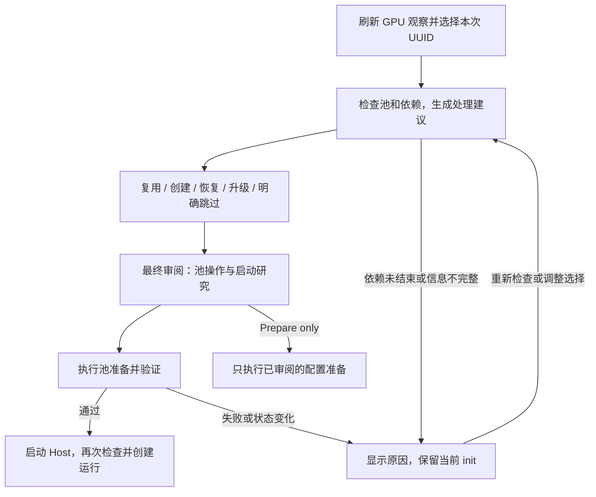

# Init 内的 GPU 池准备与服务更新

状态：2026-09-28 已实施并完成针对性回归。用户要求 init 在同一次交互中完成池的创建、
升级、复用或明确跳过；本设计细化并修正
[运行准备设计的 D1](runtime-readiness-and-context-recovery.md#2-d1--p0每次-init-确认选卡并确保兼容池可用)。
当前双语运行指南已同步。自动维护限于本项目规范路径下的托管池与可枚举的
`repository/state/` 根；外部服务只检查/复用。本次不操作生产池、研究运行或个人 Profile，
用户随后授权将实现提交并推送至 dev。实现与验证范围见第 9 节。

## 1. 问题与目标

### 2026-10-10：研究 Shell 中的配置读取与菜单乱码

同一 `inspect` 在开发终端成功，在 CC 研究会话内却返回
`pool_configuration_unknown`。使用既有 `research_shell_command()` 的真实
bubblewrap 重放后确认：池服务 MainPID 的 UID 和 cmdline 可读，读取
`/proc/<MainPID>/cwd` 因跨用户命名空间的权限限制报 `PermissionError`。
这里检查的是池服务自身，不是 NVIDIA 枚举到的其他用户 GPU 进程。
原先吞掉具体读取失败，使对话把它误说成活动依赖，又反复询问相同池配置。

修复只在 cwd 的 `PermissionError` 下读取同一 user-systemd unit 的
`WorkingDirectory`；实际进程 UID、cmdline、全池成员、reserve、池路径和 socket
仍走原验证器。可读但不匹配的 cwd、不可读/不匹配的 UID、不可读/不匹配的启动
参数和不可读/不匹配的 systemd 目录继续阻止维护。不会用 unit 的 ExecStart
或本次建议配置替代活进程 argv。源码只读隔离、socket 对端 UID、目录锁、依赖
检查和执行前复核均保留。诊断只传播固定阶段/异常类，不暴露环境、原始参数或
异常正文；重新检查沿用现有 `interaction.inspect_argv`。

另从 CC 的原始 AskUserQuestion 参数确认，中文菜单被模型插入了 34 个 U+000D
回车字符，并非 UTF-8 文本损坏。现有 PreToolUse 入口仅清除 question/header/
option label/description 中的 `\r`，保留其他 Unicode、换行、选项及元数据；
不添加自动批准，不改变答案或替用户选择。固定程序问答继续原样传递。
已显示的菜单不会追溯刷新；下一次调用已有 hook 时应用修正。

两处修复复用 systemd、proc 和现有 hook，不增加登记、持久状态或新的放行机制。
真实生产只读回放已从配置读取失败进入 16 个历史 owner 的退役确认；这只是下一项
需由用户确认的事实，不代表已获授权重配置。池与研究状态均未修改。
验证范围见[资格记录](../qualification.md#pool-inspection-in-the-research-shell-2026-10-10)。

### 2026-10-10：配置差异与已退役运行的历史登记

实测兼容池下限为 4096 MiB，而新运行 Profile 下限为 512 MiB；普通 init
直接复用，未提供配置差异选择。另有 16 个本 UID 的历史 owner 已无本地运行库，
请求全部 RELEASED；既有维护把它们汇总为未知依赖，无法继续。请求释放不证明
研究运行已结束，不能直接放宽默认检查，也不能删除池数据库绕过此限制。

修复复用既有 inspect、固定问答、普通启动参数、目录/控制锁和维护复核：

- 选卡只限定本次运行。兼容池下限与本次建议不同时，固定问答选择保留现状或
  重配置；后者默认保留全池成员，最终审阅展示前后配置。配置相同不增加问答。
- 未知 owner 按 UID/namespace/run_id 展示释放数、未释放数和进程情况。只有本
  UID、无本地运行记录、至少一条历史请求且全已释放、关联进程均消失的记录可供
  人工确认“运行已退役、状态已删除、未迁移到别处且不会恢复”。这不是自动证明。
- 确认写入本次普通 `--pool-retired-owner namespace/run_id` 参数，仍须最终 Start
  now 审阅；`none` 表示暂不确认、继续阻塞。未知的其他 owner、保留运行、开放
  Attempt、存活/未知进程、不可读状态和未释放请求继续阻止维护。
- 此授权仅用于本次维护，并在排他协调下及服务停止后复核。不删除 owner 或请求，
  不迁移研究状态，不创建永久豁免、退役标记或第二套绑定登记。未来再次维护仍须
  明确说明缺失状态；普通兼容复用不要求重复确认。历史记录完整保留。
- 预览与回答均不修改服务；必要选择未完成或维护阻塞时，不输出可启动的会话。

这是对缺失历史状态的明确、受限操作授权，不是根据同 UID 或零占用推断安全。
默认未知依赖保护保持不变。回归覆盖配置差异问答、精确身份传递、保留全池成员、
拒绝范围扩张、维护前后竞态、重复操作，以及真实 socket/SQLite/Process 闭环。
生产池和已有运行仅做只读检查；本次源码交付不执行生产服务重配置。

实施前代码有三处相互强化的限制：

- `bootstrap.launch_arguments()` 将不可用/不兼容池统一显示为 `start_ready: false`，
  没有表示“可以在本次启动中修复”的处理路径。
- `manage_gpu_pool.py ensure` 只创建或复用，拒绝不兼容的活跃池以及已有数据库的停止池。
- `autoresearch/SKILL.md` 将池替换排除在 init 外；就绪检查失败只提供准备或取消。
  `bootstrap.start_fresh()` 本身也只有池状态检查，没有统一编排池准备。

因此，预期内的服务维护被变成用户必须退出 init 才能完成的前置任务。
目标是让 init 负责资源准备，并保留实际启动前的兼容性、授权和依赖保护。
“流程不中断”指保留本次选择并在当前交互内处理，不保证任何故障下都强行启动研究。

通用流程：

不按用户名、课题、供应商或固定 GPU 编号判断。能力需求来自现有运行版本与
`validate_pool_snapshot()`；远程代码版本提醒继续是独立的建议功能。

## 2. 用户选择与处理规则

默认推荐 **共享池：由 init 自动准备**。非池模式仅在现有 Profile 校验允许时提供；
例如 `initial_vram_per_experiment` 依赖共享池，不能通过移除池参数绕过。

| 实际情况 | 计划动作 | 后续行为 |
|---|---|---|
| 无池，且无既有调度所有权冲突 | 创建 | 按审阅的 UID、UUID 与 reserve 建服务，验证后继续 |
| 池兼容且覆盖本次 UUID 子集 | 复用 | 跳过创建/升级，即使代码版本较旧也不为追求“最新”而重启 |
| 池兼容，但设备暂时繁忙 | 复用 | 说明后续容量等待；不因忙碌而认定 init 失败 |
| 项目托管池缺少必要能力，满足安全更新条件 | 升级 | 使用当前安装代码更新服务，保持池路径与数据库，验证后继续 |
| 托管服务已停止，状态与依赖可确认，满足恢复条件 | 恢复 | 保留数据库启动；需要新能力时按升级规则处理 |
| 本次授权 UUID 不在池成员内 | 调整选择或重配 | 优先重选已有成员；修改全池成员需单独展示变更范围，并满足更新条件 |
| 池仍被运行依赖，无法安全更新 | 等待处理 | 留在当前 init，允许重新检查、改选可用模式、准备或取消 |
| 外部池不兼容、来源不明或依赖不可确定 | 等待处理 | 不接管服务；展示缺失信息，允许补充连接/依赖信息并再次检查 |
| 用户明确选择合法的非池 GPU 或 CPU 模式 | 跳过 | 不操作池，按所选模式重新校验启动条件 |

“跳过”只表示不需要池管理，不能跳过能力验证后仍声称运行使用共享池。
CPU 与非池模式不是失败后的自动降级；改变执行模式需要更新最终审阅。

每次 init 的选卡限制本次运行，不等于重配整个池。兼容池的成员可大于本次子集；
复用时保持既有成员与池级 reserve。每次请求的 reserve 继续使用现有校验和容量计算。
升级默认保留原服务配置；取得原配置有歧义时，不能用本次 Profile 猜测全池配置。
扩展或缩减成员、改变池级 reserve 均属于显式重配。

## 3. 审阅、执行与失败后的同会话恢复

预览分别报告“目前是否可直接使用”与“是否有可执行的准备方案”。不存在的池或可安全
升级的池应提供 **准备资源并启动（Start now）**，不能因预览时尚未就绪而禁用此选择。

最终审阅至少显示：本次 UUID、共享/非池模式、池地址与所有者、计划动作、必要能力、
池成员/reserve 的前后差异、依赖检查结果、服务更新目标以及随后创建的运行身份。
Start now 的一次确认覆盖这些具体动作，不反复要求确认同一操作。

执行顺序由 `bootstrap.start_fresh()` 统一组织：

1. 重读现有 Profile/目标/预算/模型与授权参数，执行已有一致性校验。
2. 对本次审阅的池动作获取短时排他协调，重新观察服务、权限和依赖。
3. 创建、复用、恢复或升级服务；验证实际能力、UID、成员及审阅要求。
4. 启动托管 Host，并使用现有 CREATE_RUN 请求和 STATUS 对账创建运行。
5. 返回真实完成状态、池处理结果和研究运行状态。

执行中发现另一个 init 已完成相同准备，可收敛为复用。需要比审阅方案更大范围的修改时，
返回当前 init 更新审阅，不扩张授权。选择不变且动作仍在已确认范围内的重新检查不重复
询问模型、Profile、目标和全部参数。若运行身份/路径已冲突，则只重新审阅受影响项。

失败后保留当前选择，并给出可用选项：重新检查；调整 GPU 或池连接；选择合法的非池/CPU
模式；Prepare only；取消。不以“init complete”掩盖尚未启动的结果，不要求用户重新
从头运行 `/autoresearch init`。等待使用有界检查并显示原因，不让模型无限轮询服务。

Prepare only 不启动、停止或升级任何服务，不创建研究 state root；只允许审阅过的
Profile/设置准备写入。收养已有 Profile 时这些写入可能为零。已在 Start now 中实际
发生的服务或文件变更必须如实列出，之后取消不能声称“全程零写入”。

## 4. 升级和恢复的边界

自动处理范围是归属明确、权限匹配的项目托管池。外部共享服务只验证/复用；若要纳管，
必须有独立明确的管理授权与完整范围，不能根据路径相似或当前 UID 相同接管。

第一版升级限于当前代码可直接读取既有池数据库、且没有未结束依赖的情况：

- 从运行 CREATED 绑定和当前 RUN 状态找出依赖；Grounding、CPU 工作、暂停、API 等待、
  Host 已退出但运行未结束，均仍是依赖。
- 从既有 Attempt/进程归属、Host 控制锁与 supervisor 状态检查实际存活和未清理资源。
  数据库显示终态不能代替进程检查；检查权限不足必须显示未知。
- 检查池数据库所有非 RELEASED 请求，包括 QUEUED，不能只数已分配显存。
- 池 `runs` 表只是发生过请求的索引，不能代替 CREATED 绑定：尚未申请 GPU 的运行
  也可能依赖这个池。不可读、缺失或超出已知管理范围的依赖不能按零处理。
- 校验现有数据库能由目标实现直接使用；本功能不做跨版本研究运行迁移或池数据库迁移。
  不删除/重建数据库，不清空请求，也不把旧池换成同卡上的独立调度器。

服务已停止并不自动满足恢复条件。首版自动恢复同样要求依赖已结束；仍有运行依赖的
停止池需要明确该恢复对既有运行的影响，不能借新运行的 init 自动恢复那些运行。
不满足条件时继续在当前 init 展示处理选项。旧池缺少新能力本身不是永久拒绝理由：
来源可确认、依赖已结束且状态可读时，必须支持在同一次 init 中完成升级。

升级只更换服务使用的实现，保留原池目录、socket 地址、历史数据库与默认成员配置。
不自动 git pull、checkout 或安装供应商相关包。启动目标与当前审阅的安装一致；如果当前
代码本身也不提供必要能力，说明安装问题并保持 init 可继续，而不是循环重启。

## 5. 并发与所有权：最小协调方案

现有 `pool-service.lock` 保证同一池目录只有一个服务；`controller.lock` 保证每个运行
只有一个 Host；SQLite 事务保护各自的持久化状态。这些机制继续保留。

还需要覆盖两个动作之间的窗口：检查“无依赖”之后，另一个 Host 可能通过池预检并写入
新的 CREATED 绑定，然后原 init 停掉了它刚使用的池。重复扫描只能缩短窗口。

实现短时的共享/排他协调，锁定**既有池目录 inode**，不增加锁文件、依赖数据库或
持久化升级标记。真实进程回归确认了该同步机制在当前平台上的互斥与退出释放：

- 池准备/更新持排他目录锁，覆盖重新检查、停止旧服务、启动新服务和最终验证。
- 当前 Host 创建项目托管池绑定时持共享目录锁，覆盖最后一次池检查到 CREATED 事务
  提交；直接 CLI 创建路径也通过同一 Host 逻辑。释放后，持久化绑定成为可扫描的依赖。
- 协调仅限接纳/维护阶段，不贯穿整个研究运行；服务自身仍只使用既有服务锁。
  目录不得删除或重命名绕过锁。复用只需短时共享访问。
- 维护完成释放排他锁后，Host 必须再检查，而不是信任预览；这样另一个 init 介入时也
  不会使用过期准备结果。已接纳运行的现有事实决定是否允许再次维护。
- 获取依赖运行的 controller 锁采用非阻塞检查，避免形成“维护等 Host、Host 等维护”
  的等待环。拿不到锁或状态变化就释放维护锁，回到当前 init 的等待选项。

该锁只协调采用此协议的入口。历史 Host 不会自动获得此能力：仍存活的旧客户端阻止
自动升级；已知旧运行还需在维护期间用其既有 controller 锁阻止恢复。外部 state root、
未纳管启动方式或无法确认范围的旧服务不能仅凭本项目扫描和新锁宣称安全。
应在同一 init 中补充具体管理范围/缺失根的信息，或选择不修改该服务的路径。
第一版不引入第二套绑定登记表来掩盖旧客户端缺乏覆盖的事实。

新增同步的四项说明：

1. 可复现失败：用测试屏障暂停升级检查，再让另一 Host 提交 CREATED，然后继续
   停服务；新运行在接纳后遭遇未授权的依赖服务切换。
2. 失败资产与边界：池实际服务与运行持久化绑定之间的一致性，跨越 helper、Host 和
   supervisor 的进程边界；不是恶意用户或敌对文件系统模型。
3. 现有机制不足：Git/版本/类型不串行化进程；原子写只保护单次写入；两个数据库的事务
   不涵盖 systemd 服务切换；服务锁在旧服务运行期间由其持有，不能单独覆盖新 Host 接纳。
   普通测试能复现竞态，但不能在运行时消除它。
4. 最小新增内容：在既有目录上封装一个短时共享/排他锁，供接纳和维护复用；没有新的
   持久化事实。成本是锁顺序、超时、进程退出释放与旧入口覆盖测试。若未来既有服务 API
   能原子协调接纳和维护，则合并该同步并删除目录锁，不保留两套控制。

## 6. 失败、超时与重复执行

- 使用现有 helper 的有限就绪超时与命令超时；检查报告 auth、supervisor、版本、GPU 与
  Profile 阶段，启动报告池准备/状态、Host、接纳与 STATUS 阶段。维护失败码区分锁竞争、
  依赖、停止、启动和验证故障。总超时覆盖整个维护动作，不能每次探测重新计算完整窗口；
  失败服务清理另有最多 10 秒的有界停止请求，不声称其必然成功。
- 停旧服务前确认当前维护仍获授权，并完成配置/数据库/依赖检查。停止失败或服务锁仍由
  原进程持有时不启动第二个服务；socket 无响应不能当作原服务已退出。
- 新服务启动或能力验证失败时，报告实际状态。只清理由本次调用明确创建且尚未交给运行
  使用的失败服务；不得按同名 unit 猜测所有权并停止另一个调用已创建的服务。
- 默认不承诺二进制回滚。旧 unit 的 ExecStart 可能仍指向已更新的 checkout，重新执行
  那条命令不等于恢复旧版本。仅在原执行版本确实仍可用、配置明确且数据库未迁移时，
  才可按已审阅动作尝试恢复；否则保留证据并在当前 init 重试/改选。
- helper 中途退出后，用既有 systemd、服务锁、数据库和真实接口重建观察。重复执行
  收敛为复用或有说明的待处理状态，不用额外“升级进行中”文件决定事实。
- 池准备成功但 Host/CREATE_RUN 失败时保留健康共享池，使用现有 Host 清理和 STATUS
  对账路径。CREATE_RUN 回复不确定时不换新 ID 再创建，防止重复研究。
- 在资源尚未验证通过时不启动研究 Agent 或科研模型调用；监控/错误信息不包含认证
  环境、Profile 密钥或原始 supervisor 敏感参数。

## 7. 实施分工与验收

按依赖顺序一次交付可工作的完整链路；仅修改提示文字不算完成：

1. **P0：统一观察与计划。** 抽取 helper 的检查逻辑为可复用代码，保留现有能力校验器。
   以普通内存对象描述计划动作、可处理性、原因及允许操作；不新增持久化计划/摘要/凭证。
   bootstrap 预览使用相同结果；外部池默认只观察。
2. **P0：实现托管维护。** 在现有 helper 增加受审阅参数约束的恢复/升级/重配，接入上述
   同步与依赖检查，保留数据库和成员来源；默认 ensure 不获得无限替换权限。
3. **P0：接入 bootstrap 与 Host。** bootstrap 先准备池，再启动 Host；Host 的接纳路径
   共享校验和同步。技能保留同会话重试分支，移除“一律转交 init 外处理”的规定。
4. **P1：用户说明与观测。** 更新初始化、GPU 规划、运行恢复的中英文指南和技能说明；
   输出已完成动作、剩余问题和真正的研究启动状态。教程只在实现完成后改写为现行行为。

必要回归矩阵：

| 场景 | 必须观察到的结果 |
|---|---|
| 新环境，没有池 | 一次 Start now 创建一个服务和一个运行 |
| 兼容池，选择成员子集；或设备繁忙 | 无服务重启，保持原成员，按原策略接纳/等待 |
| 旧池缺能力，已知依赖全部终结且进程清理完成 | 同一 init 升级并完成创建；数据库历史保留 |
| 依赖运行在 Grounding/CPU/API 等待/暂停，池请求数为零 | 禁止升级，不取消运行；init 仍可调整或重新检查 |
| 已停止池、QUEUED/BOUND 请求、未知存活或不可读数据库 | 不清空状态、不假设空闲，明确区分恢复条件 |
| 两个 init 同时创建/升级；Host 在检查窗口内接入 | 一个服务所有者，无遗漏绑定，无接纳后误停 |
| 旧 Host 恢复、外部绑定、未覆盖的依赖范围 | 不将新同步机制误报为旧客户端保护 |
| 停止超时、启动失败、验证失败、维护中崩溃 | 无第二个调度器，无误杀，无伪造回滚；可从事实重试 |
| Prepare only、取消、显式合法跳过 | 无未授权池操作或研究调用；非法非池 Profile 仍被拒绝 |
| 池准备后 Host 创建失败/回复丢失 | 健康池保留，原有幂等对账，无重复运行 |

开发先运行 helper/bootstrap/Host/技能的聚焦回归，再用实际本地 socket、SQLite、
多进程与受控 supervisor 替身验证并发和中断；已有管理器可用的隔离环境再验证真实
user-systemd。采用合成 GPU 观察测试池生命周期，无需生产 CUDA 负载或付费模型。
候选冻结时按既有 G0–G5 规则补齐适用检查，明确替身与真实服务覆盖的区别。

## 8. Init 时延：把固定流程移入代码

2026-09-28 对用户提供的那次 Prepare only 会话做了只读时间线分析。
原始会话保持原位；仅元数据的汇总位于忽略目录
`.local/analysis/init-latency-20260928/timing.json`，不复制命令、消息正文或凭据。

| 观察 | 结果与解释 |
|---|---|
| CLI 显示的工作时长 | 30 分 12 秒；记录首尾跨度约 62 分 48 秒 |
| 四次 AskUserQuestion 等待 | 合计约 32 分 38 秒，单独计算，不归为框架执行耗时 |
| 非问答工具区间的并集 | 约 11 分 21 秒，包括工具准入、Hook、执行和返回等待，不能当作纯 shell 用时 |
| 其余时间间隔 | 约 18 分 50 秒，包含模型响应/生成及客户端调度；现有日志不能进一步精确分解为纯推理时间 |
| 模型与工具轮次 | 51 个独立 assistant 消息 ID，74 次工具调用，其中 Bash 60 次、问答 4 次 |
| 自动工具安全分类超时 | `mimo-v2.6-flash` 五次超时，合计约 6 分 23 秒；错误来自 Bash 准入阶段，不是这五条命令的执行超时 |
| 本地 Hook 错误 | 三次 `No closing quotation`；耗时很短，但引发修正和再次响应 |
| 上下文规模 | 消息 usage 中输入与缓存输入之和从约 49,443 增至 133,212 tokens；不据此估算实际账单 |

当前技能文件共 1,795 行，init 部分接近千行。详细运行兼容性说明、人工检查和命令拼装
混在同一交互流程中，增加模型要处理的内容和往返次数。仅由时长不能判定全部开销都来自
技能长度，但本次的响应/工具数量和反复准入失败已足以支持流程代码化。

补充的本机单次只读样本：`bootstrap paths --offline` 为 0.345 秒；现有 Profile 的
`bootstrap prepare` 接纳通过，用时 0.483 秒，没有文件写入或 provider probe。
后者输出约 30 KB。这些样本不覆盖完整启动、远程检查、GPU 服务或其他机器，不能据此
宣称整个 init 已经可以在一秒内完成。

### 8.1 适合固定到代码中的内容

扩展已有 `hypoloom.bootstrap`，提供一个聚合的只读检查入口，而不是让模型依次临时
拼装十几条 Bash 命令。仍调用已有验证器，不在技能中重新实现规则：

- 路径和 Profile 枚举、控制 Python、SQLite/依赖检查、状态根及请求 ID 的推导。
- Profile 接纳、预算、凭据是否可用、模型来源和显式覆盖的解释；只输出允许披露的字段。
- GPU 观察、池发现与兼容性、systemd 可用性；得到第 2 节的确定性处理建议。
- 文献工具配置和可执行文件检查；版本提醒独立有界执行，不将远程不可达升级为硬阻断。
- 所有 Host/CLI 参数使用 Python 参数列表生成，经现有解析器校验；用户值不进入 shell
  字符串拼接，不要求模型手写 heredoc、嵌套引号或重复大段参数。

“固定”指稳定的流程和规则，不固定某个用户目录、模型、GPU 编号、密钥、池能力字符串
或强行覆盖用户选择。路径按仓库与现有设置推导，模型沿用已选认证源，能力由现有运行
版本校验器判断。科学目标、新课题设计和真实选择歧义仍由用户与模型处理。

### 8.2 收敛为少数几次交互

已有 Profile 的常规路径建议为：

1. **一次聚合检查**：返回简洁摘要、默认建议和确实缺少的字段。
2. **一次合并选择（有需要才问）**：确认本次 GPU/执行模式、模型等尚未明确的值。
   用户已经提供的值直接采用；历史 GPU 仅作建议，本次仍须明确授权。
3. **一次最终审阅**：同时展示有效配置、池操作和 Start now / Prepare only。
4. **一次启动入口**：脚本内部按既有顺序准备池、启动 Host、创建并对账运行，返回结果。

代码处理常规分支、超时和重试范围；模型负责提出必要选择、解释失败、接收用户调整。
不新增持久化 init 状态机、配置副本或工作流引擎。当前对话里的选择与既有配置仍是输入。
参数充足时省略缺失项问答；发生真实故障时允许增加轮次，不为达成轮数指标绕过检查。

### 8.3 控制输出与重复工作

- 为交互入口增加简洁输出视图：只返回有效预算、选中模型与实际覆盖、资源计划、失败项
  和待选字段。完整接纳 payload、全部角色路由与命令向量保留在既有内部处理/详细模式。
  不让模型在每一步重新接收同一批几十 KB 的数据。
- 将技能的 init 主流程压缩为入口、必要选择、权限边界和结果分支；详细兼容性材料按需
  引用。操作其他运行的长篇说明不必在每次初始化中展开。
- 同一次检查调用内复用已解析 Profile 和认证元数据；独立的只读检查可在脚本内部有限
  并行，每项有超时。存在依赖的检查与所有写操作保持顺序。
- 保留启动前的有效配置复核与 Host 最后接纳检查；交互期间文件或设备可能变化，不能
  为提速删除这些边界，也不引入跨会话“检查已通过”的缓存文件。

### 8.4 工具准入超时单独处理

本次五次超时来自 CC 自动模式的安全分类模型。Hypoloom 的研究模型配置和该分类模型
不是同一个用途；不能把这些错误计为研究 Agent 执行或 GPU 池故障。

减少零散 shell、使用固定入口和参数列表，可以减少进入分类链路的次数和命令解析错误，
但不能保证外部分类模型可用。连续出现相同准入超时时，模型应明确说明原因并保留选择；
不能通过改写成更隐蔽的等价命令不断重试，或关闭 Hook/扩大权限以追求速度。
命令未获准执行时，脚本内部的阶段计时不存在；不要把它显示为脚本已开始运行。

执行内部给现有返回结果增加派生的阶段耗时和失败阶段，区分本地检查、池维护、Host
启动和 CREATE_RUN。客户端工具准入、用户等待与模型响应只有在会话日志可观测时才
单独统计，未知时明确未知。不新建费用账本或日志事实源。

### 8.5 实施优先级和验收目标

先交付聚合只读检查、简洁输出和固定 argv，再接入前文的池生命周期与启动编排，最后
缩短技能并更新双语教程；这些属于同一 init 优化工作，不能只延长超时。

在环境正常、已有 Profile、无新增科学设计的路径上，以不超过 6 次非问答工具调用、
不超过 8 次模型响应作为初始交互目标；最多一次补充选择和一次最终启动选择。
本地只读检查以 10 秒以内为初始测量目标，远程建议检查、维护动作和工具准入各自列出。
总时长仍受模型、审批服务和用户响应影响，在实际对照前不承诺固定分钟数或提速比例。

回归应证明精简入口与现有校验得出相同有效配置/阻断原因，秘密从未进入摘要，参数
包含空格/引号时不改变命令语义，文件在审阅后改变仍被发现。测量正常复用、旧池升级、
外部服务不可达和工具准入失败四条路径；可先用保留日志回放准入错误，不要求付费调用。

## 9. 实现与验证结果

- `hypoloom.bootstrap_inspect` 聚合只读检查，复用 Profile、模型认证、资源和通知验证器；
  生成普通 argv，不写持久化清单。模板先准备，已有 Profile 才生成可启动参数。
- `hypoloom.managed_gpu_pool` 保留原 helper 兼容入口，提供只读计划与明确授权的
  create/reuse/restore/upgrade/reconfigure；`gpu_pool_lifecycle` 扫描现有绑定、Attempt、
  进程和所有未释放请求。Host 在相同目录协调下做最终能力检查与 CREATED 提交。
- 本次选卡与全池成员分开。升级保留从原 unit/进程读出的配置；无法确认时要求显式重配，
  不把 Profile 默认值当作旧服务配置。外部根、未知池 owner、不可读历史均不自动接管。
- 232 项针对性测试通过，9 项需要 Unix socket 的原生测试未在本环境执行完成。
  覆盖真实 SQLite 历史保留、进程组、跨进程 flock、真实 Host 的 CREATE_RUN 接纳路径，
  以及启动参数、回执丢失清理、占用与配置变化。服务 supervisor 和池传输使用替身；
  这不是完整 systemd/UDS 启动或 CUDA 资格。
- 初次检查发现可选 reserve 缺省访问、总 deadline 错误归类和认证错误文字回归，均已
  修复；新测试的秘密参数和工作负载下限最初被既有验证器正确拒绝，修正了测试输入，
  未放宽生产验证器。技能文档移动后的链接及旧文案断言另做最后复核。
- 本地合成 CPU Profile 的单次只读样本：完整 prepare 输出 13,535 B，summary 为
  1,947 B；聚合 inspect 5,593 B、进程内 0.0904 s，诚实报告
  `user_manager_unreachable`，未创建状态根或池。顺序单次样本含缓存差异，不代表 CC
  端到端提速。默认技能入口从 1,795 行/110,809 B 缩至 191 行/10,942 B。

证据位于忽略目录 `.local/qualification/init-lifecycle-20260928/`。当前沙箱禁止 Unix
socket bind（EPERM）且无法连接 user-systemd，未削弱原生检查，也未改用生产服务验证。
尚未获得真实 CC init 端到端时延、服务升级原生链路或完整候选 G1/G5 资格。
已有生产池、研究运行、个人 Profile 保持原状；验证没有付费调用。用户随后授权提交并推送至 dev。
