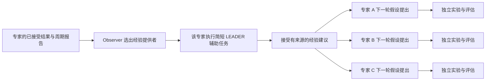

# Leader 经验共享修复方案

状态：2026-09-25 已实施，验证记录见[资格记录](../qualification.md#current-development--nonblocking-leader-experience-sharing-2026-09-25)。适用于通用多专家科研框架，不依赖 ERC、具体数据集、模型或用户 Profile。用户明确的协作语义是：leader 把有依据的思路分享给其他专家，其他专家结合这些经验继续独立提出假设。

## 问题与目标

当前 `InteractionHost._accept` 在接受 leader 后，自动为其他组件写入参与者暂停；`_advance` 等待同伴工作结束，再给 leader 指定一个独占研究轮次；`leader_inputs` 只在 leader 的 SYNTHESIS 中提供同伴记忆。轮次关闭才解除暂停。调度还赋予 leader 优先级并指定其父假设。

这是现有实现的确定行为，已在保留运行的接受事件与暂停记录中核实，不是模型擅自调用控制接口。只删除暂停写入不能完成修复：专属轮次、等待条件、Observer 对下一轮的阻塞、父假设授权及经验传递方向都需要一起调整。

目标行为：

1. leader 提炼经验和建议，其他专家的正常研究不因 leader 任命而暂停。
2. 由被选中的专家本人生成建议，不把 Observer 的任命理由冒充 leader 输出。
3. 建议明确区分已接受实验结果、专家解释和待验证设想；接收者可采纳、改造或拒绝。
4. 经验进入后续假设提出的实际输入，可追溯来源；不改写科学事实、假设父子关系或其他专家记忆。
5. 协调活动消耗正常 Agent 预算，但不额外获得实验名额、调度特权或重新打开已终止研究的权限。

## 建议流程

建议尚未产生时，各专家仍按原有研究流程推进。图中的建议输入不构成等待条件；不要求所有专家到达同一轮次。

## 1. 解除 leader 与调度控制的绑定

- 任命 leader 不生成 `PAUSE_PARTICIPANT`，因此也无需在结束时执行对应的批量恢复。
- 不等待同伴 Agent/Process 全部结束；移除 leader 路径上的 `_drained` 依赖。
- 不再为 leader 强制创建下一研究轮次或指定父假设；普通研究仍走已有 hypothesis update、adjudication 和 batch admission。Debate 的既有后续研究授权单独保留。
- 移除 leader 身份带来的组件和实验执行优先级，继续采用普通公平调度、资源池和预算规则。
- 检查并解除 leader/Observer 待处理事件对普通 `blocks_next_cycle` 的阻塞，避免删掉显式暂停后仍被另一条路径串行化。只调整经验协调路径，不放松 Debate、自演化、依赖或科研终止本身要求的边界。
- 操作者手动暂停、取消、API 等待、资源不足、预算耗尽和既有权限保护继续生效。

leader 自己的普通研究与协调任务也不共享一个并发写入的 Claude 会话。复用已有辅助任务身份和会话隔离；若现有角色并发限制要求等待，只排队该协调调用，不暂停其他专家。

## 2. 复用现有 LEADER 辅助任务生成经验

项目已经有 `AuxiliaryRequestKind.LEADER`、`AgentCommand.LEADER`、语言/模型路由和通用 `ExpertLoopCandidate`。复用这些入口及 `task_kind / summary / supporting_refs` 输出，首版不另建消息类型或建议 schema。

输入使用本次任命依据、该专家的已接受报告、可共享的其他专家报告及相关科学事实。按已有输入字节预算选择内容，保留证据来源及适用范围；不复制整个历史会话，不开放通用跨专家私有目录访问。需要的报告内容从已发布产物或既有 Git 版本读取。

建议正文应简明说明：

- 哪些观察已被实验支持，哪些尝试失败，以及实际测试的条件；
- 哪些仍只是解释或设想，尚不能排除哪些方向；
- 值得借鉴的实现、控制变量、下一实验与区分性判据；
- 对其他专家研究可能有用的启发及不适用条件。

这里是正文组织要求，不增加一组必须填满的验收字段。复用引用域、输出大小和类型验证；合法引用也不自动证明建议科学上正确。不得由建议直接写入 REFUTED、剪枝记录或全局“禁止重测”清单。

协调生命周期在建议成功接受、明确失败或取消时结束，不等待 leader 再完成训练。建议发布不增加实验数量。已有 `leader_selected`、开始/结束控制记录继续承担生命周期记录，来源绑定到实际 LEADER Attempt；按现有 ACI 23 版本边界区分旧独占轮次和新经验协调语义。运行停止时复用 `CLEANUP_OBSERVED` 记录协调中止，不创建暂停／恢复动作。

保留基于实际贡献的资格检查及 `min_rounds_before_leader`。将“还有实验名额”与“有资格分享经验”分开：已有贡献且存在协调调用预算即可分享，但这不授权该专家恢复已结束的研究。

## 3. 把建议送入后续假设提出

由 Host 从已接受的 LEADER 输出构建普通 `EmbeddedInput`，参考现有 Debate guidance 的输入注入方式，但不复用其强制重启或父假设授权。

- 对同一运行、共享研究范围内的相关专家提供最新有效建议，包括 leader 自己的普通研究分支；每条保留作者、来源 Attempt、证据引用与产生时间。
- 在一轮假设的首个 FORWARD 请求准备时选择当时已接受的建议。BACKWARD、SYNTHESIS 复用该请求实际记录的建议集合，保证两翼与综合看到相同版本。
- 如果建议在该轮已经开始后才到达，留给下一轮；不修改正在运行的请求，不重跑已完成节点。
- 失败重试复用其原始请求输入；Host 重启从已有请求和接受记录恢复，不额外维护“已读”“已送达”账本。
- 普通研究没有后续提案节点时，不为了接收建议而重新打开终止链路。
- 最新建议尚未成功产生时，继续使用已接受且适用的建议或无建议的普通输入。不能让失败协调成为其他专家的等待条件。

同一轮输入一致性直接复用已经持久化的任务请求，无需另建冻结文件、哈希或快照。历史建议保留在已有输出和引用关系中；只向新输入投递有界的当前内容，避免逐轮叠加全文。

## 4. 保留专家自主性与科学证据边界

提案提示要求专家在已有论证文本中说明相关建议如何影响设计：采用了什么、如何修改，或者为何不采用。不增加“必须同意 leader”规则，也不以是否引用 leader 作为假设准入门槛。

建议带来的知识影响不自动形成假设谱系的 parent 边。接收者保留自己的假设身份和正常父节点选择；引用 leader 的报告与继承 leader 的假设是不同关系。

首版只可靠展示“建议已包含在某次任务输入中”。是否被采纳需阅读专家实际提案，不能把输入存在、工具读过或一次引用显示成“已理解/已落实/已验证”。不为此新增确认回执、采纳状态表或文本关键词判定器。

经验分享减少重复试错，也可能扩散错误归因。通过保留原始结果、测量协议、局部结论的适用条件和接收者自主判断来控制这一风险，不把 leader 升格成科研裁决者。

## 5. 重试、恢复与协调成本

- LEADER 辅助任务使用已有接受事件的稳定身份构造 command ID，同一次任命只对应一个逻辑任务；沿用 Attempt 重试、费用记录、原子接受和终端处理。
- 发布后宕机、请求重试和重复 Observer 处理不得生成重复的接受效果；使用现有命令唯一性和事务，不增加独立去重机制。
- Observer 沿用已有报告触发与合并机制；同一来源报告不重复处理；合并只能跳过尚未派发的 Observer，已派发任务必须登记其接受或终端失败，不能因后来的报告覆盖而遗漏。无新增相关证据时，不仅因为轮询或旧建议再次被看见就重新生成一份建议；比较已有来源 ID 即可，无需新增 digest。
- 建议调用计入原有角色/运行 Agent 预算、并发容量和 provider 等待，使用现有 leader 路由。控制正文长度和上下文规模；首版不新增一套专用预算配置。
- 局部协调失败按原有重试上限结束，仅影响本次建议，不升级成其他专家的研究失败。API 全局不可用则仍遵守已有 provider recovery。
- Goal 达成、用户停止或运行进入终态优先处理；迟到的 leader 输出不能恢复派发。没有后续研究时，协调也不应无限延长收尾。

## 修改范围

| 位置 | 主要修改 |
|---|---|
| `hypoloom/interaction_host.py` | 接受、派发和关闭短协调任务；移除 leader 同伴暂停、等待清空与专属轮次；提供建议输入 |
| `hypoloom/workflow_host.py`、`expert_batch.py` | 接通现有 LEADER 调用；去掉 leader 执行优先和父假设授权；消除普通提案的隐性协调阻塞 |
| `hypoloom/agent_aci.py`、`claude_agent_host.py`、`profile_language.py` | 复用既有候选及路由，明确建议任务和提案参考语义，验证引用边界 |
| `hypoloom/agent_sessions.py` 等现有会话入口 | 核对辅助任务隔离，不并发续用同一会话，不扩大同伴写权限 |
| Grounding leader-trigger 与专家提案提示 | 从“选一个专家独占推进”改成“选择有经验的专家提供建议”；解释采纳和拒绝的自由 |
| `interaction_oracle.py` 及相关 batch/session 审计 | 按实际任务和产物核查作者、来源、接收范围、时序、唯一终端效果与非阻塞行为 |
| `observer_summary.py`、详情、Web/TUI | 展示经验协调开始/完成及建议来源；皇冠不再意味着其他专家让出研究权 |
| 架构、Usage、Profile 说明与开发记忆 | 同步中英文语义与版本限制，明确建议不会暂停同行 |

界面复用已有交互详情和任务输入详情；展示建议作者、摘要、来源和已提供给哪些提案。活动皇冠对应正在进行的协调调用；完成后保留历史贡献说明。旧运行仍按其真实独占轮次解释，不能把旧暂停伪装成新协作模式。

## 验证与实施顺序

第一步完成调度和 LEADER 辅助任务闭环，第二步完成建议的实际输入传递，第三步同步独立审计、界面与文档。作为一套完整修复交付，不能在删除暂停后就声称经验共享完成。

重点回归场景：

1. 三位专家中选出一位 leader；其他两位在建议调用尚未结束时继续进入新提案或实验，且没有因 leader 产生的暂停控制。采用充足预算/容量，避免把普通资源等待误判成阻塞。
2. leader 正在等待自己的调用机会时，其他专家和已有 Process 继续推进；没有抢占或隐性 `blocks_next_cycle` 屏障。
3. 后续 FORWARD/BACKWARD/SYNTHESIS 实际输入包含相同的接受建议及其来源；在轮次中途到达的建议只进入下一轮。
4. 一位专家采用、一位专家修改、一位专家有理由地拒绝建议，均可继续执行；原有父假设和科学结论不被改写。
5. 建议超限、引用非法、调用失败和预算不足有明确结束结果；其他专家正常工作，既有 operator/debate 暂停不被误清除。
6. 在调用前、接受后重建同版本 Host，独立检查一个逻辑协调任务、一个接受效果、可追溯实际输入及无额外进程残留；不能通过自造第二套状态归约器来验证。
7. 保留已有预算、API 恢复、取消、终止、Debate、科学事实及会话所有权回归；旧版本观察器按旧语义显示。

实施阶段使用聚焦回归。候选稳定后，通过真实 Host、原生 Claude 协议的本地测试服务与 CPU Process 完成有界三专家场景，独立统计任务、实验、终端效果和残留，遵循现有 G0–G5。该场景验证调度/传递/恢复，不证明真实付费模型一定善用建议；科研质量需后续实际运行观察，不能以协议测试替代。

## 版本与范围

复用既有运行/ACI 版本边界记录语义变化，不新增 Profile 模式矩阵、数据库表或第二份事实源。保留运行使用其固定 bundle，更新 checkout 不会改变其行为；此次方案不启动、暂停、恢复、迁移或改写任何现有运行。新语义应用于修复后创建的运行。

不新增保证机制：已有 Git、版本元数据、稳定 command/Attempt/事实 ID、事务、实际请求输入与普通验证足以承载本方案，不需要额外 hash、receipt、marker、schema 或独立消息队列。既有认证、隐私、写入所有权和不可逆操作保护保持。

本次范围仅为 leader 经验协作语义。此前发现的指标重复减基线、LOCAL/GOAL 交付衔接和输出长度问题另行修复，不借此扩大本轮实现范围。
