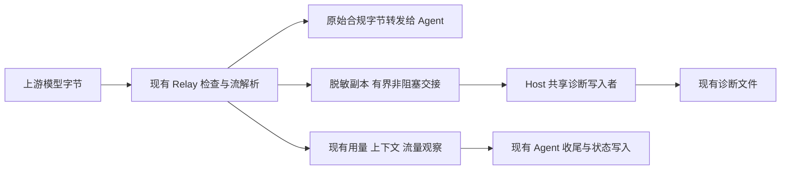

# 流式诊断写入与历史读取性能优化方案

状态：2026-10-18 已实施并完成本轮离线、CPU 闭环及安装验证；所有输入下不超过
10% 的捕获开销目标尚未达成。完整检验和定向复验分开记录，不宣称单次全量全绿。
本设计处理已复现的慢盘阻塞、重复历史读取及其收尾边界。
现有研究运行、冻结 bundle、Profile 和付费调用均未改动。

## 1. 问题与证据边界

已确认的直接问题是：`ProviderRelay` 每次 `response.read1()` 后调用
`_ExchangeCapture.save()`，通过 `RuntimeDiagnostics.write_json()` 重写
`exchange.json`，其中包含同步 `fsync`。读取下一块前必须完成磁盘操作。
正文写入、诊断文件创建及关闭也在请求处理线程执行。

私有证据保留在 `.local/analysis/rpm-root-cause-20261018/`，不复制进公共文档：

- 连续约 26 秒采样中，状态盘忙碌率约 99.9%；多个 Host 线程持续等待文件系统
  日志提交，70 次连接观察中有 60 次存在未读取数据，最大积压约 167 KiB。
- 隔离回放中，逐块保存处理 7 块耗时 31.22 秒，26.33 秒用于中间元数据写入；
  仅末尾保存的模拟处理 64 块耗时 3.52 秒；相同逐块代码在内存文件系统上
  处理 64 块耗时 0.018 秒。输入数量不同，不能据此承诺生产加速倍数。
- Attempt 历史字段约 117 MB。监控与通用历史查询的执行计划包含
  `USE TEMP B-TREE FOR ORDER BY`，同时存在重复查询、解码和临时写入。
- 观察到流式中断后以相同消息改用非流式请求。现有 adapter 声明的
  `transport_max_retries=0` 并未消除这种 native 行为，不能把配置值当作实际次数。

这些证据证明本地性能缺陷正在影响运行，尚不能确定每次 `IncompleteRead`
的上游原因，也不能把本机处理速率直接解释成供应商生成速率。
本次不会调整模型、推理强度、科研并行数或预算来掩盖问题。

## 2. 官方设计参考及本项目的选择

| 参考 | 已有做法 | 本项目采用的部分 |
| --- | --- | --- |
| [Envoy access logging](https://www.envoyproxy.io/docs/envoy/latest/intro/arch_overview/observability/access_logging) | 文件日志异步刷新；支持结束时和周期性记录 | 将诊断文件 I/O 移出网络处理线程，按时间合并进度 |
| [Python 3.12 Logging Cookbook](https://docs.python.org/3.12/howto/logging-cookbook.html#dealing-with-handlers-that-block) | `QueueHandler` 与共享 `QueueListener` 分离生产和写入；处理队列满 | 共享后台写入者、有界非阻塞交接；正文继续使用现有诊断格式 |
| [OpenTelemetry Logs SDK](https://opentelemetry.io/docs/specs/otel/logs/sdk/#batching-processor) | 批量导出、容量上限、队列满策略和有时限的 flush/shutdown | 明确字节预算、溢出表示和关闭等待；不照搬其默认参数 |
| [SQLite temporary files](https://www.sqlite.org/tempfiles.html#transient_indices) / [query plans](https://www.sqlite.org/eqp.html#temporary_sorting_b_trees) | 无合适索引时，排序可能把返回行写入临时结构 | 消除重复读取与宽行排序，再根据实测判断普通索引是否必要 |
| [AWS Builders' Library](https://aws.amazon.com/builders-library/timeouts-retries-and-backoff-with-jitter/) | 限制重试，避免多层重试放大负载 | Relay 不增加重发；保留现有请求数、时间和额度约束 |

以上是设计参考。以下参数、模块分工和验收目标是针对本项目提出的方案，
不代表这些系统规定的行业统一参数。实现使用现有 Python 与 SQLite 组件，
不引入 Collector、消息代理、外部队列或新的持久化诊断服务。

## 3. 数据来源和必要性说明

保留现有单一来源：模型字节由 `ProviderObservation` 解析；同一份观察结果进入
token/context 控制、`ProviderTraffic` 和最终 Agent 观察，再被序列化为诊断文件。
正式运行状态仍由 Host 写入现有 SQLite，正式实验结果仍走既有发布与 Oracle。
后台写入者只保存副本，不生成新的成功判定、费用结算或生命周期状态。

针对后台交接和活体观察交接，记录最小必要性说明：

1. 可复现失败：一次诊断同步保存可阻塞数秒，导致已抵达的模型数据不能及时
   读取；若仅把诊断写入改为异步，Agent 收尾可能先读到尚未完整写出的文件。
2. 失败资产和边界：非权威诊断副本侵入网络处理路径；随后该副本又被用作
   用量佐证和错误分类的输入。边界是活体传输观察向副本与收尾读者的交接。
3. Git、主键、事务、原子替换、类型校验和普通测试可以保护版本、身份及内容，
   但不会让慢磁盘 I/O 不阻塞调用线程。既有解析器足以解释流，无需另造 reducer。
4. 最小新增部分是 Host 内有界的诊断交接和既有 exchange 观察的短期引用；
   复用 `(attempt_id, exchange)`、既有字段与解析/汇总器。维护成本集中于
   容量、顺序、关闭、脱敏和读者兼容。未来若统一诊断后端提供同样能力，
   将该交接合并进去。没有新数据库表、schema、摘要签名、收据或完成标记文件。

这是普通慢盘、部分写入和并发收尾问题，不扩展到恶意同用户进程威胁。
优化不得削弱凭据保护、权限、预算限制、原子文件替换、正式状态持久化和独立审计。

## 4. P0：从流式路径移出诊断 I/O

### 4.1 网络线程的责任

- 保留请求身份、model/effort、token/context、次数、字节和绝对 deadline 检查。
- 保留对跨块凭据的扫描及拒绝；必要解析仍同步执行，不能推迟预算判断。
- 保持 HTTP/SSE 的实际语义。正常字节不改写、不合并为一个完整响应后再交付，
  不补造 `message_stop`，不将断流转换为成功。
- 诊断只进行内存操作和不等待容量的交接。文件创建、路径检查、文件写入、
  原子替换、flush/fsync 与诊断错误输出均交给后台，避免异常路径重新阻塞。
- 接收计数、转发计数和结束时间在事件实际发生时记录，不使用后台落盘时间。
  传输结束后按现有顺序更新 context、释放流量许可和 context 串行锁，不等磁盘。

### 4.2 后台写入策略

由 `ClaudeAgentHost` 持有一个共享 provider 诊断写入者，各 Relay 借用它。
扩展 `runtime_diagnostics.py` 中已有能力；先限定于 provider 捕获，不把
正式制品、SQLite、native stdout 验证输入或其他运行日志一起改造成异步系统。

| 项目 | 实现的内部默认值/规则 |
| --- | --- |
| 后台写入线程 | 每个 Host 一条，懒启动；不为每个 chunk/request 创建线程 |
| Host 诊断交接预算 | 32 MiB，包含排队、正在写入的内容和交接对象；编码缓冲也计入 |
| 单 exchange 待写正文 | 最多 4 MiB，受 Host 总预算约束 |
| 控制与终结摘要预留 | 总预算内预留 4 MiB，正文不能占用 |
| 正文合并 | 每 exchange 最多 256 KiB 一批，或约 100 ms 调度一次 |
| 进度元数据 | 普通字节进度每秒采样；后台每 exchange 每秒最多一次中间写入，待写值合并 |
| 开始、响应头、结束、错误 | 生命周期更新不被进度采样丢弃；终结覆盖待写中间值，排在已接收正文之后 |
| 关闭等待 | Attempt 收尾不等待诊断磁盘；Host 正常退出合计最多等 2 秒 |

这些值是经过本地回放的内部默认值，不增加用户 Profile 字段。时间间隔是正常
存储条件下的调度目标；磁盘永久阻塞时不承诺该时间内能完成落盘。
队列必须同时限制对象数，不能以无限多个空对象绕过字节预算。

元数据仍以临时文件加原子替换写入。后台每次实际提交元数据时继续使用既有
durability 语义，正文在结束时继续同步；减少的是逐块提交次数，不是全局关闭
`fsync`。写线程不能持有 Relay 流量锁或交接锁执行磁盘操作。

### 4.3 队列满、慢盘和隐私

- 中间进度按现有 exchange 身份覆盖合并；正文只保留连续前缀。
  第一次拒收某份正文副本后停止追加该副本，防止中间缺口被拼成貌似完整的流。
- 入队前复用现有跨块脱敏逻辑，不另写一套算法。溢出或取消时丢弃尚不能安全
  输出的脱敏尾部；磁盘写入沿用 0700/0600、路径及 symlink 保护。
- 通过现有 `capture_errors`、`response_capture.complete/capture_errors/bytes_*`
  表示副本不完整；`response_body_complete` 继续表示真实传输完整性。
  副本丢失不改写传输成功或失败，缺失的费用佐证也不能变成零费用。
- 终结记录的预留空间也耗尽时，停止接收新的诊断副本并明确报告不可用。
  不使用无限队列、同步补写、递归错误日志或无限重试来处理溢出。
- Python 线程无法安全取消已经阻塞的内核文件写入。关闭超时只结束调用方等待，
  不宣称内核 I/O 已取消；同一 Host 不再增殖替代写线程。正常验收须确认后台
  工作排空、文件句柄关闭；故障测试须如实报告未完成诊断。

### 4.4 收尾与用量佐证必须一并修复

当前 `claude_agent_host.py` 在资源关闭前就调用 `read_exchanges()`，并可能在
关闭后继续使用先前的列表。因此仅异步写文件会扩大已有的读写时序风险。

实现顺序如下：

1. 让当前 Relay 把既有 `_ExchangeCapture.data` 的紧凑最终观察交接给所属
   Agent handle；不保留请求正文、思考正文或完整历史，也不重新解析/结算。
2. 在 Agent 收尾第一次用量判断之前，停止接收新 Relay 请求，完成或明确中止
   已在途的传输处理。等待受现有关闭期限约束，与后台诊断排空无关。
3. 对活体 handle，从同一 Relay 的完整观察集合调用现有
   `observed_input_floor`、`summarize_exchanges`、`provider_failure` 和 context
   函数。观察保留受既有请求数、元数据大小及上述内存预算限制。
4. 集合不完整或超出预算时，不把截短列表当作全部调用：向需要完整佐证的
   现有验证入口传递不可用，保留保守费用/unknown 行为。同步 token enforcement
   仍由既有 `_observed_tokens` 判断。不能用迟到的文件覆盖更完整的活体观察。
5. 正式最终 Agent 观察沿既有 Host/SQLite 事务写入；诊断 writer 将同一观察
   保存到原文件。内存观察在被消费后释放，文件写入失败不能产生第二次终结。
6. 离线、旧版本和重启后的读者继续使用 `read_exchanges()`。缺失或部分文件
   保持 unknown/partial；不从残缺流推断完整费用或成功。

运行时观察、后台副本和离线读者之间只共享既有字段及验证器，不增加一份费用账本。
落盘前内存诊断会在崩溃时丢失，这是有界异步副本的明确代价；正式状态事务的
持久化保证不变。本次不引入诊断 WAL 或新的恢复协议。

## 5. P1：减少历史读取与排序

### 5.1 一次读取和解析，供同一观察周期复用

`build_monitor_snapshot()` 已有 `_attempts` 入口，应让同一只读事务中的
状态投影、`_attempt_views()` 和 `build_product_observation()` 复用它所读取
的 Attempt 数据。后两者目前再次查询大字段的部分改为使用已读映射，
额外 JOIN 只读取所需的 command/transition 小字段。预算和状态仍使用原 reducer。

通用 `list_attempts()` 及各调用点逐项检查：只需要身份、状态、时间的地方使用
已有 `include_observation=False`；需要完整观察时每周期读取/解码一次。
`build_status_projection()` 的 fallback 直接按 `run_id` 查询，避免全库读取后过滤。

### 5.2 排序键与大字段分开

先在小字段上确定稳定顺序，再按既有 `attempt_id` 主键分批读取需要的详情；
已经全量读取的周期可对内存引用按原排序键排序，不将大型 JSON 再送入 SQL sorter。
必须保留时间相同的 tie-breaker、原 `attempt_ordinal` 顺序及 JOIN 身份语义。
显式分页或分批查询均在同一读事务中完成；不能跨提交拼接一份观察。

首轮不新增数据库 schema 或修改现有运行索引。若瘦查询仍为瓶颈，再单独以
`EXPLAIN QUERY PLAN` 和数据规模实测证明普通索引的收益，遵循既有版本规则。
不把 `temp_store=MEMORY` 或扩大 SQLite 缓存作为本次主要修复。

### 5.3 复用缓存并保留实时性

- 复用 `ObserverRefresh` 已有 `PRAGMA data_version` 失效机制，数据库未变化时
  不因每两秒刷新而重新解析全部历史。Host 内继续使用 `StateStore` 既有提交缓存。
- 缓存紧凑展示投影，不长期复制完整 prompt/input artifacts 或重新建立持久表。
  RPM、队列、进程存活、时钟/冷却及运行中 transcript 的观察单独刷新，保留真实
  来源时间和 stale/unknown；不能把旧观察的时间改成现在。
- `_warm_evidence()` 先读有序身份/必要元数据，按原证据读取预算选择对象，再取
  对应详情。现有缓存命中与缺失语义不变，不能只取最近 16 行后永久饿死旧对象。
- 关闭后复用的 Attempt 必须按既有不可变终态规则；OPEN → CLOSED 等变化重新
  读取。数据库提交/回滚和不同连接的缓存失效使用既有机制，不造新版本标记。
- 独立 Oracle 继续读取原始事实与制品，不能用生产展示 reducer 代替审计。
  不能仅凭数据库未变就认为磁盘制品未变，因此不以 `data_version` 停用原审计。

约 123 MB 的独立合成回放已确认宽行排序的临时写入消失，具体测量见第 9 节。

## 6. P2：在性能修复后复核剩余断流

Relay 不增加自动重试。native fallback 与 Host 工作流重试继续受原有的单次
调用、总请求数、时间和费用语义约束；使用本地 HTTP stub 验证实际请求次数。
不凭 `transport_max_retries=0` 假定 native 一定不会改用非流式调用。

用同一脚本流比较修复前后：到首块时间、转发停顿、完成时间、诊断提交耗时、
队列峰值、完整捕获比例及实际请求数。结合既有 RPM/in-flight/queued 和
`ss` 接收队列采样区分网络等待、本机转发和磁盘等待。
这些是验证期观测，不新增影响调度的健康分数或自动熔断机制。

本地阻塞消除后仍出现的 `IncompleteRead` 再按真实 request ID、状态和时间
定位供应商/网关问题。不得先以降低推理强度或扩大重试掩盖它。

## 7. 实施顺序与验证

| 阶段 | 修改范围 | 必须给出的验证证据 |
| --- | --- | --- |
| A：观察交接 | `provider_relay.py`、`claude_agent_host.py`，复用 `provider_observation.py` | 最后一次响应、Agent 退出与 Relay 关闭竞态；费用/模型佐证与原验证器一致，缺失保持 unknown |
| B：有界后台写入 | `runtime_diagnostics.py` 的 provider 捕获接口与 Relay 调用点 | 慢写/满队列不阻塞网络；顺序、隐私、文件原子性、内存上限和终结次数正确 |
| C：历史读取 | `monitor.py`、`observation_api.py`、`observer_refresh.py`、必要的 `state_store.py` 调用点 | 同一事务的数据与原投影一致；大字段重复读取/临时排序消失；实时字段和独立审计不回退 |
| D：候选冻结 | 既有版本、打包与 G0–G5 流程 | 针对性回归完成后才跑完整离线资格与适用资源/付费兼容检验 |

A 和 B 作为一个完整修复交付；不能先上线异步文件写入而遗漏活体收尾读者。

功能与资源验证：

- 在现有 Relay/diagnostics 测试中注入 100 ms、1 s、10 s 写入停顿和明确事件
  控制的阻塞。证明后台仍阻塞时首块/后续字节和流量许可可以正常推进；
  使用事件顺序断言，不靠任意延长测试 timeout 获得通过。
- 验证跨块 secret、错误响应脱敏、畸形 SSE、部分 EOF、字节/次数/token/deadline
  拒绝、断流后下一请求，以及最后一块刚到时 Agent 退出。
- 验证小队列的正文溢出、终结预留耗尽、磁盘满、权限错误和关闭超时。
  正常路径完整落盘；异常路径明确 partial/unavailable。绝不拼接缺口、
  双算 token、遗漏请求后宣称完整或丢弃正式成果。
- 比较旧版落盘观察和新活体观察使用同一现有验证器的结果；旧诊断文件仍可读。
  独立统计实际上游请求、唯一终结、许可释放、线程/文件句柄和工作目录残留。
- 用现有真实 Host、broker、Agent、CPU Process、收集、发布与后续动作拓扑
  完成有界 G3 闭环，独立 Oracle 保持严格。不是仅验证独立 writer 的单元测试。

性能验证的首轮目标（结果和限制见第 9 节）：

- 1/6/12 路相同本地脚本流，覆盖约 128 B、4 KiB 分块及长响应。
  正常存储下完整捕获率 100%；与关闭可选捕获的同一基线比较，中位完成时间
  额外开销目标不超过 10%。共享机器噪声单列，不能把该目标当作生产 SLA。
- 元数据写入次数受开始/结束事件及每秒进度频率约束，不随 token 分块数增长。
  注入慢盘时，网络进展不等待诊断 I/O，达到内存上限后明确降级副本。
- 沿用既有 100/1,000/5,000 Attempt 规模夹具，补充约 120 MB 大字段场景。
  未变数据库的热刷新不重复全量解码；冷刷新大字段最多一遍，排序只携带必要
  字段或引用。记录时间、RSS、逻辑读写和临时文件量，而非只看 RPM。

完整离线资格在候选冻结后执行，不作为开发循环。历史 G4/G5 不能计作本候选
通过；需要新资源或付费样本时另行确定范围和额度，不自动使用先前授权余额。

## 8. 对现有运行和发布的适用边界

新代码只适用于之后由新版本创建的 Host/运行。冻结 bundle 不会被修改，
跨版本恢复/迁移不受支持。当前研究任务的停止、重启、恢复或转移需要单独明确
的操作授权；本设计不以这些操作作为实施前提，也不清理旧 Host 或历史数据。

2026-10-18 实施与验证期间未提交或推送；2026-10-19 用户授权将当前改动提交并
推送至 dev，运行时代码与测试保持已验证版本。未来如发布至 main，继续遵循
其用户向内容和单一版本提交的既有策略；dev 保留本设计与验证记录。

## 9. 实施与验证记录

实现沿用既有模块、诊断格式、预算 reducer 与独立 Oracle。没有新增数据库表、
Profile 字段、持久化队列或重试层。Agent 从所属 Relay 消费完整的最终 exchange
观察；观察缺失时保持保守用量处理，不回退到尚未写完的诊断文件。同步的 native
输出验证、正式状态事务和其他日志仍按原路径执行；本次仅隔离 provider 副本 I/O。

历史查询改为读取后排序引用，同一只读事务复用解析结果。监控未变时只重新读
OPEN Attempt，并刷新 Host、RPM、上下文和显示时钟；历史证据来源时间保留，
独立审计照常运行。证据预热轮转旧记录，避免长期只检查最近的 16 条。

验证资料保存在 `.local/qualification/provider-stream-20261018/`，仅使用本地
stub、临时运行和 CPU 工作，不修改真实研究运行或借用付费额度。

### 9.1 发现并修正的问题

- 初版完整 G1：8,435 通过、26 失败、159 显式跳过。22 项失败来自两个测试
  模拟对象未提供新的共享读取接口；三个失败揭示启动/响应元数据被节流丢弃；
  一个浏览器夹具将同一观察分两次更新，轮询可能读到中间态。原失败报告保留。
- 启动和响应更新现在由后台保留并延后刷新，即使上游静默也不会永久丢弃。
  普通字节进度仍按秒采样，避免重新引入逐块编码和脱敏开销。终结不受采样限制。
  测试保留对传输中间状态的要求；最终文件观察明确等待异步副本完成。
- 额外复现并修正缓存刷新遗漏 `FAILED` 终态的问题，直接复用现有终态集合；
  五种状态回归验证终态不被误报为孤立运行。
- G3 的支持包测试曾将有 15 秒读取上限的全运行导出当作完整副本。修正为通过
  既有 Attempt 选择器单独检查 Grounding 证据；原内容、权限和审计断言保留，
  不扩大生产导出时限。另一次代码变动导致的版本不匹配失败独立保留。
- 上述修正后的第一批定向回归为 150 项通过。后续最终候选结果集中记录在
  [资格记录](../qualification.md#provider-stream-io-and-history-performance-2026-10-18)。
- 收尾复查以合成凭据复现供应商请求 ID 回显：旧文件读者已脱敏，新内存
  交接却保留原值。现在直接复用既有 `sanitize_payload` 和相同的已知凭据集合；
  请求 ID 与 model 回显均有真实 HTTP 回归，确认网络拒绝规则和费用观察不变。
  当时的离线检验在 1,216 项通过后主动中断，81 个已记录进程组均无活成员；
  不将该中断结果当作完整通过。没有使用真实凭据或扩大到新的安全威胁模型。
- 最终完整 G1 为 8,466 通过、两项旧浏览器夹具失败、159 跳过。测试明确触发
  新版本刷新，并一次发布共同目标夹具；后续十项检查通过，运行时代码不变。
  完整选择与复验精确覆盖 8,468 通过、159 跳过，共 8,627 个用例身份，无
  未解决失败；保留完整运行的失败状态，不将复验合并伪装成一次全绿。
- 最终全量中的 11 个相关 G3 场景独立关闭 143 个 Agent 和 11 个 Process，
  发布 11 个结果，无重复归属，Oracle 均通过，110 个记录进程组无存活成员。
  全量 1,253 个测试数据库记录的 2,671 个进程组也无存活成员。全部 196 个
  运行时文件在源码、wheel、隔离安装及新 bundle 中一致，安装后 CPU 闭环通过。

### 9.2 性能证据及限制

合成历史库包含 300 条 Attempt、122,880,000 字节观察字段。旧查询使用临时
B-tree，前后两次查询分别约 0.653 / 0.524 秒，各产生约 246 MB 逻辑写入；
新查询约 0.172 / 0.072 秒，无临时排序和写入。数据库在内存文件系统、临时
排序设为 FILE，操作系统页缓存已热；这些不是物理冷盘读取时间。峰值 RSS
约从 143–147 MiB 变为 139–140 MiB。100/1,000/5,000 行回归同时验证排序一致。

流式回放比较关闭捕获、旧同步捕获和候选异步捕获，固定输入与实际 HTTP 传输，
分别观察 1/6/12 路、128 B/4 KiB 分块。慢元数据写入注入 20 ms；早期结果从
约 135 次中间写入降至两次，证明传输不再等待逐块磁盘提交。

无节拍突发流的早期额外开销未达“不超过 10%”目标。逐块合并元数据的中间
版本在 12 路、每块间隔 5 ms 时也有明显 CPU 开销，因此保留生命周期更新、
仅按秒采样普通进度；失败测量仍单独保存。最终测量与完整捕获计数见资格记录。
本地 stub 数据不能证明真实供应商 RPM 已恢复，也不构成吞吐 SLA。断流的
上游原因仍需在后续获授权的新运行中观察；不以此次本地修复宣称已经解决。
