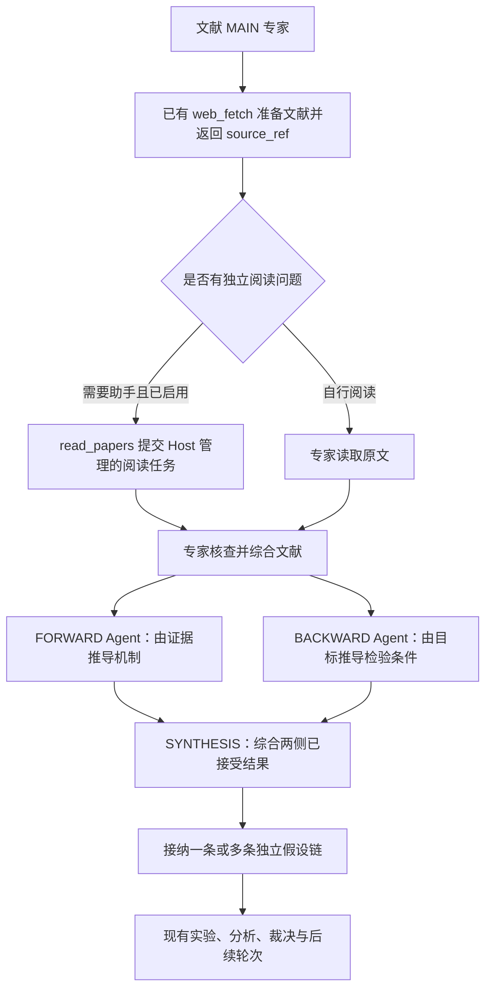

# 文献工具、并行论证与专家分支开发方案

状态：2026-09-27，**D1–D4 已实施，使用 ACI 26 与 `claude-code-bwrap/64`**。
本方案面向通用科研流程，不绑定某位用户、数据集、模型或供应商。
开发基线为 `067b6f9`；实际验证范围与失败样本见
[qualification](../qualification.md)。本文保留开发目标与设计理由；未执行的验证
不因列在计划中就视为通过。

采用现有 Host、Agent Attempt、研究节点、文献来源及结果接纳机制。
保留运行继续使用其固定 bundle；本方案不授权修改、恢复或迁移现有运行。

## 1. 问题与交付目标

只读诊断已经确认以下事实；它们是不同的问题，不能统一归因为“模型不愿分叉”。

| 已观察事实 | 解释 | 交付目标 |
| --- | --- | --- |
| 三个专家的实际 SYNTHESIS 请求允许最多两个候选，但成功输出均只有一个 | `max_hypotheses_per_round` 是上限；没有第二个候选被 Host 丢弃 | 专家明确判断是否值得并行探索，保留合法单链 |
| 一次阅读提交含不支持的 `wait_for_completion`，修正后又把 URL 当作 `paper_ref` | 两次调用均在接纳前失败，未产生阅读任务 | 模型能根据工具返回取得合法引用、纠正错误并完成委派 |
| FORWARD、BACKWARD 由两个独立 Agent 执行，但 Host 逐个等待 | 工作流顺序与同角色忙碌检查共同限制并发 | 独立论证同时进行，完成后综合 |
| Web 缺少对“允许多少、提交多少、实际运行多少”的清晰区分 | 工具调用被拒绝也容易被误认为没有尝试委派 | 展示真实并发、等待原因和工具错误 |

此前的上下文容量失败已通过重试恢复；它不是所有专家只生成一条假设的原因。
本轮不借此扩大上下文管理改动，也不调整科研目标、实验阈值或个人 Profile。

## 2. 参考设计与本项目取舍

- [MCP 工具规范](https://modelcontextprotocol.io/specification/2026-07-28/server/tools)
  支持结构化工具返回及资源引用。这里借鉴“工具产生规范引用、后续工具接收引用”，
  继续使用已有 JSON 返回和 `source_ref`，无需为此升级整套协议或创建另一种文献 ID。
- [Anthropic 工具设计经验](https://www.anthropic.com/engineering/writing-tools-for-agents)
  强调清晰字段、相关结果和可操作的错误反馈。本项目优先改进已复现的调用路径。
- [LangGraph 并行工作流](https://docs.langchain.com/oss/python/langgraph/workflows-agents#parallelization)
  和 [ADK 并行工作流](https://adk.dev/agents/workflow-agents/parallel-agents/)
  提供独立分支、集中汇合的参考。FORWARD/BACKWARD 采用固定调度，不要求模型再做一次派工决策。
- [Anthropic Research 实践](https://www.anthropic.com/engineering/multi-agent-research-system)
  使用按问题拆分的动态助手。阅读助手沿用这一职责划分，原专家负责核查、综合和决策。
- [LangGraph 的成功节点恢复语义](https://github.com/langchain-ai/langgraph/blob/main/libs/checkpoint/README.md)
  值得参考；本项目用现有命令、已接受响应和产物复用成功分支，不引入其 checkpoint 存储。

这些资料支持架构选择，不证明本项目的耗时、费用或科研质量必然改善。
不引入 LangGraph/ADK 运行时依赖，不新增另一套任务队列或状态数据库。

## 3. 目标流程



箭头表示前置任务完成关系，不表示把文献全文提供给每个节点。
继续保持 BACKWARD 的目标导向输入范围，不自动加入 FORWARD 输出或文献 MAIN 响应。

区分四个数量：专家数量、论证任务数量、阅读助手数量、假设链数量。
FORWARD/BACKWARD 的两个任务不消耗“候选数量名额”，也不等价于两条科学假设。
两者消耗普通 Agent 容量和各自实际调用预算。

## 4. 开发包 D1：文献引用与阅读工具衔接（P0）

### 接口决策

保留现有工具名和参数，使用两次真正的工具调用：

```text
web_fetch(mode="document", url=文献地址)
  -> status="available", source_ref=框架生成的引用, title, text_path, index_path

read_papers(action="submit", readings=[{
  reading_id: "method-check",
  paper_ref: 上一步返回的 source_ref,
  question: 一个具体且有边界的问题
}])
```

`source_ref` 由现有文献准备和归档记录生成。URL 用于获取，规范引用用于精确复用；
两者不互相冒充。已经挂载的来源从 `/papers/INDEX.md` 选取；已知来源不要求重新下载。
`paper_ref` 保持兼容，并在字段说明中明确它接收返回的 `source_ref`。

在 `paper_sources.py` 提取一个内部已接纳来源查找函数，供现有 document 复用和
`paper_reading.py` 的提交校验共用。其输入限于调用者已授权的来源集合，不扫描其他
专家或整个磁盘，不维护额外映射表，不自行产生替代 ID。I/O 继续走现有
`WebToolOperation`；来源安装、任务接纳和发布仍由 Host 完成。

### 错误与引导

- `host_tools_server.py` 的桥接层指出未知字段名及允许字段，不只返回笼统错误。
  不回显任意字段值；`wait_for_completion` 的反馈明确提交后使用 status/wait。
- `paper_reading.py` 分别说明 reading ID 无效或重复、字段缺失、问题为空、
  引用未接纳等实际原因；共享来源查找逻辑，不在提示层重新实现准入规则。
- URL 被传入引用字段时提示正确的 document 获取步骤；未知引用提示查看当前目录。
  只提供调用者可见的有界帮助信息，不自动猜测“最相近”的论文或版本。
- 成功返回和运行时 literature skill 提供简短调用示例，明确 submit/status/wait/cancel。
  不要求每次重新加载完整工具教程，也不把完整文献放进工具回复。
- 一次批量 submit 仍先验证全部条目，再用原有事务接纳；一个条目无效时不得暗中
  启动其他条目。相同 reading ID 的重复提交沿用原命令，冲突仍明确报错。

首版不增加独立 `paper_ref()` 工具、resolve action、自动 DOI 识别或隐式下载。
若实测显示两步调用仍频繁失败，再单独评估显式 URL 输入与现有获取流程的组合。
这不是关闭既有来源校验的理由。

## 5. 开发包 D2：Host 管理的 FORWARD/BACKWARD 并行（P0）

### 调度边界

复用现有 `ResearchNodeTask`、FORWARD/BACKWARD/SYNTHESIS 和稳定 command ID。
固定的两个论证任务是同一专家本轮的兄弟任务，无需新增常驻父 Agent 或通用 spawn 工具。

1. 保留 QUERY_PLAN、MAIN、Grounding、组件依赖及 Debate 重启的既有授权前提。
2. 先通过原有事务记录实际 FORWARD 请求，随后 BACKWARD 可准备和派发，**不等待
   FORWARD 计算完成**。FORWARD 请求尚未记录时，BACKWARD 不独立选择本轮建议。
3. `_drive_expert_proposal` 按可执行任务推进，而不总是返回序列中第一个未成功任务。
   每轮组件遍历最多为每位专家派发一个提案任务；利用已有轮转，让其他专家获得机会，
   后续 tick 补上另一侧。角色视图准备也必须避免一侧 OPEN 导致另一侧永远不可达。
4. `_participant_busy` 只允许同 run/component/role/cycle 的不同 FORWARD/BACKWARD
   同时执行。继续禁止相同逻辑任务的两个 OPEN Attempt、其他阶段意外重叠和同链并写。
   不通过清空 busy roles 或跳过统一容量检查实现并行。
5. SYNTHESIS 只有在两侧响应均已接纳且发布后才派发，按任务身份匹配结果，不依赖
   哪侧先结束。模型调用已退出、输出刚生成或状态为 CLOSED 都不能独自证明成功。

现有 `max_active_agents`、专家/运行预算和 provider recovery 决定真实并行度。
一格容量自然串行，两格可并行；不增加专用并行额度，也不让等待中的父调用免费占位。
`max_forks` 继续只限制并行研究链。模型、effort 和权限沿用既有节点配置解析。

### 输入一致性与隔离

已发现的关键依赖是 `interaction_host.guidance_inputs`：它读取首个 FORWARD 请求中的
Leader 建议，供后续节点复用。保持这一现有来源，不为并行另建轮次快照。
新到建议留给后续轮次；不能让 BACKWARD 因稍晚派发就使用另一版建议。

Goal、Grounding、评价约束和轮次身份继续取自既有已接纳输入。
FORWARD 的文献输入、BACKWARD 的目标导向材料和 SYNTHESIS 的两侧响应仍分别构建。
重试按现有规则复用输入并添加纠错材料，不因并行改为复制另一侧对话。

`agent_sessions.py` 已按逻辑节点/Attempt 分离这两类会话与工作区；实施时验证
真实 session、路径、只读角色视图和原始来源挂载确实隔离。共享同一目录进行写入、
并发 resume 同一 session、把两侧 transcript 合成上下文均不允许。

### 失败、恢复与停止

| 情况 | 预期行为 |
| --- | --- |
| 一侧成功，另一侧可重试失败 | 保留成功侧；仅重试失败侧，沿用其原预算和恢复策略 |
| Host 在任一侧记录、派发或发布附近退出 | 同版本恢复按既有 command/Attempt/发布记录继续；不重复成功效果 |
| 必需的一侧重试耗尽 | 结束本轮提案的运行失败；取消并排空本轮仍在执行的另一侧；保留已发布结果，不伪造科学否定 |
| 用户停止或 Goal 停止 | 两侧均走现有停止和收尾；迟到输出不启动综合或新实验 |
| API 不可用 | 进入现有 provider 等待/操作者恢复，不创建额外重试循环 |
| 容量、预算或私有视图准备暂不可用 | 明确等待原因；按既有 tick 继续服务控制与其他工作 |

两侧成功结果、失败重试、取消调用和未知预留全部进入原费用统计。
逻辑完成与真实进程退出分别验证，不通过删除失败记录实现“干净结束”。

### 版本和旧路径

在现有运行/ACI 版本元数据中表达新的调度语义；实施时按项目既有规则选择具体版本，
不预先新增版本声明文件。首批覆盖当前 v4 Profile 的 batch 路径，包括普通下一轮和
Debate 指定的提案重启。历史非 batch 的单 next-task reducer 保持原语义。
旧运行使用其原 bundle，不把所有历史 Oracle 检查统一改成新规则。

## 6. 开发包 D3：有理由的假设分支选择（P1）

在现有 SYNTHESIS 指令、角色 skill 和配置说明中解释：

- 有机制差异、有独立可检验预测、且成本可承受的候选，适合利用现有多链容量。
- 缺少证据、存在先后依赖或只是普通超参数变化时，可以选择单链。
- 在已有 summary/rationale 中简述选择理由；不新增必填字段或专门裁决模型。
- `max_hypotheses_per_round` 和实际 `effective_max_forks` 是候选上限，
  `max_forks` 是活跃研究链上限。两侧论证不是两个候选名额。

保留 `1..effective_max_forks` 的当前验证规则、父假设约束和批量原子接纳。
不以文字相似度或“必须两个”新增准入门槛，不根据没有第二条链就判定模型失败。
实际候选差异和可检验性留在科研质量评估中检查。

## 7. 开发包 D4：并行状态、工具失败与成本观察（P1）

复用 `monitor.py`、`observer_summary.py`、`observer_evidence.py`、详情与 Web 投影。
单个专家的活动区可同时列出 FORWARD/BACKWARD；假设 lineage 只表示科学假设，
阅读助手和论证任务不伪装成假设节点。

| 显示内容 | 事实来源与解释 |
| --- | --- |
| 本轮候选数 / 候选上限 | 已接纳 batch 与实际请求中的 effective_max_forks；提交前显示尚未提交 |
| 活跃研究链数 / 并发上限 | 去重后的 chain 身份及冻结配置；不是 Agent Attempt 数 |
| FORWARD/BACKWARD/综合状态 | 各 command 的请求、Attempt、接纳和终端记录 |
| 阅读任务排队、运行、完成、失败、取消 | 已有 reading 命令和 Attempt；重试不增加逻辑任务数量 |
| 阅读调用被拒绝次数 | 既有 transcript 中匹配的 tool_use/tool_result；不算作已创建助手 |
| 等待原因 | 现有 Host 容量、预算、provider 及准备状态；没有证据时显示未知 |
| Token、费用及覆盖情况 | 现有 Attempt 计费合并；工具错误本身不虚构一笔子 Agent 费用 |

公开卡片只显示经过裁剪的错误原因和任务身份；原始参数仍按现有详情与支持报告权限读取。
缺少工具结果、归档不完整或旧记录未覆盖时显示“未知/记录不全”，不把它们计为零失败。
使用已有事件 ID 去重和增量读取方式，不在每次 Web 刷新扫描全部 transcript，
也不持久化另一份权威计数。只看到请求包含建议或结果，不等于模型已理解或采用。

## 8. 实施文件与顺序

| 顺序 | 主要位置 | 交付内容 |
| --- | --- | --- |
| D1 | `host_tools_server.py`、`paper_sources.py`、`paper_reading.py`、literature-summary skill | 共享来源查找、准确错误、工具衔接与调用示例 |
| D2 | `expert_batch.py`、`workflow_host.py`；复用 sessions/interaction | 两侧就绪判断、限定并发、原有输入来源、恢复与收尾 |
| D2 验证 | `batch_oracle.py`、`session_oracle.py`、`interaction_oracle.py`、相关 Oracle 入口 | 按实际身份核对前置、接纳、会话与终端效果，不复制调度器 |
| D3 | `claude_agent_host.py`、提案 skill、Profile 说明 | 选择理由与上限语义；候选验证原则保持 |
| D4 | `monitor.py`、`observer_summary.py`、`observer_evidence.py`、`observer_details.py`、Web assets | 活动与分支分开，错误及等待可见，成本不重计 |
| 交付 | 架构、使用说明、Profile 教程、qualification、开发记忆 | 双语同步实际行为及验证范围 |

每个包先完成聚焦回归，再合并为候选。提案推进复用现有 `expert_batch.py`，
Host 保留事务所有权，不提高原有 authority LOC 上限。旧版 reader 与串行路径保留。

## 9. 验收与收益评估

### 必须完成的机制验证

1. 重现两个原始错误，模型获得具体反馈后，实际完成文献准备、合法提交、助手读取、
   主专家接收结果。另测失效/跨作用域引用、批量中单项错误及同 ID 重试。
2. 真实 Host 中观察同专家 F/B 的进程执行重叠、不同 session/工作区和正确结果归属；
   同时证明其他专家能够推进。不能只检查调度器返回了两个任务。
3. 容量为 1 时可串行完成；足够容量时并行；预算不足、provider 等待、视图准备不阻塞
   控制接口。相同任务的重复 OPEN、其他阶段越权重叠仍被拒绝。
4. 一侧先完成、另一侧失败重试，以及不同完成顺序，都只产生一次 SYNTHESIS 接纳。
   缺失、失败、取消或尚未发布的必需输入不能通过汇合。
5. Leader 建议在两侧派发之间到达时，本轮输入仍一致；Debate 重启保留正确来源及父身份。
6. 在请求提交、原生启动、结果发布与停止边界注入退出，核对同版本恢复、成功侧复用、
   费用归属及所有子进程收尾。单侧耗尽后不能留下无归属的另一侧调用。
7. 从修复后的提案走过实际 CPU 假设链实验、结果分析、裁决及下一轮，覆盖一候选和
   多候选；科研事实数与 Attempt 数分别统计，后续任务真实可达。
8. Web/CLI/support 对同一记录得到一致计数；包含调用拒绝但零 reader 的反例、归档缺失、
   失败重试和未知价格。展示与监控不得启动研究任务或写入运行状态。

复用 `tests/runtime/test_paper_reading.py`、`test_native_paper_reading.py`、
`test_expert_batch_host.py`、`test_expert_loop_host.py`、相关会话/交互/Observer 测试。
独立统计实际逻辑任务、原生进程、成功接纳、CPU 结果、停止效果与残留，
Oracle 不重建第二套就绪调度算法，也不为通过测试删去原有严格检查。

### 按现有 G0–G5 推进

- 开发期间采用 G0 聚焦回归；冻结候选后完成 G1、G2 和适用 G3/G4/G5。
- G2 仅读取保留运行，明确新语义与历史 reader 的覆盖边界。
- G3 使用真实 Host/bundle/broker/原生 CLI/本地测试 provider/CPU Process 完成上述闭环。
- G4 按既有科研演进和资源测试要求执行；GPU 仅在适用且资源已授权时使用，
  不借用当前研究运行的 GPU 配额。未执行的覆盖明确记录。
- G5 先做有限工具纠错样本，再用固定前置资料、单专家任务对照串行与并行。
  保持模型、输入、论证要求和调用限制一致，隔离并行度这一因素；不要用修改整个
  运行容量而连带改变阅读阶段的方式宣称提案加速。
- 可用 GLM/MiMo 等已配置接口做跨模型兼容样本；具体模型和样本预算在执行记录中
  明确。实施评估复用用户已授权的 CC 配置，不复制凭据到文档。
  评估使用有限样本、时间、turn、token 和费用停止条件，历史失败与未知费用不清零。

分别报告工具纠错成功率、首次成功引用/委派、真实重叠时间、阶段总耗时、重试成本、
Token 和价格覆盖情况，以及证据准确性、候选差异和可检验性。
理论上两侧计算时间由求和变成取较大者，但准备、限流、重试和综合仍占时间。
不承诺固定倍数加速，不把少量 canary 当作长期科研质量或费用节省证明。

## 10. 机制取舍与范围

失败资产是工具输入的可用性，以及既有研究任务的执行顺序。边界是模型工具调用到
Host 接纳、Host 请求到并行执行。已有来源 ID、command/Attempt 身份、事务、发布
验证、Git 和普通测试能够保存并核验所需事实，故本方案不增加 hash、新事实 schema、
轮次快照、checkpoint、回执、独立队列或另一套状态权威。

新增代码限于现有查找/反馈、任务就绪与限定并发、派生观察及测试；维护成本是这些
入口的版本兼容与回归。可共用的来源查找和状态投影合并进原入口，不永久保留平行实现。
如果实施中发现需要额外保证机制，应先按 AGENTS 的四项要求单独论证，不能从本设计
推导出无限扩展授权。认证、隐私、写入归属、不可逆操作及既有发布保护继续保留。

通用代码助手、递归委派、跨专家共享完整会话、自动扩大并发、RAG/向量记忆、
单调用自动获取并阅读、API 配额调优属于后续独立工作，不是本轮交付前置条件。

## 11. 独立阅读的方法与深度（2026-10-09）

本次采用三层指引，沿用现有阅读委托与摘要接口，面向新建运行：

1. 助手共有指令直接提供通用阅读方法，不依赖助手调用 Skill。助手只有
   Read/Glob/Grep，不能自动继承专家的技能、研究目标或完整会话。
2. 专家从当前任务、用户偏好及自身 focus 选择学科侧重点；人工智能任务关注
   数据划分与泄漏、训练和推理、基线公平性、消融、成本和复现条件，其他学科
   使用其实际证据标准。框架不把所有任务认定为人工智能。
3. 专家通过现有 `question` 传递简短研究背景、必要约束、阅读目的和具体问题。
   不新增 depth/domain 字段，不复制全部历史或预设期望结论。普通字符串委托
   继续有效；未指定深度时，助手根据问题选择足够的阅读范围并说明范围。

初筛只判断研究问题、贡献和相关条件；定向核查追溯问题依赖的定义、方法、
结果或附录；关键方法、理论或迁移判断使用精读。精读贯通研究动机、核心机制
或论证、验证和局限，读取支撑关键结论的相关附录，不以逐页覆盖率充当理解。
论文可同时属于方法、理论、实证、数据集／基准或综述。方法阅读解释新增设计
及证据；理论阅读解释定义、假设、命题、证明思路和边界，不强求实验。保留
作者自身目标、反面证据、未支持的解释和意外但相关的发现。

助手在现有 `summary` 中交付回答、证据页码、适用条件、实际阅读范围与缺口，
结构随问题调整。成功响应只代表委托完成，不认证全文阅读或科学理解。提取文本
缺失公式、图像时不得推断已经核查。专家检查影响决策的原文，再跨论文整合。

独立且工作量足够的问题在工具、容量与预算允许时批量委派；依赖先前答案的
问题由专家后续安排。简单查找、已有充分笔记或无法委派时保留直接阅读。
不新增强制论文数、助手数、输出 schema、完整性 gate 或持久阅读计数。
已有 Git 版本、来源引用、委托记录与普通测试足以支撑本次改动。

实施入口为 `full_cc_runtime.py` 的 PAPER_READ 指令、既有 `read_papers.question`
描述、专家 literature-summary 技能及 research-workflow 的 evidence 引导。
使用现有适配器版本机制标识为 `claude-code-bwrap/76`，ACI 和权限不变。
验证覆盖现有 Host 委托／隔离／收集、实际原生请求交付和 CPU 闭合；本地脚本
供应商只能证明指引交付与生命周期，不证明真实模型阅读质量或提速。
